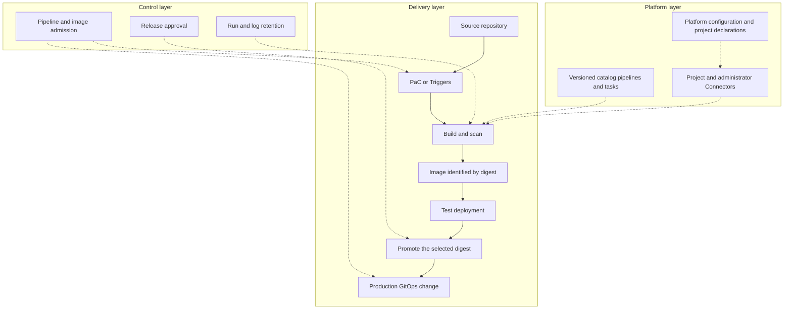

---
products:
  - Alauda Container Platform
  - Alauda DevOps
kind:
  - Best Practices
ProductsVersion:
  - 4.x
---

# Alauda DevOps Best Practices: Overview and Scenario Guide

A team starting with one repository usually needs a build and a test result first.
Once that works, the questions change: how does the tested image reach production,
who approves it, and what must the platform prepare before another team can use the
same process? This series works through those questions in that order. It explains
how to choose and combine capabilities, then points to the product instructions
and reference files needed to implement the choice.

The configuration baseline is Alauda DevOps Pipelines 4.15, Artifact Hub Shim 1.0,
Connectors 1.14, and Alauda Container Platform GitOps 4.4 on a compatible ACP
installation. Follow each component's compatibility requirements when selecting
packages. Examples use GitLab, Harbor, Nexus, and SonarQube. The reference design
requires environment preparation and acceptance checks before production use.

## How to use this guide

Choose an entry according to the problem you have now:

| Your starting point | What you need to decide | Read next |
| --- | --- | --- |
| You have one repository, or a simple job without a repository, and want a working pipeline. | Where to keep the definition and how to start it. | [Start a pipeline](#start-a-pipeline). |
| A pipeline already runs, but build, test, and release are separate manual activities. | How to carry the same image through environments and where to introduce release controls. | [Connect the delivery stages](#connect-the-delivery-stages), then [From Commit to Production on ACP](./From_Commit_to_Production_on_ACP.md). |
| Several teams will share the platform, and every project requires repeated administration. | Which settings and responsibilities to standardize before handing the platform to projects. | [Prepare a shared platform](#prepare-a-shared-platform), then [Managing Platform Configuration and Onboarding Isolated Projects](./Managing_Platform_Configuration_and_Onboarding_Isolated_Projects_with_Argo_CD_and_Tekton_on_ACP.md). |

Each scenario below explains when a capability helps, how it fits with the others,
and where to continue. The delivery and platform articles develop the choices,
configuration points, and expected results. For a guided implementation of the
application workflow, use the [Application CI/CD tutorials](https://docs.alauda.io/alauda-devops-pipelines/4.15/pipelines/tutorials/index.html).

The [companion samples](https://github.com/AlaudaDevops/devops-best-practices-samples)
contain a platform repository, project declarations, onboarding pipelines, a
project GitOps template, application CI/CD, and acceptance scripts. They are
reference files to adapt. Replace example addresses, images, identities, and
encrypted credential placeholders before use. The articles explain the decisions
and boundaries so that reading the files is not a prerequisite for understanding
the design.

## The overall design

The design has three layers. The **delivery layer** follows one change from source
to a running application. The **platform layer** provides the definitions, tool
access, and project environments that make that path repeatable. The **control
layer** places authorization and evidence checks at specific points on the path.



| Layer | What belongs here | Who makes the decisions |
| --- | --- | --- |
| Delivery | Source, triggers, build and scan results, image digests, test deployment, and production changes. | Application developers and project maintainers. |
| Platform | Component settings, versioned catalog content, administrator Connectors, encrypted credentials, project declarations, and deployment boundaries. | Platform administrators. |
| Control | Required merge checks, release approval, promotion access, image admission, and retained audit evidence. | Platform administrators and designated release approvers. |

The layers have different reconciliation owners. Argo CD reconciles the objects
tracked in the platform or project GitOps repository. Onboarding creates or
reconciles namespaces, project Connectors, and external tool tenants; Argo CD does
not automatically manage those external operations. ACP creates the namespace
with the same name as its project, which onboarding adopts. Assign one owner to
each resource or field so that two controllers do not repeatedly undo each other.

Separating build and release identities also matters. A developer can produce a
candidate image; the release decision authorizes a particular digest after its
build and test evidence is examined. A signature, approval, and production Git
change each establish a different part of that record.

## Start a pipeline

For a single application, first decide who should maintain the definition and
whether definition changes need the same review history as source changes. A
simple manually operated job can start in the cluster. A team that wants
merge-request checks benefits from PaC. When several projects share the same
workflow, centralize its implementation and let projects supply inputs.

| Model | Definition and execution | Choose it when | What you take on |
| --- | --- | --- | --- |
| Pipeline in the cluster | Maintain a Pipeline in a project namespace; save parameters, Workspaces, and Integrations in a Run Template. | A small number of jobs need a straightforward entry, including jobs without a code repository. | Definition history and permission control are maintained through the platform process. |
| Pipelines as Code (PaC) | Keep PipelineRun definitions in `.tekton/`; repository events start runs and report results. | Definitions should evolve with source, and reviewers need checks on a merge request. | Repository access, webhook delivery, definition provenance, and credentials available to proposed source must be governed. |
| Centrally managed template | Publish a versioned catalog Pipeline, or maintain a Pipeline in a controlled namespace; projects reference it. | Multiple projects need a shared process with deliberate upgrades. | The platform owns compatibility and published versions; projects still own their inputs and adoption. |

These choices can coexist. PaC can reference the central Pipeline through a
resolver, leaving only trigger annotations and project inputs in `.tekton/`.
A Run Template can expose that same centrally maintained workflow to manual,
event-driven, and scheduled execution. Central reuse therefore does not require
giving up the repository's review experience.

Start with [Run Template](https://docs.alauda.io/alauda-devops-pipelines/4.15/pipelines/how_to/run_template.html),
[Configure GitLab Repository](https://docs.alauda.io/alauda-devops-pipelines/4.15/pac/guides/configure_gitlab_repo.html),
[Configure GitHub Repository](https://docs.alauda.io/alauda-devops-pipelines/4.15/pac/guides/configure_github_repo.html),
or [Centralized Management with Hub Pipeline and Run Template](https://docs.alauda.io/alauda-devops-pipelines/4.15/pipelines/how_to/hub_pipeline_run_template_centralized_management.html).
The delivery article explains how the two event routes connect to these definitions.

### Choose how work starts

| When work should start | Entry | Typical reason |
| --- | --- | --- |
| A person requests it | Console or rendered PipelineRun from a Run Template. | First validation, a regression run, or a release decision. |
| Code changes | PaC, or Triggers with a Run Template. | Validate a merge request or build after a merge. |
| An artifact event arrives | Harbor event trigger. | Hand an image digest to a later stage. |
| An interval elapses | ScheduledTrigger. | Reconcile tool resources, rotate credentials, or run a periodic check. |
| Another system requests it | Incoming Webhook. | A change-management system or an internal portal starts work. |

Use one route, PaC or Triggers, for the same code event. Both can create runs, so
connecting both to that event can duplicate the work. Prefer PaC when the
repository review experience is central; use Triggers when the platform owns the
event mapping and Run Template. A schedule is useful for reconciliation because
it reuses the same inputs and execution definition as a manual recovery run.

For a PaC retry from a merge request, comment
`/test <pipelinerun-name> branch:<branch>` on the merge request. PaC uses the
merge request's source branch for that comment; `branch:` records the intended
source but does not switch the merge request to another branch. To run a
different branch, post the same command on the latest commit of that branch.
The release-candidate `ci` sample has an additional runtime restriction
described below; it intentionally rejects comment retries. See [Trigger PAC
Pipelines](https://docs.alauda.io/alauda-devops-pipelines/4.15/pac/how_to/trigger_pipeline.html)
for the complete syntax.

For an Incoming Webhook, send an HTTP `POST` with a JSON body to the PaC
controller's `/incoming` endpoint. The five fields identify the Repository,
namespace, branch, PipelineRun definition, and shared secret:

```bash
# PAC_CONTROLLER_URL is the platform-provided controller endpoint.
curl -i -X POST "$PAC_CONTROLLER_URL/incoming" \
  -H 'Content-Type: application/json' \
  -d '{"repository":"<repository>","namespace":"<namespace>","branch":"main","pipelinerun":"<pipelinerun>","secret":"<webhook-secret>"}'
```

Treat the request as accepted only when HTTP `202` is returned and a new
PipelineRun appears. An empty HTTP `200` can mean that no run matched, for example
because the secret did not match. Keep the secret in the caller's credential
management. Controller configuration, route exposure, and authentication are
platform prerequisites; see [Incoming Webhooks](https://docs.alauda.io/alauda-devops-pipelines/4.15/pac/how_to/incoming_webhooks.html).

## Connect the delivery stages

Once CI runs, the next problem is preserving the relationship between what was
built, what was tested, and what is released. Pass `repository@sha256:<digest>`
between stages. A tag helps someone recognize a release, but moving the tag does
not change the digest recorded in an environment's deployment configuration.

For development or test, a direct workload update can be sufficient. Production
often needs a reviewed record of desired state, which makes a GitOps change a
useful deployment entry. Separating the production artifact project adds another
decision: who may copy an approved candidate into that project? Add each control
for the decision it serves.

| Situation | Combination and reason | Continue with |
| --- | --- | --- |
| One commit must produce a traceable, tested image. | Reuse catalog Tasks for build and scan, then retain the resulting digest and run evidence. | [From Commit to Production](./From_Commit_to_Production_on_ACP.md). |
| Test should update quickly and Git history of its state is unnecessary. | Deploy the digest directly with an authorized workload or Helm Task. | [Application CI/CD tutorials](https://docs.alauda.io/alauda-devops-pipelines/4.15/pipelines/tutorials/index.html). |
| Production state must be reviewed and recoverable from Git. | Update the production GitOps reference through a merge request, then let Argo CD reconcile it. | [GitOps](https://docs.alauda.io/gitops/4.4/). |
| Build and production registry access must be separate. | Copy the selected digest to a private production project with a release identity. | [Promote Artifacts with Skopeo Copy](https://docs.alauda.io/alauda-devops-artifacthub-shim/1.0/catalog/how_to/promote_artifacts_with_skopeo_copy.html). |
| A person must authorize the release and leave a record. | Add an ApprovalTask and retain its responses; configure a separate Git review where required. | [Manual Approval Gate](https://docs.alauda.io/alauda-devops-pipelines/4.15/pipelines/how_to/manual_approval_gate.html). |
| Deployment must check a platform-controlled signer. | Configure Chains centrally and verify the digest before release and at admission. | [Signing Key Configuration](https://docs.alauda.io/alauda-devops-pipelines/4.15/chains/configure/signing_key_configuration.html). |
| The registry should hand an image to a later stage. | Carry the Harbor event's digest into the next run and check its CI evidence. | [Harbor event triggers](https://docs.alauda.io/alauda-devops-pipelines/4.15/triggers/how_to/harbor_events.html). |

An image push event establishes that an image arrived. Promotion establishes that
bytes were copied through a selected path. Neither establishes that CI passed.
The approver must correlate the digest with a successful trusted build, scanning,
and the test deployment. A signature establishes the configured signer's
statement; its meaning depends on who controls the key and which definitions and
source are allowed to use the signing path.

### What the delivery sample chooses

The sample uses GitOps for both test and production so that test exercises the
same synchronization path as production. Test changes commit directly; production
changes propose a merge request. It uses separate source and production registry
projects, with a separate release identity and an approval node before copying.
These are example choices to compare with your own review and artifact-access
requirements.

Test CD, promotion, and production CD are manually started in the sample and take
the preceding stage's digest. This makes every handoff visible while establishing
the workflow, but manual digest entry is a fallback for the sample rather than the
target operating model. A production workflow should carry the digest from the
trusted CI result through reviewed trigger inputs. Harbor-driven automation can be
added after event authentication, parameter mapping, and CI-result correlation are
configured. The first production deployment waits for the first promoted image
and its reviewed production GitOps change.

For this sample, a trusted CI result is `ci` for a `push` on `main`. A pre-build
check reads the actual PaC event and branch annotations and rejects comment-triggered
`ci` runs before building, including comments on `main`. Merge requests use a
separate definition and scratch image repository. The shared project credential
still covers both repositories; a separate scratch registry project and restricted
credential are needed to prevent proposed source from writing release candidates.

## Prepare a shared platform

As more teams join, repeated administration becomes an ownership problem. The
platform must decide which definitions, tool resources, credentials, policies,
and retention settings each project receives. Standardize those decisions before
onboarding, then let projects choose their application-specific workflow within
the established boundary.

| Platform situation | Approach and reason | Detailed guidance |
| --- | --- | --- |
| Pipelines need tools without distributing administrator credentials. | Use project Connectors and proxy workload tokens; track the remaining long-lived credentials separately. | [Connectors Proxy](https://docs.alauda.io/alauda-devops-connectors/1.14/connectors/concepts/connectors_proxy.html) and [CSI Driver](https://docs.alauda.io/alauda-devops-connectors/1.14/connectors/concepts/connectors_csi.html). |
| Each project needs resources in four external tools. | Orchestrate the four Connectors automatic creation Tasks from a reviewed declaration; assign one reconciliation owner per tenant. | [Onboarding and product Tasks](./Managing_Platform_Configuration_and_Onboarding_Isolated_Projects_with_Argo_CD_and_Tekton_on_ACP.md#reuse-the-product-tasks). |
| Platform settings exist only in a running cluster. | Keep component settings, policies, encrypted credentials, and project declarations in a platform repository. | [Platform configuration](./Managing_Platform_Configuration_and_Onboarding_Isolated_Projects_with_Argo_CD_and_Tekton_on_ACP.md). |
| Teams must not change one another's environments or credentials. | Separate namespaces and tool tenants, constrain deployment identities, and verify effective access. | [Project boundaries](./Managing_Platform_Configuration_and_Onboarding_Isolated_Projects_with_Argo_CD_and_Tekton_on_ACP.md#accept-the-project-boundaries). |
| Projects need restrictions beyond the shared baseline. | Combine platform ClusterPolicies with project Policies; restrict direct TaskRun and CustomRun creation and optionally constrain definition sources. | [Pipeline execution constraints](https://docs.alauda.io/alauda-devops-pipelines/4.15/pipelines/how_to/constrain_pipeline_execution_with_kyverno.html). |
| Cluster history must be cleaned while audit evidence remains available. | Select Pruner settings and external Results storage together, with separate approval-evidence retention. | [Audit and recovery](./Managing_Platform_Configuration_and_Onboarding_Isolated_Projects_with_Argo_CD_and_Tekton_on_ACP.md#preserve-audit-records-and-plan-recovery). |
| Credentials need periodic reconciliation or renewal. | Schedule the same onboarding workflow with failure alerts and a per-project concurrency lock. | [ScheduledTrigger](https://docs.alauda.io/alauda-devops-pipelines/4.15/triggers/how_to/scheduledtriggers.html) and [reconciliation](./Managing_Platform_Configuration_and_Onboarding_Isolated_Projects_with_Argo_CD_and_Tekton_on_ACP.md#reconcile-and-rotate-deliberately). |
| Another system initiates work. | Expose an authenticated Incoming Webhook and define what acceptance and completion mean to the caller. | [Incoming Webhooks](https://docs.alauda.io/alauda-devops-pipelines/4.15/pac/how_to/incoming_webhooks.html). |

Keep Kyverno `PolicyException` creation under platform-administrator control.
The exception can weaken a shared admission boundary, so it must not be left to
the local project policy or to an application identity.

Proxy workload tokens do not remove every long-lived credential responsibility.
Image pull Secrets, PaC clone credentials, and Chains registry credentials still
need scoped access, rotation, and recovery. A project owner who can create Pods
in a credential-bearing namespace can use those credentials. Administrator,
release, and signing namespaces therefore need explicit run-creation boundaries.

Cleanup and archiving also have shared consequences. Event-based Pruner defaults
can affect every namespace on the first synchronization, with successful and
failed history counted separately. Set the global Pruner `enforcedConfigLevel` to
`namespace` before relying on namespace-specific overrides; otherwise the
cluster-level value remains in force. Inventory tenants and their retention needs
before enabling deletion. Results Watcher can add `results.tekton.dev/*`
finalizers to finished runs across its watch scope; define that scope before
enabling it. Disabling archiving does not remove existing finalizers. Follow the
product recovery procedure before cleanup, and verify access to the external
Results store that remains after live objects are pruned.

The [platform article](./Managing_Platform_Configuration_and_Onboarding_Isolated_Projects_with_Argo_CD_and_Tekton_on_ACP.md)
explains the 18 decisions, their repository layers, onboarding outputs,
permissions, rotation, and acceptance. These are administrator-managed settings;
check [Feature Maturity](https://docs.alauda.io/alauda-devops-pipelines/4.15/overview/feature_maturity.html)
and introduce them in stages. The platform repository provides durable
configuration and a review trail. Keys, external tool data, and Results storage
need separate backups. Reverting a project registration can prune the ACP project
and its same-named namespace, so review that operation as decommissioning.

## Choose an adoption path

| What the team needs now | Start with | Add when the requirement appears |
| --- | --- | --- |
| A small number of jobs. | Cluster Pipeline and a Run Template. | PaC for source review; central templates when reuse becomes worthwhile. |
| A traceable application delivery path. | Build and scan, pass digests, and choose deployment per environment. | Production Git review, approval, artifact promotion, and admission according to the release boundary. |
| A platform for isolated projects. | Shared baselines, administrator prerequisites, and a reviewed project declaration. | Scheduled reconciliation, deliberate rotation, policy enforcement, and retained audit evidence after acceptance. |

Each row can be adopted incrementally. A team can keep a simple job in the
cluster while its main application uses PaC and a shared catalog Pipeline. Release
controls should answer the environment's authorization and evidence requirements.
Adding a control also adds a platform owner, prerequisites, and an operational
recovery responsibility.

## Operate without internet access

Make the catalog, pinned tool and base images, package dependencies, certificates,
and vulnerability databases available through approved internal services. Runtime
pipelines must resolve Tasks and Pipelines from local catalog or cluster sources.
The sample points Trivy at `registry.example.com/mirror/trivy-db:2`; replace it with
a reachable database mirror and grant the scanner access.

The degree of network isolation, number of teams, and required approval evidence
are deployment inputs for the platform team. Capacity sizing, migration and
decommissioning automation, platform disaster recovery, customer change-management
integration, and offline package distribution procedures require their own
operating plans. This series provides the choices and configuration boundaries
from which to develop those plans.

## Related information

- [Pipelines 4.15](https://docs.alauda.io/alauda-devops-pipelines/4.15/)
- [Artifact Hub Shim 1.0](https://docs.alauda.io/alauda-devops-artifacthub-shim/1.0/)
- [Connectors 1.14](https://docs.alauda.io/alauda-devops-connectors/1.14/)
- [GitOps 4.4](https://docs.alauda.io/gitops/4.4/)
- [Software Supply Chain Security with Tekton and Kyverno](./Software_Supply_Chain_Security_of_Alauda_Container_Platform_with_Tekton_and_Kyverno.md)
- [Pipeline Policy Constraints with Tekton and Kyverno](./Pipeline_Policy_Constraints_with_Tekton_and_Kyverno.md)
