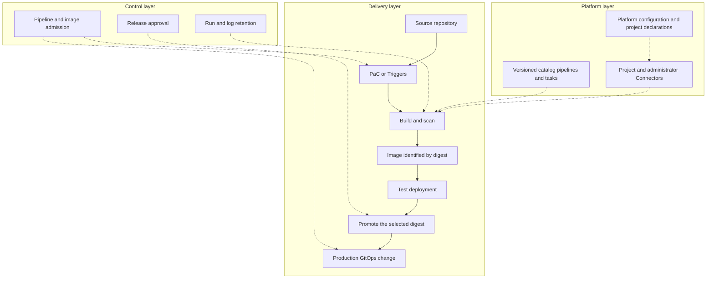

---
products:
  - Alauda Container Platform
  - Alauda DevOps
kind:
  - Best Practices
ProductsVersion:
  - 4.x
---

# Alauda DevOps Best Practices: Overview and Scenario Guide

This series helps application and platform teams combine Alauda DevOps capabilities into a delivery workflow. Start with a working pipeline, connect build outputs to controlled releases, and then standardize the platform for multiple isolated projects.

The configuration baseline is Alauda DevOps Pipelines 4.15, Artifact Hub Shim 1.0, Connectors 1.14, and Alauda Container Platform GitOps 4.4 on a compatible ACP installation. Use the compatibility requirements of each component when selecting packages. Examples use GitLab, Harbor, Nexus, and SonarQube. They describe a reference implementation, with environment preparation and acceptance checks required before production use.

The series has three entry points:

| Your starting point | Read next |
| --- | --- |
| You need a build or test pipeline for one repository. | [Start a pipeline](#start-a-pipeline) below. |
| A pipeline already runs; you need a traceable path from a commit to production. | [From Commit to Production on ACP](./From_Commit_to_Production_on_ACP.md). |
| You operate a shared platform and need repeatable configuration and project onboarding. | [Managing Platform Configuration and Onboarding Isolated Projects](./Managing_Platform_Configuration_and_Onboarding_Isolated_Projects_with_Argo_CD_and_Tekton_on_ACP.md). |

The [companion samples](https://github.com/AlaudaDevops/devops-best-practices-samples) contain the platform repository, project declaration, onboarding pipelines, GitOps repository template, application delivery examples, and acceptance scripts. Replace example addresses, image references, identities, and encrypted credential placeholders before using them.

## The overall design

The delivery layer moves one change from source to an immutable image and then to an environment. The platform layer supplies reusable definitions, tool access, namespaces, and operating settings. The control layer decides what may run, who approves a release, and what evidence must be retained.



Application developers own source and application delivery configuration. Platform administrators own shared components, admission rules, administrator credentials, and onboarding. Release approvers authorize a selected digest after examining its build and test evidence. Separate the release identity from the build identity.

## Start a pipeline

Choose the simplest definition model that meets the team's needs. The models can coexist.

| Model | Definition and trigger | Use it when |
| --- | --- | --- |
| Pipeline in the cluster | Create a Pipeline in a project namespace. Save parameters, Workspaces, and Integrations in a Run Template. Start manually, through Triggers, or on a schedule. | A small number of pipelines need a straightforward execution entry. |
| Pipelines as Code (PaC) | Keep PipelineRun definitions in the application's `.tekton/` directory. Code events start runs and report results to the merge request. | Definitions should evolve with source and participate in merge-request checks. |
| Centrally managed template | Maintain a versioned Pipeline in the catalog, or a Pipeline in a controlled namespace. Projects supply parameters through a Run Template or a PaC PipelineRun using a resolver. | Multiple projects should share the same standard workflow. |

For a PaC retry from a merge request, comment `/test <pipelinerun-name> branch:<branch>` on the merge request. For a push-triggered run, comment the same form on the commit at the head of that branch. The `branch` value makes the source explicit. Refer to [Trigger PAC Pipelines](https://docs.alauda.io/alauda-devops-pipelines/4.15/pac/how_to/trigger_pipeline.html) for the complete syntax. Use one event route for each event: PaC or Triggers. Enabling both routes for the same event can start duplicate work.

Start with [Run Template](https://docs.alauda.io/alauda-devops-pipelines/4.15/pipelines/how_to/run_template.html), [Configure GitLab Repository](https://docs.alauda.io/alauda-devops-pipelines/4.15/pac/guides/configure_gitlab_repo.html), or [Centralized Management with Hub Pipeline and Run Template](https://docs.alauda.io/alauda-devops-pipelines/4.15/pipelines/how_to/hub_pipeline_run_template_centralized_management.html). The [Application CI/CD tutorials](https://docs.alauda.io/alauda-devops-pipelines/4.15/pipelines/tutorials/index.html) provide a guided implementation.

For systems that do not use Git events, an Incoming Webhook can start a PipelineRun. Send an HTTP `POST` with a JSON body containing `repository`, `namespace`, `branch`, `pipelinerun`, and `secret` to the PaC controller's `/incoming` endpoint. For example:

```bash
curl -i -X POST "$PAC_CONTROLLER_URL/incoming" \
  -H 'Content-Type: application/json' \
  -d '{"repository":"<repository>","namespace":"<namespace>","branch":"main","pipelinerun":"<pipelinerun>","secret":"<webhook-secret>"}'
```

Treat the call as accepted only when it returns HTTP `202` and a new PipelineRun appears. An HTTP `200` response with an empty body can mean that no run was triggered, for example because the secret did not match. The controller URL, route exposure, and secret are platform prerequisites; see [Incoming Webhooks](https://docs.alauda.io/alauda-devops-pipelines/4.15/pac/how_to/incoming_webhooks.html).

## Connect the delivery stages

| Requirement | Recommended combination | Detailed guidance |
| --- | --- | --- |
| Build a traceable artifact | Reuse catalog Tasks, scan the output, and pass its digest to later stages. | [From Commit to Production](./From_Commit_to_Production_on_ACP.md). |
| Deploy to development or test | Update the workload by digest directly when Git history of environment state is unnecessary. | [Application CI/CD tutorials](https://docs.alauda.io/alauda-devops-pipelines/4.15/pipelines/tutorials/index.html). |
| Deploy to production | Review a change to the production GitOps repository; Argo CD reconciles the selected digest. | [Alauda Container Platform GitOps](https://docs.alauda.io/gitops/4.4/). |
| Separate production artifact access | Approve and copy the selected image by digest into a production registry project. | [Promote Artifacts with Skopeo Copy](https://docs.alauda.io/alauda-devops-artifacthub-shim/1.0/catalog/how_to/promote_artifacts_with_skopeo_copy.html). |
| Record who approved a release | Add an ApprovalTask, use group resource names, and retain its approval response. | [Manual Approval Gate](https://docs.alauda.io/alauda-devops-pipelines/4.15/pipelines/how_to/manual_approval_gate.html). |
| Verify image signatures | Configure Chains keys and registry access centrally; verify the image by digest before promotion and at deployment admission. | [Signing Key Configuration](https://docs.alauda.io/alauda-devops-pipelines/4.15/chains/configure/signing_key_configuration.html). |
| Hand off an artifact event | Map a Harbor event to the next pipeline, carrying the digest. Check scan and signing evidence separately. | [Use Harbor Event Triggers](https://docs.alauda.io/alauda-devops-pipelines/4.15/triggers/how_to/harbor_events.html). |

Promotion copies a selected image; it does not establish that the image passed CI. The approver must match the digest with a successful trusted build and the test environment. For the sample, a trusted CI result is the `ci` PipelineRun for a `push` event on `main`; the sample rejects comment-triggered `ci` runs before building, and uses a separate definition for merge-request validation. The project credential still needs a separate scratch registry boundary to prevent proposed code from writing release candidates. Signatures establish the configured signer's statement, not which pipeline produced the image; their meaning also depends on control over the signing key and the definitions allowed to run.

The samples deliberately keep test CD, promotion, and production CD as manually started runs. Their inputs come from the preceding run's digest result. Harbor-driven automation is a separate integration step. The first production deployment waits for a promoted image; after that image is promoted, follow the same reviewed production GitOps path for later releases.

## Prepare a shared platform

Platform settings are administrator decisions. Roll them out in stages and check [Feature Maturity](https://docs.alauda.io/alauda-devops-pipelines/4.15/overview/feature_maturity.html) for the selected release.

| Platform concern | Recommended approach |
| --- | --- |
| Tool access | Use project-scoped Connectors. Proxy access uses short-lived workload tokens. Manage image pull Secrets, PaC clone credentials, and Chains registry credentials as separate long-lived credential responsibilities. A project owner who can create Pods in a credential-bearing namespace can use the credentials in that namespace. |
| Project onboarding | Orchestrate the four Connectors automatic creation Tasks, then seed a project GitOps repository and propose platform registration through a merge request. Complete the administrator prerequisites and acceptance checks. |
| Platform configuration | Keep component settings, policies, encrypted administrator credentials, and project declarations in a platform repository. Assign one owner to each resource or field. |
| Namespace isolation | Use separate project namespaces and tool-side tenants. Separate build, delivery, and workload namespaces and restrict access to administrator namespaces. |
| Execution policy | Use platform ClusterPolicies and project Policies. Restrict direct TaskRun and CustomRun creation. Optionally require approved resolver types and coordinates. Move from Audit to Enforce after checking intended workflows. |
| Cleanup | Select one cleanup mechanism. For event-based Pruner, review global defaults and namespace override settings before enabling deletion. A global first sync can affect every namespace, with successful and failed history counted separately; inventory tenants and notify owners before changing the defaults. |
| Audit history | Store run records and logs in external Results storage with an explicit retention period. Export approval evidence separately before deleting its objects. |
| Scheduled work | Use ScheduledTrigger or CronJob for reconciliation and rotation, with failure alerts and no overlapping runs for a tenant. The sample uses an atomic per-project lock; operators must inspect failed or cancelled runs before clearing a retained lock. |

Results Watcher scope deserves a separate rollout decision. Its default watch scope can affect finished runs across the cluster and add `results.tekton.dev/*` finalizers. Scope it before enabling it. Disabling archiving does not remove existing finalizers; follow the product recovery procedure before cleanup. After Pruner removes cluster objects, the external Results store is the audit source.

The platform repository is the durable, reviewable source for configuration and project boundaries. It makes changes auditable and repeatable, but it is not a backup for sealed-secrets keys, signing keys, external tool data, or the Results store. Keep those dependencies in a separate recovery plan. Reverting a registration commit can prune an ACP project and its same-named namespace, so treat that action as decommissioning rather than an ordinary rollback.

The [platform article](./Managing_Platform_Configuration_and_Onboarding_Isolated_Projects_with_Argo_CD_and_Tekton_on_ACP.md) explains the 18 platform decisions, repository layout, ownership boundaries, onboarding workflow, rotation, and acceptance checks.

## Operate without internet access

Make the catalog, pinned tool and base images, package dependencies, certificates, and vulnerability databases available through the platform's approved internal services. Runtime pipelines must resolve Tasks and Pipelines from local catalog or cluster sources. The sample CI configuration points Trivy at `registry.example.com/mirror/trivy-db:2`; replace it with a reachable database mirror and grant the scanner access.

The degree of network isolation, number of teams, and required approval evidence are deployment inputs that the platform team must decide. Capacity sizing, migration and decommissioning automation, platform disaster recovery, customer change-management integration, and offline package distribution procedures are outside this series. Define those procedures for the target environment.

## Related information

- [Pipelines 4.15](https://docs.alauda.io/alauda-devops-pipelines/4.15/)
- [Artifact Hub Shim 1.0](https://docs.alauda.io/alauda-devops-artifacthub-shim/1.0/)
- [Connectors 1.14](https://docs.alauda.io/alauda-devops-connectors/1.14/)
- [GitOps 4.4](https://docs.alauda.io/gitops/4.4/)
- [Software Supply Chain Security with Tekton and Kyverno](./Software_Supply_Chain_Security_of_Alauda_Container_Platform_with_Tekton_and_Kyverno.md)
- [Pipeline Policy Constraints with Tekton and Kyverno](./Pipeline_Policy_Constraints_with_Tekton_and_Kyverno.md)
