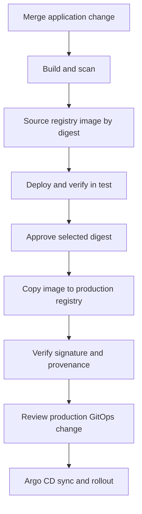
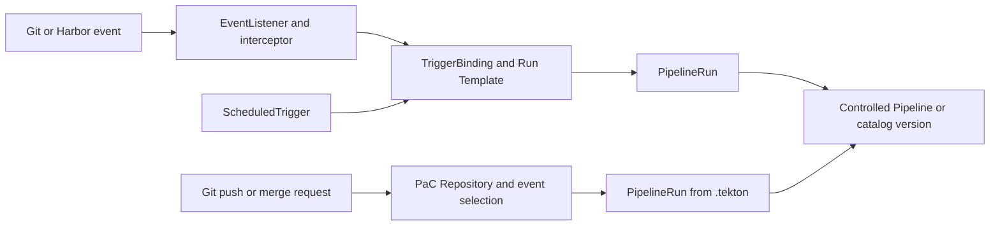

---
products:
  - Alauda Container Platform
  - Alauda DevOps
kind:
  - Best Practices
ProductsVersion:
  - 4.x
id: KB261000023
---

# From Commit to Production on ACP: Choosing Triggers, Deployment, and Release Controls

After a change is merged, a team usually wants it built, checked, and deployed to
test without someone passing image names between systems. Production introduces
further questions: which tested image should be released, who may authorize it,
and where should the desired production state be recorded?

Use this article when those questions lead to choices about pipeline ownership,
GitOps, approvals, or artifact promotion. It explains the alternatives and their
consequences, then follows the choices made by the companion sample. For a guided
implementation of the individual operations, follow the
[Application CI/CD tutorials](https://docs.alauda.io/alauda-devops-pipelines/4.15/pipelines/tutorials/index.html).

By the end, you should be able to explain:

- Where a repository's pipeline definition belongs, who maintains it, and how it is triggered.
- Why each environment uses direct deployment or GitOps, and how it receives the selected image digest.
- Whether production needs artifact copying, human approval, approval-gated credentials, and deployment admission.
- Where each control takes effect and which prerequisites the platform team must supply.

Work through these decisions in that order. A small project can bootstrap with a
manual run, but the target workflow should carry the selected digest from the
trusted CI result through reviewed inputs. Source-based definitions, central
templates, and release controls can then be introduced when their benefits
justify their ownership and operating cost.

This is the delivery part of [Alauda DevOps Best Practices](./Alauda_DevOps_Best_Practices_Overview.md). Its configuration baseline is Pipelines 4.15, Artifact Hub Shim 1.0, Connectors 1.14, and GitOps 4.4. Project namespaces, tool-side resources, and Connectors must already exist; the [platform article](./Managing_Platform_Configuration_and_Onboarding_Isolated_Projects_with_Argo_CD_and_Tekton_on_ACP.md) explains their preparation.

The [companion samples](https://github.com/AlaudaDevops/devops-best-practices-samples) use a fictional `shop` project. CI runs in `shop-build`; CD and promotion run in `shop-cd`; workloads run in `shop-test` and `shop-prod`. The sample binds the project owner group in `shop` only; applying the PaC Repository, CD and promotion objects, and starting their runs requires a platform administrator or a separately delegated grant in `shop-build` and `shop-cd`. See the sample application's ["Who applies what"](https://github.com/AlaudaDevops/devops-best-practices-samples/blob/main/sample-app/README.md#who-applies-what) table. Replace every example address, tool image, group, credential placeholder, and policy identity for your environment. Make the vulnerability database, tool images, base images, and dependencies available locally for disconnected execution.

## Prepare the project and its responsibilities

Start with a working project pipeline and access to its code and registry. The
platform team supplies project namespaces and Connectors; it also adds developers
to the GitLab tenant group. Onboarding creates the group but does not synchronize
its members. A developer without the required group role cannot create the
application repository.

Keep builds in a separate namespace because the container build Tasks can require
a different Pod Security level from application workloads. The sample uses
`baseline` for `shop-build` and `restricted` for workload namespaces. See
[Built-in Tasks and the Restricted Standard](https://docs.alauda.io/alauda-devops-pipelines/4.15/pipelines/how_to/comply_with_pod_security_restricted.html#built-in-tasks-and-the-restricted-standard).
The delivery namespace provides a separate place to control release execution;
creating that namespace alone does not establish who may use its credentials.

This article keeps the choice, prerequisites, minimal configuration, and evidence
for each handoff in the main text. Complete Task parameters and executable
PipelineRuns live in the catalog and companion sample. Platform-wide settings,
project provisioning, retention, and recovery are described in the platform
article.

## Follow one image identity through the workflow



The six decisions along this route are definition ownership, triggering,
deployment per environment, transfer of build results, release authorization, and
enforcement. Choosing a tool for one step does not settle the decisions at the
other steps.

Use `repository@sha256:<digest>` for deployment, promotion sources, signature
verification, and audit correlation. Tags help people identify releases; a tag
alone does not identify immutable content. Record both the repository and digest:
the content identity can remain the same when promotion changes the repository,
but permissions and admission rules depend on that repository.

A useful starting design is PaC for application events, catalog Tasks for the
work, direct deployment to test, and a reviewed GitOps change for production.
Add approval and artifact copying where the release boundary requires them. The
sample deliberately uses GitOps for test as well; the reason is explained below.
A Harbor push event establishes that an image was pushed. It does not establish
successful scanning, testing, signing, or approval.

When a vulnerability is found in an already deployed image, fix it and use the same build, promotion, and deployment workflow to release a new digest. Keep the build evidence and the decision to replace the vulnerable image with the release record.

## Choose where definitions live and how runs start

| Model | Definition location | Trigger | Suitable use |
| --- | --- | --- | --- |
| Cluster Pipeline | Pipeline in the project namespace; execution settings in a Run Template | Manual, Triggers, or ScheduledTrigger | A small number of centrally operated pipelines |
| Pipelines as Code | PipelineRun files in the application's `.tekton/` directory | Push and merge-request events | Definitions versioned with source and merge-request checks |
| Central template | Versioned catalog Pipeline, or a Pipeline in a controlled cluster namespace | Run Template or a PaC PipelineRun with `pipelineRef` | Shared standards across projects |

### Start with a cluster Pipeline when the job is simple

A Pipeline in the project namespace is useful for a few jobs that the platform
operates directly, including work without a code repository. Save parameters,
Workspaces, and Integrations in a Run Template so that a person, an event, or a
schedule can invoke the same execution configuration. If the job needs source,
`git-clone` can obtain it through a Connector.

The benefit is a straightforward entry and fewer repository resources to prepare.
The tradeoff is that definition review and change history belong to the platform's
configuration process. Keeping the Pipeline only in the live cluster provides no
Git review trail. This route can still build the same source and run the same
Tasks as PaC.

### Use PaC when the workflow should evolve with source

PaC keeps PipelineRun definitions in `.tekton/`, selects them for repository
events, and reports results to the code platform. This suits branch-specific
behavior and checks that reviewers should see alongside an application change.
The application team can propose definition changes through its normal review
process.

That convenience brings repository access, webhook delivery, definition
provenance, and pre-merge credential exposure into scope. Select the definition
source deliberately; a reviewed definition can still execute proposed application
code. The runtime credential boundary is discussed below.

### Publish a central template when projects share a process

When many repositories implement the same build and scan sequence, separate
shared workflow maintenance from project inputs. The platform publishes a
versioned catalog Pipeline, while each project supplies its repository, image
location, and execution settings. A controlled cluster Pipeline is another option
when the platform owns its change process.

The benefit is one maintained workflow with consistent behavior. The cost is an
explicit compatibility contract: the platform maintains versions and Tasks, and
projects review adoption of new versions. Publishing a new version does not
upgrade every consumer. A central template can be used from either a Run Template
or PaC; it is an ownership choice that can accompany either trigger route.

### Choose one event route for each job

The Application CI/CD tutorials start with a cluster Pipeline and Triggers. PaC
provides another route when source review is the natural entry. Both ultimately
create PipelineRuns:



Use Triggers when the platform owns event filtering and parameter mapping. Use
PaC when definitions and checks should follow repository review. Choose one route
for the same event and job, since enabling both can duplicate the work. The
same project can keep simple jobs in the cluster, use PaC for its main application,
and reference a central template from both.

For a retry from a merge request, comment `/test <pipelinerun-name> branch:<branch>` on the merge request. PaC uses that merge request's source branch; the `branch:` argument documents the source but does not select another branch. For a push-triggered run, comment the same form on the latest commit of the branch that should run. Keep the complete syntax in one place by linking to [Trigger PAC Pipelines](https://docs.alauda.io/alauda-devops-pipelines/4.15/pac/how_to/trigger_pipeline.html).

A failed check blocks a merge only when the Git platform requires that check to pass. On GitLab, enable **Pipelines must succeed**. If Auto DevOps creates an additional pipeline and no runner picks it up, the GitLab pipeline can remain running and the merge request continues to show a running pipeline; disable Auto DevOps for these repositories or provide a runner.

### Combine PaC with a central template

Keep event annotations and project inputs in `.tekton/`. Reference the platform's Pipeline with a resolver and a pinned version. The following fragment shows the reference used by the application sample; it is not a complete PipelineRun. Use the sample's full parameter and Workspace bindings.

```yaml
spec:
  pipelineRef:
    resolver: hub
    params:
      - name: catalog
        value: catalog-pipelines
      - name: kind
        value: pipeline
      - name: name
        value: python-image-build-scan-deploy
      - name: version
        value: "0.3"
```

Use `resolver: cluster` for a controlled cluster Pipeline. Avoid a bare `pipelineRef.name` in PaC definitions when admission must inspect the definition's source. See [Resolvers](https://docs.alauda.io/alauda-devops-pipelines/4.15/pipelines/concepts/resolver_concept.html) and [Define PipelineRuns in Git](https://docs.alauda.io/alauda-devops-pipelines/4.15/pac/how_to/maintain_pipeline_code.html).

Upgrade a catalog Pipeline by reviewing a change to its pinned version. Projects do not automatically adopt a newly published version. For reproducible rollback of the definition, retain reviewed versions and define whether published coordinates are immutable. A Run Template's version change is a change to that existing template, rather than a reason to create another template.

### Protect the definition and its runtime credentials

For a self-managed GitLab instance, set `spec.git_provider.url` on every PaC `Repository`. Without that URL, the PaC behavior described in [Advanced Repository Configuration](https://docs.alauda.io/alauda-devops-pipelines/4.15/pac/how_to/advanced_repository_config.html) can send completion status requests and the Repository token to `gitlab.com`. Set the provider URL explicitly for application, platform, and project GitOps repositories.

Set `spec.settings.pipelinerun_provenance: default_branch` where pre-merge runs must use reviewed definitions. This selects the definition, not trusted application code: a merge-request run still builds the proposed source with the credentials mounted by that definition. Limit those credentials and keep merge-request image outputs separate from release candidates.

### Why the sample combines PaC and a catalog Pipeline

The sample keeps trigger annotations and project inputs in the application
repository and references `python-image-build-scan-deploy` version `0.3`. Reviewers
can see when work runs and where it writes, while the platform maintains the
build-and-scan implementation. The version reference makes adoption a reviewed
project change rather than an immediate fleet-wide rollout.

Merge-request validation also pushes an image because the scanner reads from the
registry. It therefore needs a separate output location and a short retention
policy. Only the trusted post-merge path is intended to produce candidates for
test CD and promotion. The sample separates the two outputs:

| Definition | Event | Image repository | Delivery use |
| --- | --- | --- | --- |
| `sample-app/.tekton/ci.yaml` | Push to `main` | `registry.example.com/shop/hello` | Source for test CD and promotion |
| `sample-app/.tekton/ci-merge-request.yaml` | Merge request | `registry.example.com/shop/hello-mr` | Temporary merge-request artifacts |

The release-candidate definition also uses the catalog Pipeline's pre-build step to require a `push` event with source and target branch `main`. It reads PaC's actual Pod annotations, because comment arguments can override event and branch template variables. A named `/test ci` command can bypass PaC event annotations, so it fails this runtime check before `build-image`, even when commented on `main`. Retry release-candidate CI with a new reviewed push; use `ci-merge-request` for comment-triggered validation.

The sample's Harbor Connector has project-level access. Separating repository names and adding the event check do not themselves enforce a credential boundary: merge-request code still runs with a credential that can write that project. For stronger separation, use a distinct temporary registry project and a credential that cannot write release-candidate images. Before delivery, match the selected digest to the `IMAGE_DIGEST` of a successful trusted `main` CI run whose event type is `push`, then examine its scan and test evidence.

If delivery starts from a Harbor event, expose the EventListener only where Harbor can reach it and authenticate every request, for example with an interceptor that compares the webhook's authorization header with a Secret. An EventListener without source validation starts a run for any request that reaches it. See [Use Harbor Event Triggers](https://docs.alauda.io/alauda-devops-pipelines/4.15/triggers/how_to/harbor_events.html).

Both sample CI definitions bind the Connector proxy CA through the `ca-bundle` Workspace. The proxy's CA is required even when the upstream registry uses a publicly trusted certificate. For offline scanning, set `trivyExtraArgs` to use the platform's mirrored vulnerability database, for example `--db-repository registry.example.com/mirror/trivy-db:2`. The scanner must be able to pull that image.

The platform and GitOps repository validation samples compose `git-clone` and `run-script` inline. If the platform enables a policy that forbids inline `pipelineSpec`, publish that validation flow as a catalog Pipeline and reference it through a resolver.

## Choose a deployment route per environment

Choose per environment rather than adopting one route merely because CI already
uses it. The main question is where the desired environment state should live and
who is allowed to change it.

| Route | How the selected digest reaches the environment | Tradeoff |
| --- | --- | --- |
| Direct deployment | A task such as `workload-apply`, `helm-upgrade`, or `run-script` updates the workload. | Fewer moving parts; Git does not hold a second copy of environment state. |
| GitOps | A change updates the environment's image reference in Git; Argo CD reconciles it. | Reviewable environment state and history; requires a repository and a sync path. |

### Prefer direct deployment when a cluster update is sufficient

Direct deployment suits development and test environments that should update
quickly and do not need a separate reviewed history of desired state. The pipeline
can update a workload with `workload-apply`, a Helm release with `helm-upgrade`, or
custom logic with `run-script`. Cross-cluster execution needs the appropriate
Kubernetes Connector and authorization.

This route has fewer components to operate. Its tradeoff is that Git does not
hold a second copy of the environment's state; retain the run inputs and logs and
define how to recover or repeat a deployment. If someone edits the workload
later, this route alone does not continuously restore the intended state.

### Prefer GitOps when desired state needs review and reconciliation

GitOps gives an environment a versioned desired state and a review point before
Argo CD changes the cluster. This is useful for production and pre-production,
where operators need to answer which version was intended, who changed it, and
how to propose a return to an earlier version.

The tradeoff is another repository and synchronization path to operate. A merged
change can still fail rendering, admission, image pulling, or rollout. Check the
selected revision and workload after synchronization. An emergency live edit can
also be reverted by self-healing; establish the Git-based recovery path before
relying on it.

A useful starting point is direct deployment for development or test and GitOps
for production. These routes can coexist in one delivery design.

For direct deployment, use a digest in `workloadContainers`; use a lowercase `workloadKind`, such as `deployment`. The run identity needs access to read and update the target workload. Consult the catalog Task for its rollout, timeout, rollback, and cross-cluster options.

For GitOps, use one directory and one Application per environment. Keep each image digest in one place, such as the Kustomize `images` entry:

```text
gitops/
├── base/
└── envs/
    ├── test/kustomization.yaml
    └── prod/kustomization.yaml
```

Enforce production Git review in the code platform. Use protected branches and, where supported, code-owner approval. Other options include a separately protected production branch or repository, or a reviewed server-side policy. Branch protection alone does not create directory-level protection. Remove direct production write access that would bypass the chosen review path.

### Why the sample uses GitOps for both environments

The sample uses `envs/test` and `envs/prod`, each with its own Application and
automated synchronization, pruning, and self-healing. Test exercises the same
rendering and synchronization path that production will use. This consistency is
useful when establishing the workflow, even though a direct test deployment
would need fewer components.

The review requirement differs by environment. Test CD commits directly with
`submitMode: direct`; production CD opens a merge request with `submitMode: pr`.
The production overlay already contains the production registry repository, so a
release changes only its digest. This keeps the release diff focused on the
content being selected. Test uses `kustomize edit set image`, which can rewrite
its overlay; production uses a narrowly validated `sed` change and verifies the
rendered result.

The sample starts all three handoffs manually: test CD, promotion, and production
CD. This makes the inputs and identities visible while setting up the workflow.
Automatic Harbor event chaining requires additional authentication, mapping, and
CI-evidence checks; it is an extension to this sample. Adding another environment
also requires a project GitOps directory and validation path. Re-running
onboarding does not upgrade a non-empty repository with that directory.

### Pass results between build, promotion, and GitOps

Keep an explicit handoff contract. CI records an image repository and
`IMAGE_DIGEST`; promotion selects that immutable source and reports its destination
digest. The next stage must use the actual preceding result and the destination
repository, without substituting a mutable tag or an unrelated successful run.

| Handoff | Value passed | Check before continuing |
| --- | --- | --- |
| Trusted CI to test | Source repository plus `IMAGE_DIGEST`, as `repository@sha256:<digest>`. | The `push` run on `main` succeeded and its scan results match that digest. |
| Test to promotion | The tested source reference and a human-readable release label. | Test ran that exact image and the release record includes its application checks. |
| Copy to production CD | Destination repository plus `dst-IMAGE_DIGEST`; the sample promotion exposes `promoted-digest`. | The copy result and registry digest match the selected candidate. |
| Production CD to GitOps | The bare destination digest in the sample's fixed production overlay. | The merge request changes the intended environment, and Kustomize renders the complete production reference. |

With direct deployment, pass the full reference into the deployment Task's image
parameter. With GitOps, start `gitops-repo-update` and pass the value to the update
script. It has its own status and identity; a successful build does not imply that
this later run or its merge request succeeded. Pass the selected digest as an
argument to its update script. Use a fresh source Workspace volume per run and an image that contains every command used by the script. `submitMode: pr` also requires the configured GitLab CLI image and a token with API access.

The update script must validate the input and the rendered image before
committing. The sample's production script requires a SHA-256 digest and exactly
one digest field in its overlay, then changes only that field. Keep the GitOps
writer separate from the application CI token and restrict both its Git rights
and the namespace from which it can be used. The execution-rights section below
explains why the sample's Maintainer token needs additional protection.

The sample starts test CD, promotion, and production CD manually from rendered PipelineRun YAML. Replace the template parameters, verify the image mapping, identity, and Workspaces, and submit with `kubectl create`. This manual setup path is a fallback for the sample; the target workflow should carry the digest from the trusted CI result through reviewed trigger inputs instead of asking an operator to copy an image reference. A console Run Template form exposes Pipeline parameters: in the sample, remove the empty third `updateArgs` entry, use the full `repository@sha256:digest` for test CD, and use the bare `sha256:digest` for production CD because the production repository is fixed by the seeded overlay. Restrict who may create PipelineRuns in the delivery namespace; a console form can expose parameters that are fixed in the rendered YAML path. Use [Run Template](https://docs.alauda.io/alauda-devops-pipelines/4.15/pipelines/how_to/run_template.html) for other execution entries. Harbor event automation is an additional integration, not part of the sample's manual path.

### Assign execution rights separately from repository ownership

The application team maintains the CD and promotion definitions, but that does
not automatically grant permission to apply or run them. The sample's owner
binding is in `shop`; access in the build and delivery namespaces needs an
administrator or an explicit delegated grant.

| Object or action | Namespace | Responsible party and permission |
| --- | --- | --- |
| Application PaC Repository and its access Secret | `shop-build` | Platform administrator, or a delegated maintainer with Repository and Secret write access. |
| Inspect CI results | `shop-build` | An authorized reader of PipelineRuns, TaskRuns, and the required logs. |
| Apply CD Run Templates and the promotion Pipeline | `shop-cd` | Administrator or delegated maintainer with the corresponding resource write access. |
| Start CD or promotion and inspect its result | `shop-cd` | Authorized initiator with PipelineRun creation and read access; assess the credentials reachable by that permission. |
| Approve promotion | `shop-cd` | A member of the configured approver group with approval permissions; console access also needs the optional ACP role binding. |
| Grant production Connector access or manage its AccessPolicy | `platform-connectors` | Platform administrator, independently of an application Pipeline editor. |

The sample uses `shop-delivery` for GitOps updates and `shop-release` for
promotion. CI uses the namespace's default execution identity unless
`TektonConfig` configures another default. When changing that default, update the
sample's Connector bindings to match. A named Connector `get` grant records the
intended relationship but does not narrow wider ACP default read permissions.
Proxy authorization is a separate control when its feature flags are enabled.

Permission to create a Pod or PipelineRun in `shop-cd` also exposes the same
namespace's GitOps writer Secret. Protect that namespace while the Secret remains
there. To delegate execution without handing over the writer, move the Connector
and its Secret to a protected namespace and authorize a controlled cross-namespace
mount. Production Git protection must also constrain the writer itself: the
sample's Maintainer group token can change protection settings. Use a writer that
cannot change those rules, directly write production, or merge its own production
change, together with a separately controlled production branch or repository
where needed.

### Return to a previous production version

Production rollback follows the same review boundary. Rebuilds can produce different content, so select a retained, previously promoted digest and use this GitOps path:

1. Find the previous digest in the production Git history.
2. Confirm that it remains in the production registry, verify its signature, and check compatibility with current configuration and data.
3. Create a branch and change only the production overlay's `digest:` line.
4. Open a merge request, wait for validation, then review and merge it.
5. Confirm the selected image in Argo CD and the Deployment, and wait for rollout completion.
6. If returning to the newer version is required, use the same reviewed one-line change.

For the evidence review, keep the expected one-line diff and verify the live
objects explicitly:

```bash
git log -p -- envs/prod/kustomization.yaml
kubectl -n argocd get application <project>-prod -o yaml
kubectl -n <project>-prod get deployment <workload> -o jsonpath='{.spec.template.spec.containers[*].image}{"\n"}'
kubectl -n <project>-prod rollout status deployment/<workload>
```

The Git diff should change only the production digest; the Application and
Deployment should report that same digest, and the rollout command should finish
successfully.

Database and data migrations need an application-specific rollback plan. Rehearse the complete runbook in the target environment. Configure [Harbor tag retention](https://goharbor.io/docs/2.14.0/working-with-projects/working-with-images/create-tag-retention-rules/) and [tag immutability](https://goharbor.io/docs/2.14.0/working-with-projects/working-with-images/create-tag-immutability-rules/) so that required rollback images remain available.

## Select the release controls

A release can require several kinds of authorization. Decide which question each
control must answer before adding it: copying an artifact, approving a release,
releasing a credential, and admitting a workload are separate operations.

### Decide whether to copy the artifact or update only its reference

A separate production registry project is useful when build writers must not be
production writers, or when production content needs its own retention and access
policy. Copy the tested digest without rebuilding it, then update the production
Git reference. This adds a release identity, registry permissions, copy evidence,
and signature-storage responsibilities.

If both environments intentionally consume the same repository, updating the
production Git reference can be sufficient. A repository allow-list then cannot
distinguish a test candidate from an approved production digest. Where that
distinction is required, add admission based on approved-digest evidence rather
than assuming that access to the shared repository represents release approval.

### Separate release approval from access to its credentials

An ApprovalTask records a person's decision and can stop the normal workflow
before copying. A production Git review authorizes the desired environment state.
An organization can choose either review point or require both; the sample
requires both so that the release decision and the production change remain
visible as separate records.

Approval-gated Connector access is useful when the production credential owner
and the Pipeline owner are different teams. It lets the credential owner maintain
an independent approver set. It also introduces installation-wide proxy
permission prerequisites and a rollout sequence. If one trusted platform team
owns both, a dedicated release identity, protected credential namespace, and
promotion admission can provide a simpler starting point. An approval node alone
does not prevent another run from trying to use the same credential.

Promotion, approval, credential gating, and image admission therefore address the
following decisions:

| Decision | Recommended control |
| --- | --- |
| Should production use a separate artifact project? | Copy the selected digest into that project, then update the production Git reference. If test and production consume the same image repository, promote only the Git reference and admit only digests approved for production, because a repository-based rule cannot distinguish the environments. |
| Who authorizes the selected release? | An ApprovalTask, a production Git merge-request review, or both, according to policy. |
| Who may use the production Connector? | A dedicated release identity plus admission and RBAC restrictions. Add approval-gated proxy access when credential owners and pipeline owners are separate. |
| What may be deployed? | Admission policies for allowed production repositories, signatures, and any required approved-digest evidence. |

Use the Core promotion admission rules in [Constrain Artifact Promotion with Kyverno](https://docs.alauda.io/alauda-devops-artifacthub-shim/1.0/catalog/how_to/constrain_artifact_promotion_with_kyverno.html). Rules 1–3 constrain the promotion execution path. Add rule 4 when the promotion Pipeline is maintained in a namespace, to control changes to that definition. The companion samples do not install these promotion rules or a production-repository-only deployment policy; platform administrators must add them before using the reference design as a production control. A signed image proves possession of the signing key, not that this particular pipeline produced it.

Promotion validates the source and destination mapping and copies bytes. It does not query CI to establish that the image passed. The approver must correlate the digest with the trusted build, scan, and test evidence. The sample validates that the image mapping is first, the source uses a SHA-256 digest, and the repositories and release-label format match the configured workflow. Optional signature mappings must refer to the same image digest. When promotion admission is enabled, use the Pipeline's `imageMappings` input for every source-to-release mapping: the admission rule recognizes that mapping form, so a separately supplied repository or tag parameter is not a substitute.

### Why the sample keeps promotion and production CD separate

The sample has two Harbor projects, `shop` and `shop-prod`. Promotion copies the
selected candidate to the production project after approval; a later production
CD run uses the resulting digest to propose a Git change. Copying makes the image
available for production. Merging and synchronizing the Git change selects it for
the environment. Inspect both outcomes before declaring a release complete.

The production Connector lives in `platform-connectors`, where project members
must not be able to create Pods or runs. Standing read grants are always required;
the production AccessPolicy and its feature flags are optional until the platform
chooses approval-gated proxy access. Keep that choice explicit during acceptance.

### Add an approval node

Use ACP group resource names in `approvers`, rather than a group's display name or an individual's name. The following is a task fragment; replace the example group with the actual resource name:

```yaml
- name: wait-for-approval
  taskRef:
    apiVersion: openshift-pipelines.org/v1alpha1
    kind: ApprovalTask
  timeout: "24h"
  params:
    - name: approvers
      value:
        - group:release-managers
    - name: numberOfApprovalsRequired
      value: "1"
    - name: description
      value: "Approve promotion into production"
```

PipelineRun and task timeout budgets must include work before approval, the entire approval window, and work after approval. Keep the approver group separate from identities allowed to initiate or modify release runs. Use [Manual Approval Gate](https://docs.alauda.io/alauda-devops-pipelines/4.15/pipelines/how_to/manual_approval_gate.html) for approval permissions, group responses, and timeout configuration. Retain the ApprovalTask responses separately before the objects are removed.

Do not assume that an approval response is attributable merely because its
`name` field contains an approver name. The sample expects the Manual Approval
Gate webhook to bind a response to the authenticated user and to reject a
patch that names another user, but that behavior must be verified with the
Manual Approval Gate version installed on the target cluster. Test an approved
member's own response and an out-of-identity response before treating the
ApprovalTask as an auditable user decision. Until both checks pass, preserve the
authenticated audit event separately and describe the ApprovalTask as a record
of submitted input rather than proof of who submitted it.

Approvers can inspect pending work in the console or through `kubectl`. The optional sample `promotion/optional/console-approver.yaml` supplies a custom console role and group binding; it can view project groups and member names platform-wide but does not read Secrets, so review that scope before applying it. An approval notification can be sent with the catalog's `send-mail` Task. Email addresses, SMTP configuration, and credentials must be configured separately; the sample does not integrate that notification step.

To start a run through a Pipelines-as-Code Incoming Webhook, send a `POST` request whose JSON body contains `repository`, `namespace`, `branch`, `pipelinerun`, and `secret` to the controller's `/incoming` endpoint. Treat the call as successful only when it returns HTTP `202` and a new PipelineRun appears; an HTTP `200` with an empty body means that no run was started, for example because the secret did not match. See [Incoming Webhooks](https://docs.alauda.io/alauda-devops-pipelines/4.15/pac/how_to/incoming_webhooks.html).

Customer change-management system integration is outside this series. The available building blocks are the approval node and [Incoming Webhooks](https://docs.alauda.io/alauda-devops-pipelines/4.15/pac/how_to/incoming_webhooks.html). Define the mapping and audit contract for that integration separately.

### Gate the production Connector after approval

Keep the production Connector and its Secret in a namespace where project members cannot create Pods or run arbitrary pipelines. A Pod can mount a Secret from its own namespace without a separate Secret-read authorization check. Consequently, permission to create Pods or PipelineRuns in a credential-bearing namespace is a credential boundary. With `enable-connectors-approval` disabled, a principal that can create a Pod or PipelineRun in `shop-cd` can use the production Connector granted to the release identity; an ApprovalTask does not protect that path. Treat the namespace and its ServiceAccounts as the boundary until proxy approval is enabled and verified.

The sample release ServiceAccount `shop-release` mounts the source and production Connectors from `platform-connectors`. Its standing grants are in `sample-app/promotion/standing-access.yaml`. The two registry configurations share the copy Task's proxy environment; the destination configuration overrides conflicting source settings. In this sample both ends therefore use the production Connector's proxy credential. The production robot must be able to pull the staging repository as well as write the production repository; onboarding grants both. The source mount supplies the source CA bundle and does not establish a separate read-only authentication path. Bind both `src-ca-bundle` and `dst-ca-bundle`, even when the registries use publicly trusted certificates, because the proxy re-signs TLS. Use RBAC for the cross-namespace proxy grants described by the product guide.

Approval gating uses two installation-wide feature flags. Roll them out in this order:

1. Inventory every identity mounting a Connector that is not behind approval. Prepare its read authorization and `connectors/proxy` permission with verb `*`. A `get` grant on `connectors/proxy` is insufficient. Do not grant direct proxy access to the production Connector that approval must gate.
2. Enable `enable-connectors-approval`. Immediately create the required AccessPolicies, including the administrator-Connector grants and the production approval policy. Do not start affected runs in the interval between enabling the flag and creating the policies.
3. Keep the promotion Pipeline's ApprovalTask and production AccessPolicy `approvers` aligned. The `approvers` field in a project declaration is an audited record only; onboarding does not apply or compare it. Keep the AccessPolicy under platform-administrator control so a Pipeline editor cannot change both sides of the gate. Remove any other matching default or direct proxy grants.
4. Enable `enable-connector-proxy-permissions`, which applies the proxy permission check to requests as well.

Set feature flags through `ConnectorsConfig`. For the full configuration and verification path, see [Enable Proxy Permission Checks and Approval Gating](https://docs.alauda.io/alauda-devops-connectors/1.14/connectors/how_to/enable_proxy_permissions_and_approval.html), [AccessPolicy](https://docs.alauda.io/alauda-devops-connectors/1.14/connectors/concepts/access_policy.html), and [Skopeo Copy connector approval](https://docs.alauda.io/alauda-devops-artifacthub-shim/1.0/catalog/how_to/promote_artifacts_with_skopeo_copy.html#connector-approval).

`defaultPermission` policies have authorization prerequisites and are not a substitute for every cross-namespace RBAC grant. Every identity used for a Connector mount must be able to `get` the named Connector in its source namespace; a name-scoped `get` Role records that relationship but does not by itself satisfy a policy that requires namespace-wide reads. A `defaultPermission` policy applies only to identities with namespace-wide `get`; other identities can be silently skipped, with that skip visible only in the controller log while the policy can still report `Ready`. The sample grants the onboarding identity namespace-wide `get` in the management namespace, while keeping proxy permissions limited to the named administrator Connectors; keep that broader read scoped to the management namespace. A Ready policy alone does not establish a working mount. Verify the actual identity, Pod events, mounted configuration, and AccessRequest result.

### Connect the release steps in their actual order

The intended order is to identify the candidate and its CI and test evidence,
validate its source and destination, obtain approval, copy it, verify the
production signature and provenance, and propose the production GitOps change.
Where source signature verification is required, perform it before copying.
Waiting for approval must not silently change the candidate; keep the digest in
the run inputs and release record.

Harbor automation can start a later run after a push or scan event, but it needs
four additional agreements: a reachable listener, authenticated callbacks,
TriggerBinding parameters that match the Run Template, and a check that the
selected digest belongs to a successful trusted CI run. A notification only
alerts an approver; it neither grants permission nor supplies that evidence.

Incoming Webhooks provide an entry for another system. The caller still needs a
contract for run identification, completion, failure, and the evidence it retains.
Receiving the request and completing the release are separate events.

## Sign and verify the image

### Choose what the signature should establish

Use signatures when deployment must verify a statement from a platform-controlled
signer. Decide which statement matters: that the candidate was signed after a
build, that the copied production artifact has release provenance, or that its
digest was approved. A signature check alone establishes the configured signer's
statement. The trust in that statement depends on protection of the key,
execution identities, and allowed definitions.

Verification before promotion can reject an unsuitable source before it enters
the production project. Verification at workload admission checks the image that
the cluster is being asked to run, including requests outside the normal release
path. Both can be used. The sample supplies deployment verification and separate
cosign acceptance checks; it does not add a source-verification task before its
copy step. Chains does not create a run-level signature for a `PipelineRun` that
contains `CustomRun` tasks, so correlate those runs with their image digest,
TaskRun evidence, and any separate approval record.

### Prepare signing and registry access centrally

Configure Chains signing keys centrally and distribute only the public verification key to projects. Protect both the signing Secret and the ability to create Pods in its namespace. Application teams do not need access to the signing Secret.

Before enabling signing, check the effective permissions of every project identity, including automatically created EventListener ServiceAccounts and their groups. They must be denied Secret `get`, `list`, and `watch`, and Pod creation in the Chains namespace. Inspect cluster-wide grants as well as project RoleBindings. If a check allows access, narrow the grants in their platform-managed source or install a component version with least-privilege roles before onboarding; then repeat the checks and confirm denial with an independent project token. Built-in webhook Secret validation runs under the separate core-interceptors identity, so it does not require cluster-wide Secret access for the EventListener. After narrowing permissions, verify both an authenticated real event and an incorrect-authentication negative control. The sample [Chains prerequisites](https://github.com/AlaudaDevops/devops-best-practices-samples/blob/main/sample-app/chains/README.md#check-project-access-before-enabling-signing) provide the administrator commands.

The sample stores signatures and attestations beside the image. Chains first uses matching registry credentials from the run's ServiceAccount. In the sample, the image-pull Secret also has push permission and is used by Chains, so it is not a read-only credential; separate a read-only workload Secret from a signing credential in a hardened deployment. Those credentials must be able to push to the image's registry project. Where they are absent, configure a centrally managed registry credential on the Chains controller through `TektonConfig`. Chains does not use a Connector's CSI proxy Workspace as its registry credential. Keep the `shop-release` ServiceAccount free of a matching production-registry push credential; otherwise Chains will select it first and the promotion identity will gain a direct production write path. Use the platform-owned central credential when the promotion run has no matching ServiceAccount credential.

Treat `signing-secrets` as platform-owned and inspect its `immutable` field
and owner references before rotating it. If the installed Chains or installer
marks it immutable or manages it through a SealedSecret, create the replacement
through that component's documented procedure and update the verification key and
admission policy as one reviewed change; do not edit generated Secret data in
place. Keep the old public key in the verification policy alongside the new key
until every image signed with the old key, including retained rollback images and
running Pods, is retired. Verify signatures with both keys during the transition,
then remove the old key in a separate reviewed change.

The central credential is created by an administrator, outside Git. Limit it to the registry projects that Chains must read and sign. When onboarding a project, the platform team must add its source and production registry projects to that credential's access. Rotate it and restrict its Secret and namespace. Apply controller configuration changes in a maintenance window, preserving other container options already configured.

### Verify stored evidence independently

A successful PipelineRun is not proof of stored signatures. Inspect TaskRun signing annotations and events, and independently verify the image and its attestation. The acceptance object here is the image digest and the copy TaskRun's provenance; approval history is separate evidence.

```bash
# IMAGE is the selected repository@sha256:digest; the platform supplies cosign.pub.
cosign verify --key cosign.pub "$IMAGE"
cosign verify-attestation --key cosign.pub --type slsaprovenance "$IMAGE"
```

The `--type` value must match the provenance predicate emitted by Chains. This sample expects Chains `artifacts.taskrun.format: slsa/v1`, which emits SLSA provenance v0.2, and therefore uses cosign `--type slsaprovenance`. The `slsa/v1` configuration name does not mean the SLSA v1 predicate. A different Chains format requires the corresponding cosign type and attestation-policy paths.

For an offline installation configured without a transparency log, use the product's offline verification settings, including `--insecure-ignore-tlog=true` where required. This skips the external transparency-log check; retain the signature and attestation checks. Authenticate to private registries without committing the login credentials.

If the platform chooses a separate signature repository, configure `storage.oci.repository` centrally and use the corresponding `COSIGN_REPOSITORY` in verification and the repository setting in Kyverno. Changing the storage setting does not migrate existing attachments. Preserve the existing CI evidence separately before switching, and verify a newly signed image at the configured location before relying on it for promotion. Review storage and overwrite behavior before combining build and promotion attestations for the same digest: depending on the registry and Chains configuration, a promotion signature may coexist with or replace an attachment written by CI. Capture and verify the CI signature and provenance before promotion, and retain a separate copy or repository when both records must remain independently auditable. When the separate repository uses one attachment tag per digest and promotion replaces the CI attachment, do not add the CI `.sig` and `.att` mappings to the promotion run; verify the CI evidence first and preserve it separately. Copying build signature attachments during promotion is optional; the sample uses explicit `.sig` and `.att` mappings for the default same-repository layout. For multi-architecture images, follow the Skopeo Copy Task contract and set `multiArch: all` when copying the index and its attachments; do not assume the single-image mappings cover an index automatically.

### Introduce deployment verification with positive and negative controls

At deployment admission, start the image-verification policy in Audit, with the sample's `mutateDigest: false` setting, and review the matching images and reports before Enforce. For a private release registry, create the pull-only `kubernetes.io/dockerconfigjson` Secret in the namespace where the Kyverno admission controller runs, reference it through `imageRegistryCredentials.secrets`, and give it pull access to every release image and to the OCI `.sig` and `.att` attachments. If Chains stores attachments in a separate signature repository, the same Kyverno credential (or an explicitly configured equivalent) must be able to read that repository too. A workstation's `skopeo login` or `cosign login` authenticates only that client; it does not give Kyverno registry access. Treat `UNAUTHORIZED`, `401`, or a similar registry-authentication message in a PolicyReport as a credential or registry configuration failure, not as evidence that the image is unsigned. First obtain a successful report for a known signed digest, then run the unsigned negative control, and switch to Enforce only after both results are attributable to signature verification. The sample's production image list is explicit: add each newly onboarded production repository to the policy. See [Image Signature Verification](https://docs.alauda.io/alauda-devops-pipelines/4.15/chains/how_to/image_signature_verification.html).

The signature policy selects explicitly listed production image repositories.
Images from another repository can fall outside that selection even in a
production namespace. Pair verification with a production-image-source and digest
restriction when that is the platform's release boundary; the sample does not
install that additional restriction.

During signing-key rotation, use one attestor with `count: 1` and separate `entries` for the old and new public keys, including each key's required offline verification options. This accepts a signature from either key. Verify old-image admission before replacing the signer, then verify the new signature and admission. Retain the old entry while any old-signed deployment or rollback image is still needed.

An attestation's Pipeline label can help detect selecting the wrong workflow, but
a name alone is not a unique execution identity: another namespace can contain a
Pipeline with the same name. The sample's SLSA v0.2 provenance does not establish
the namespace through that label. Protect the signing path and admission inputs
rather than treating the label as proof of a particular platform-owned Pipeline.

## Check the controls at their actual enforcement points

| Point in the workflow | What is checked | Remaining responsibility |
| --- | --- | --- |
| Repository event and definition resolution | Event matching and reviewed definition source | Limit the credentials available to proposed source code. |
| PipelineRun admission | Allowed definition source and configured promotion path | Restrict who can edit referenced definitions and parameters. |
| TaskRun or CustomRun creation | Approved controller identities for direct-run restrictions | Protect automation identities and their RBAC. |
| Approval | Designated approver responses | Match the approved digest with CI and test evidence. |
| Production registry write | Promotion mapping and credential access | Control other writers, including the signing identity. |
| Workload admission | Allowed registry and required signature checks | Remove direct deployment paths that bypass the policy. |
| Retention and cleanup | Selected run/log retention | Export approval evidence and verify archived access. |

Use platform ClusterPolicies for the baseline and project Policies for additional restrictions. Allow only platform administrators to create `PolicyException` objects, or disable exceptions according to platform policy; do not delegate this escape hatch to project identities. A resolver-type allow-list alone does not pin catalog, repository, namespace, version, or definition content. The inline validation exception must be handled explicitly when enabling a no-inline policy.

The sample's resolver and bare-run policies exclude `platform-connectors`, where onboarding uses administrator Connectors. Keep Pod and PipelineRun creation in that namespace limited to platform administrators and the platform ServiceAccount; the policy exclusions do not create that boundary.

Roll policies out with evidence from a disposable project. Audit establishes
which requests would match; Enforce is needed to demonstrate rejection. Verify
allowed requests first, then disallowed ones, so that a missing registry credential
or a Pod Security rejection is not mistaken for a successful signature test.
Prepare high availability and a local recovery procedure before enforcing a
webhook-dependent control. An unreachable webhook with `failurePolicy: Fail` can
block matching writes; an orderly controller shutdown can remove webhook
registration, so do not assume every form of controller unavailability has the
same admission result.

### Match delivery steps to components and tools

The workflow combines product capabilities rather than placing every function in
one component. Tool access normally uses project Connectors; PaC's clone Secret,
image-pull configuration, and Chains registry credentials have separate lifecycles.

| Delivery step | Capability and tool | Configuration or evidence owner |
| --- | --- | --- |
| Receive a push or merge request | PaC or Triggers with GitLab/GitHub. | Platform prepares the route; the project selects events and required merge checks. |
| Obtain source | `git-clone` with a Git Connector, or PaC-provided clone credentials. | Project supplies the repository and revision; platform governs credential scope. |
| Obtain dependencies | Maven, npm, or PyPI configuration through the relevant Connector and Nexus. | Platform supplies the mirror and CA; the build must fail if required mirror configuration is absent. |
| Check code quality | A SonarQube scan Task with its project Connector. | Project chooses the applicable quality gate and retains the scan result. |
| Build, push, and scan an image | Catalog build/scan Tasks with Harbor or another OCI registry. | Platform supplies Tasks, tool images, registry access, and the offline vulnerability database. |
| Hand off a registry event | Harbor EventListener, interceptor, and TriggerBinding. | Platform authenticates and maps the event; the workflow checks the digest's CI evidence. |
| Update an environment | `workload-apply`, `helm-upgrade`, or `run-script`, or Argo CD synchronization. | Execution identity needs the target authorization; project verifies the rollout. |
| Propose a GitOps change | `gitops-repo-update`, using Git and GitLab MR creation for `submitMode: pr`. | Project supplies the update script; platform protects the writer and production review path. |
| Approve and copy | ApprovalTask, `skopeo-copy`, and optional Connector AccessPolicy. | Release approvers authorize the digest; the credential owner controls access. |
| Notify an approver | Optional catalog `send-mail` Task and SMTP. | Local integration supplies recipients, SMTP configuration, and credentials. |
| Sign and verify | Chains, cosign, and Kyverno admission. | Platform controls keys, registry access, trusted image scope, and policy rollout. |
| Retain evidence | Results storage and separate approval-record export. | Platform defines retention; the release owner correlates the records before cleanup. |

For dependency setup, see
[Using Maven Connector as Maven Registry Mirror](https://docs.alauda.io/alauda-devops-connectors/1.14/connectors-maven/how_to/using-as-maven-registry-mirror.html).
Bind the relevant Connector's CA where the Task requires it. Direct workload
operations and custom application logic are covered by
[Manage ACP Application with run-script Task](https://docs.alauda.io/alauda-devops-artifacthub-shim/1.0/catalog/how_to/manage_acp_application_with_run_script.html).
Use the product links in each decision section for complete fields and supported
variants.

## Accept the delivery workflow

### Identify the expected delivery records

A completed release should connect a reviewed source revision, successful trusted
CI, scan and test results, an immutable image reference, the approval response,
the copy result, a reviewed production GitOps revision, and the actual production
rollout. Keep identifiers that join those records; a collection of unrelated
successful runs is insufficient.

| Outcome | Record that demonstrates it |
| --- | --- |
| The candidate came from the intended change. | Source revision and trusted `push` run, including its exact image result. |
| Test exercised that candidate. | Test image reference, rollout, and application checks. |
| Production content was selected and authorized. | Approval responses, source/destination mapping, and promotion results. |
| Production desired state was reviewed. | The merge request, validation result, and merged Git revision. |
| Production runs the selected content. | Argo CD revision, rendered image, Deployment image, and completed rollout. |
| Required controls remain effective. | Independent signature/provenance checks and allowed/denied admission probes. |

The sample's manual entries are useful during setup, but each operator must copy
the preceding result accurately. When automating those entries, preserve the same
handoff checks and release records rather than equating an event with readiness.

### Run acceptance and inspect the remaining evidence

Run `acceptance/01-commit-to-production.sh` after the first promotion, production GitOps merge, and completed rollout. Use a disposable acceptance project with its own namespaces and Harbor production repository. `PROJECT` is required; inspect the remaining defaults and replace all environment-specific inputs. The script creates temporary admission probes in that project's production namespace. The table distinguishes its checks from the release evidence that you must inspect separately.

| Check | Script coverage | Evidence to inspect separately |
| --- | --- | --- |
| CI completed | Uses the supplied `BUILD_DIGEST`; it does not select or validate a CI run. | The trusted `push` run on `main` succeeded; its repository, digest, scan, and test results match the release input. |
| Test ran the selected image | Compares the complete image reference and waits for rollout completion. | Application-level test results for that deployment. |
| Promotion copied that image | Compares the release tag's registry digest with `BUILD_DIGEST`. | The promotion run's `promoted-digest` and destination mapping match that digest and repository. |
| Production uses the promotion result | Checks Application sync/health, the exact release digest, and rollout completion. | Review and merge of the intended GitOps diff and its rendered image. `Synced` alone can describe an older revision. |
| Signature and provenance exist | Runs both cosign commands against the production image. | The attestation identifies the expected copy TaskRun; approval history is retained separately. |
| Admission reports or enforces the policy | First checks a signed production image, then an unsigned image; selects reports by probe UID and policy. | Audit reports demonstrate reporting. Claim enforcement only after the same controls pass in Enforce. Distinguish signature denial from Pod Security and registry-access failures. |
| Approval is attributable | Checks the approval object's ownership chain and responses, including group members. | Save those responses, the approved digest, and related run identifiers in the release record before cleanup. |

### Adapt the reference to the target environment

Replace the example project and group resource names, code and registry addresses,
cluster destination, tool images, CA sources, signing key, mirrored dependencies,
and credentials. Register new production repositories in verification policy and
central signing access. Review environment directories, AppProject destinations,
execution identities, and the actual Git platform's review capabilities together.

Before production, address the sample's explicit hardening work: restrict the GitOps writer's namespace, protect production Git changes, install the promotion Core rules, constrain production image sources, and limit direct cluster writes. Do not grant project members Pod creation in namespaces that contain administrator or release credentials. Establish local rollback and policy-service recovery runbooks.

Continue with [Managing Platform Configuration and Onboarding Isolated Projects](./Managing_Platform_Configuration_and_Onboarding_Isolated_Projects_with_Argo_CD_and_Tekton_on_ACP.md) for the platform configuration, project declarations, and operating boundaries behind this workflow.
