---
products:
  - Alauda Container Platform
  - Alauda DevOps
kind:
  - Article
ProductsVersion:
  - 4.x
id: KB261000023
---

# From Commit to Production on ACP: Choosing Triggers, Deployment, and Release Controls

Use this article to choose where pipeline definitions live, how deployments consume build outputs, and where approvals, promotion, and signature checks belong. For a guided implementation, follow the [Application CI/CD tutorials](https://docs.alauda.io/alauda-devops-pipelines/4.15/pipelines/tutorials/index.html).

This is the delivery part of [Alauda DevOps Best Practices](./Alauda_DevOps_Best_Practices_Overview.md). Its configuration baseline is Pipelines 4.15, Artifact Hub Shim 1.0, Connectors 1.14, and GitOps 4.4. Project namespaces, tool-side resources, and Connectors must already exist; the [platform article](./Managing_Platform_Configuration_and_Onboarding_Isolated_Projects_with_Argo_CD_and_Tekton_on_ACP.md) explains their preparation.

The [companion samples](https://github.com/AlaudaDevops/devops-best-practices-samples) use a fictional `shop` project. CI runs in `shop-build`; CD and promotion run in `shop-cd`; workloads run in `shop-test` and `shop-prod`. Replace every example address, tool image, group, credential placeholder, and policy identity for your environment. Make the vulnerability database, tool images, base images, and dependencies available locally for disconnected execution.

## Follow one image identity through the workflow

```mermaid
flowchart LR
  Commit[Merge application change] --> CI[Build and scan]
  CI --> Source[Source registry image by digest]
  Source --> Test[Deploy and verify in test]
  Test --> Approve[Approve selected digest]
  Approve --> Copy[Copy image to production registry]
  Copy --> Sign[Verify signature and provenance]
  Sign --> MR[Review production GitOps change]
  MR --> Sync[Argo CD sync and rollout]
```



Use `repository@sha256:<digest>` for deployment, promotion sources, signature verification, and audit correlation. Tags help people identify releases; a tag alone does not identify immutable content. A Harbor push event establishes that an image was pushed. It does not establish successful scanning, testing, signing, or approval.

When a vulnerability is found in an already deployed image, fix it and use the same build, promotion, and deployment workflow to release a new digest. Keep the build evidence and the decision to replace the vulnerable image with the release record.

## Choose where definitions live and how runs start

| Model | Definition location | Trigger | Suitable use |
| --- | --- | --- | --- |
| Cluster Pipeline | Pipeline in the project namespace; execution settings in a Run Template | Manual, Triggers, or ScheduledTrigger | A small number of centrally operated pipelines |
| Pipelines as Code | PipelineRun files in the application's `.tekton/` directory | Push and merge-request events | Definitions versioned with source and merge-request checks |
| Central template | Versioned catalog Pipeline, or a Pipeline in a controlled cluster namespace | Run Template or a PaC PipelineRun with `pipelineRef` | Shared standards across projects |

Start with a cluster Pipeline when that is sufficient. Add PaC when the change history and merge-request experience matter. Use central templates when projects should reuse a standard workflow. The same project can use all three for different jobs. Choose one route, PaC or Triggers, for a given event.

For retries from a merge request, use `/test <pipelinerun-name>`. Keep the complete syntax in one place by linking to [Trigger PAC Pipelines](https://docs.alauda.io/alauda-devops-pipelines/4.15/pac/how_to/trigger_pipeline.html).

### Combine PaC with a central template

Keep event annotations and project inputs in `.tekton/`. Reference the platform's Pipeline with a resolver and a pinned version. The following fragment shows the reference used by the application sample; it is not a complete PipelineRun. Use the sample's full parameter and Workspace bindings.

```yaml
spec:
  pipelineRef:
    resolver: hub
    params:
      - name: catalog
        value: catalog-pipelines
      - name: kind
        value: pipeline
      - name: name
        value: python-image-build-scan-deploy
      - name: version
        value: "0.3"
```

Use `resolver: cluster` for a controlled cluster Pipeline. Avoid a bare `pipelineRef.name` in PaC definitions when admission must inspect the definition's source. See [Resolvers](https://docs.alauda.io/alauda-devops-pipelines/4.15/pipelines/concepts/resolver_concept.html) and [Define PipelineRuns in Git](https://docs.alauda.io/alauda-devops-pipelines/4.15/pac/how_to/maintain_pipeline_code.html).

Upgrade a catalog Pipeline by reviewing a change to its pinned version. Projects do not automatically adopt a newly published version. For reproducible rollback of the definition, retain reviewed versions and define whether published coordinates are immutable. A Run Template's version change is a change to that existing template, rather than a reason to create another template.

### Protect the definition and its runtime credentials

For a self-managed GitLab instance, set `spec.git_provider.url` on every PaC `Repository`. Without that URL, the PaC behavior described in [Advanced Repository Configuration](https://docs.alauda.io/alauda-devops-pipelines/4.15/pac/how_to/advanced_repository_config.html) can send completion status requests and the Repository token to `gitlab.com`. Set the provider URL explicitly for application, platform, and project GitOps repositories.

Set `spec.settings.pipelinerun_provenance: default_branch` where pre-merge runs must use reviewed definitions. This selects the definition, not trusted application code: a merge-request run still builds the proposed source with the credentials mounted by that definition. Limit those credentials and keep merge-request image outputs separate from release candidates.

The sample separates the two outputs:

| Definition | Event | Image repository | Delivery use |
| --- | --- | --- | --- |
| `sample-app/.tekton/ci.yaml` | Push to `main` | `registry.example.com/shop/hello` | Source for test CD and promotion |
| `sample-app/.tekton/ci-merge-request.yaml` | Merge request | `registry.example.com/shop/hello-mr` | Temporary merge-request artifacts |

The sample's Harbor Connector has project-level access. Separating repository names does not itself enforce a credential boundary. For stronger separation, use a distinct temporary registry project and a credential that cannot write release-candidate images. Before delivery, check that the selected digest is the `IMAGE_DIGEST` of a successful trusted `main` CI run.

Both sample CI definitions bind the Connector proxy CA through the `ca-bundle` Workspace. The proxy's CA is required even when the upstream registry uses a publicly trusted certificate. For offline scanning, set `trivyExtraArgs` to use the platform's mirrored vulnerability database, for example `--db-repository registry.example.com/mirror/trivy-db:2`. The scanner must be able to pull that image.

The platform and GitOps repository validation samples compose `git-clone` and `run-script` inline. If the platform enables a policy that forbids inline `pipelineSpec`, publish that validation flow as a catalog Pipeline and reference it through a resolver.

## Choose a deployment route per environment

| Route | How the selected digest reaches the environment | Tradeoff |
| --- | --- | --- |
| Direct deployment | A task such as `workload-apply`, `helm-upgrade`, or `run-script` updates the workload. | Fewer moving parts; Git does not hold a second copy of environment state. |
| GitOps | A change updates the environment's image reference in Git; Argo CD reconciles it. | Reviewable environment state and history; requires a repository and a sync path. |

A useful starting point is direct deployment for development or test and GitOps for production. The samples use GitOps for both test and production so that the same reconciliation path can be used in both environments.

For direct deployment, use a digest in `workloadContainers`; use a lowercase `workloadKind`, such as `deployment`. The run identity needs access to read and update the target workload. Consult the catalog Task for its rollout, timeout, rollback, and cross-cluster options.

For GitOps, use one directory and one Application per environment. Keep each image digest in one place, such as the Kustomize `images` entry:

```text
gitops/
├── base/
└── envs/
    ├── test/kustomization.yaml
    └── prod/kustomization.yaml
```

In the sample, test CD uses `submitMode: direct`; production CD uses `submitMode: pr`. The production overlay is seeded with the production registry repository, so a release changes only its digest. The first production deployment waits for a promoted image.

Enforce production Git review in the code platform. Use protected branches and, where supported, code-owner approval. Other options include a separately protected production branch or repository, or a reviewed server-side policy. Branch protection alone does not create directory-level protection. Remove direct production write access that would bypass the chosen review path.

### Pass results between build, promotion, and GitOps

`gitops-repo-update` is a Pipeline and runs as a separate PipelineRun. Pass the selected digest as an argument to its update script. Use a fresh source Workspace volume per run and an image that contains every command used by the script. `submitMode: pr` also requires the configured GitLab CLI image and a token with API access.

The sample updates the `digest:` line with `sed` and verifies the rendered image with Kustomize. This preserves a one-line production diff. Avoid using a rewrite operation that changes unrelated formatting or image fields. The GitOps writer token needs the scopes required for cloning, pushing, and creating the merge request; keep it separate from the application CI token.

The sample starts test CD, promotion, and production CD manually from rendered PipelineRun YAML. Replace the template parameters, verify the image mapping, identity, and Workspaces, and submit with `kubectl create`. Use [Run Template](https://docs.alauda.io/alauda-devops-pipelines/4.15/pipelines/how_to/run_template.html) for other execution entries. Harbor event automation is an additional integration, not part of the sample's manual path.

Production rollback follows the same review boundary: select a retained, previously promoted digest, verify its signature and application compatibility, and review the GitOps change. Database and data migrations need an application-specific rollback plan. Establish and rehearse the complete rollback runbook in the target environment. Configure [Harbor tag retention](https://goharbor.io/docs/2.14.0/working-with-projects/working-with-images/create-tag-retention-rules/) and [tag immutability](https://goharbor.io/docs/2.14.0/working-with-projects/working-with-images/create-tag-immutability-rules/) so that required rollback images remain available.

## Select the release controls

Promotion, approval, credential gating, and image admission solve separate decisions:

| Decision | Recommended control |
| --- | --- |
| Should production use a separate artifact project? | Copy the selected digest into that project, then update the production Git reference. |
| Who authorizes the selected release? | An ApprovalTask, a production Git merge-request review, or both, according to policy. |
| Who may use the production Connector? | A dedicated release identity plus admission and RBAC restrictions. Add approval-gated proxy access when credential owners and pipeline owners are separate. |
| What may be deployed? | Admission policies for allowed production repositories, signatures, and any required approved-digest evidence. |

Use the Core promotion admission rules in [Constrain Artifact Promotion with Kyverno](https://docs.alauda.io/alauda-devops-artifacthub-shim/1.0/catalog/how_to/constrain_artifact_promotion_with_kyverno.html). Rules 1–3 constrain the promotion execution path. Add rule 4 when the promotion Pipeline is maintained in a namespace, to control changes to that definition. The companion samples do not install these promotion rules or a production-repository-only deployment policy; platform administrators must add them before using the reference design as a production control.

Promotion validates the source and destination mapping and copies bytes. It does not query CI to establish that the image passed. The approver must correlate the digest with the trusted build, scan, and test evidence. The sample validates that the image mapping is first, the source uses a SHA-256 digest, and the repositories and release-label format match the configured workflow. Optional signature mappings must refer to the same image digest.

### Add an approval node

Use ACP group resource names in `approvers`, rather than a group's display name or an individual's name. The following is a task fragment; replace the example group with the actual resource name:

```yaml
- name: wait-for-approval
  taskRef:
    apiVersion: openshift-pipelines.org/v1alpha1
    kind: ApprovalTask
  timeout: "24h"
  params:
    - name: approvers
      value:
        - group:release-managers
    - name: numberOfApprovalsRequired
      value: "1"
    - name: description
      value: "Approve promotion into production"
```

PipelineRun and task timeout budgets must include work before approval, the entire approval window, and work after approval. Keep the approver group separate from identities allowed to initiate or modify release runs. Use [Manual Approval Gate](https://docs.alauda.io/alauda-devops-pipelines/4.15/pipelines/how_to/manual_approval_gate.html) for approval permissions, group responses, and timeout configuration. Retain the ApprovalTask responses separately before the objects are removed.

Approvers can inspect pending work in the console or through `kubectl`. The optional sample `promotion/optional/console-approver.yaml` supplies a custom console role and group binding; review its scope before applying it. An approval notification can be sent with the catalog's `send-mail` Task. Email addresses, SMTP configuration, and credentials must be configured separately; the sample does not integrate that notification step.

Customer change-management system integration is outside this series. The available building blocks are the approval node and [Incoming Webhooks](https://docs.alauda.io/alauda-devops-pipelines/4.15/pac/how_to/incoming_webhooks.html). Define the mapping and audit contract for that integration separately.

### Gate the production Connector after approval

Keep the production Connector and its Secret in a namespace where project members cannot create Pods or run arbitrary pipelines. A Pod can mount a Secret from its own namespace without a separate Secret-read authorization check. Consequently, permission to create Pods or PipelineRuns in a credential-bearing namespace is a credential boundary.

The sample release ServiceAccount `shop-release` reads the source Connector and mounts the production Connector from `platform-connectors`. Its standing grants are in `sample-app/promotion/standing-access.yaml`. Use RBAC for the cross-namespace proxy grants described by the product guide.

Approval gating uses two installation-wide feature flags. Roll them out in this order:

1. Inventory every identity mounting a Connector that is not behind approval. Prepare its read authorization and `connectors/proxy` permission with verb `*`. A `get` grant on `connectors/proxy` is insufficient. Do not grant direct proxy access to the production Connector that approval must gate.
2. Enable `enable-connectors-approval`. Immediately create the required AccessPolicies, including the administrator-Connector grants and the production approval policy. Do not start affected runs in the interval between enabling the flag and creating the policies.
3. In the production AccessPolicy, configure the designated `approvers` and keep them aligned with the ApprovalTask and promotion admission policy. Remove any other matching default or direct proxy grants.
4. Enable `enable-connector-proxy-permissions`, which applies the proxy permission check to requests as well.

Set feature flags through `ConnectorsConfig`. For the full configuration and verification path, see [Enable Proxy Permission Checks and Approval Gating](https://docs.alauda.io/alauda-devops-connectors/1.14/connectors/how_to/enable_proxy_permissions_and_approval.html), [AccessPolicy](https://docs.alauda.io/alauda-devops-connectors/1.14/connectors/concepts/access_policy.html), and [Skopeo Copy connector approval](https://docs.alauda.io/alauda-devops-artifacthub-shim/1.0/catalog/how_to/promote_artifacts_with_skopeo_copy.html#connector-approval).

`defaultPermission` policies have authorization prerequisites and are not a substitute for every cross-namespace RBAC grant. A Ready policy alone does not establish a working mount. Verify the actual identity, Pod events, mounted configuration, and AccessRequest result.

## Sign and verify the image

Configure Chains signing keys centrally and distribute only the public verification key to projects. Protect both the signing Secret and the ability to create Pods in its namespace. Application teams do not need access to the signing Secret.

The sample stores signatures and attestations beside the image. Chains first uses matching registry credentials from the run's ServiceAccount. Those credentials must be able to push to the image's registry project. Where they are absent, configure a centrally managed registry credential on the Chains controller through `TektonConfig`. Chains does not use a Connector's CSI proxy Workspace as its registry credential.

The central credential is created by an administrator, outside Git. Limit it to the registry projects that Chains must read and sign. When onboarding a project, the platform team must add its source and production registry projects to that credential's access. Rotate it and restrict its Secret and namespace. Apply controller configuration changes in a maintenance window, preserving other container options already configured.

A successful PipelineRun is not proof of stored signatures. Inspect TaskRun signing annotations and events, and independently verify the image and its attestation. The acceptance object here is the image digest and the copy TaskRun's provenance; approval history is separate evidence.

```bash
# IMAGE is the selected repository@sha256:digest; the platform supplies cosign.pub.
cosign verify --key cosign.pub "$IMAGE"
cosign verify-attestation --key cosign.pub --type slsaprovenance "$IMAGE"
```

For an offline installation configured without a transparency log, use the product's offline verification settings, including `--insecure-ignore-tlog=true` where required. This skips the external transparency-log check; retain the signature and attestation checks. Authenticate to private registries without committing the login credentials.

If the platform chooses a separate signature repository, configure `storage.oci.repository` centrally and use the corresponding `COSIGN_REPOSITORY` in verification and the repository setting in Kyverno. Review storage and overwrite behavior before combining build and promotion attestations for the same digest. Copying build signature attachments during promotion is optional; use the documented `imageMappings` and `multiArch: all` configuration if selected.

At deployment admission, start the image-verification policy in Audit, with the sample's `mutateDigest: false` setting, and review the matching images and reports before Enforce. The sample's production image list is explicit: add each newly onboarded production repository to the policy. See [Image Signature Verification](https://docs.alauda.io/alauda-devops-pipelines/4.15/chains/how_to/image_signature_verification.html).

## Check the controls at their actual enforcement points

| Point in the workflow | What is checked | Remaining responsibility |
| --- | --- | --- |
| Repository event and definition resolution | Event matching and reviewed definition source | Limit the credentials available to proposed source code. |
| PipelineRun admission | Allowed definition source and configured promotion path | Restrict who can edit referenced definitions and parameters. |
| TaskRun or CustomRun creation | Approved controller identities for direct-run restrictions | Protect automation identities and their RBAC. |
| Approval | Designated approver responses | Match the approved digest with CI and test evidence. |
| Production registry write | Promotion mapping and credential access | Control other writers, including the signing identity. |
| Workload admission | Allowed registry and required signature checks | Remove direct deployment paths that bypass the policy. |
| Retention and cleanup | Selected run/log retention | Export approval evidence and verify archived access. |

Use platform ClusterPolicies for the baseline and project Policies for additional restrictions. Restrict PolicyException creation or disable exceptions according to platform policy. A resolver-type allow-list alone does not pin catalog, repository, namespace, version, or definition content. The inline validation exception must be handled explicitly when enabling a no-inline policy.

## Accept the delivery workflow

Run `acceptance/01-commit-to-production.sh` from the sample only in an isolated acceptance project after replacing its inputs. The checks are an execution procedure, not a claim that an arbitrary environment is ready.

| Check | Required evidence |
| --- | --- |
| CI completed | The trusted `main` run succeeded; its image repository and digest match the selected release input. |
| Test ran the selected image | Compare the complete workload image reference and verify rollout completion. |
| Promotion copied that image | The promotion result reports the expected destination repository and digest. |
| Production uses the promotion result | The GitOps merge request is merged, the rendered image matches the destination digest, and the workload rollout completed. `Synced` alone can describe an older revision. |
| Signature and provenance exist | Both cosign commands succeed against the production image. A signing annotation alone is insufficient. |
| Admission enforces the selected policy | Use a restricted-compatible probe in the acceptance project and distinguish policy rejection from Pod Security or image-pull failure. Clean up the probe afterward. |
| Approval is attributable | Save the ApprovalTask response, approver group members, selected digest, and related run identifiers in the release record. |

Before production, address the sample's explicit hardening work: restrict the GitOps writer's namespace, protect production Git changes, install the promotion Core rules, constrain production image sources, and limit direct cluster writes. Do not grant project members Pod creation in namespaces that contain administrator or release credentials. Establish local rollback and policy-service recovery runbooks.

Continue with [Managing Platform Configuration and Onboarding Isolated Projects](./Managing_Platform_Configuration_and_Onboarding_Isolated_Projects_with_Argo_CD_and_Tekton_on_ACP.md) for the platform configuration, project declarations, and operating boundaries behind this workflow.
