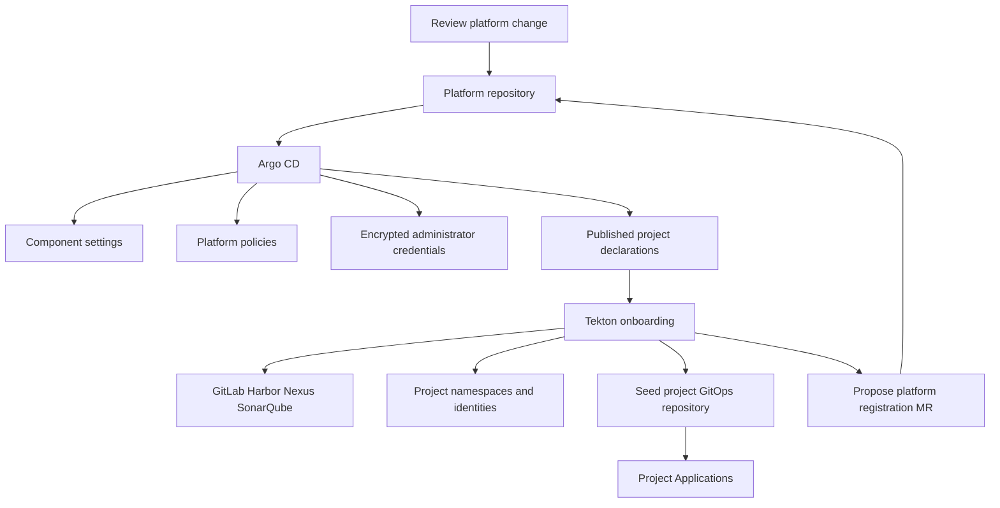

---
products:
  - Alauda Container Platform
  - Alauda DevOps
kind:
  - Best Practices
ProductsVersion:
  - 4.x
id: KB261000025
---

# Managing Platform Configuration and Onboarding Isolated Projects with Argo CD and Tekton on ACP

A platform team often starts by configuring components in the cluster and
creating tool accounts when a project asks for them. As the number of projects
grows, it becomes harder to answer which settings are intentional, how to create
the next project consistently, and what must be prepared in another environment.

Use this article when platform configuration needs a durable reviewed source,
when opening a project repeats administration in GitLab, Harbor, Nexus, and
SonarQube, or when deployment and credential boundaries need to be explained
together. A platform Git repository records shared intent. An onboarding pipeline
turns a reviewed project declaration into namespaces and tool resources, then
proposes the project's deployment registration through a merge request.

The two mechanisms have different ownership. Argo CD reconciles the objects and
fields owned by Git. The onboarding Tasks reconcile the external resources they
create. Neither mechanism replaces backups of decryption keys, signing keys,
external tool data, or Results storage. Reverting a registration can delete
resources, so recovery needs more than replaying or reverting YAML.

By the end, you should be able to:

- Separate platform configuration, shared templates, and project application state.
- Explain the 18 platform decisions, their owners, and their repository layers.
- Prepare the prerequisites, review a project declaration, and follow onboarding through its registration merge request.
- Verify the resulting project boundaries and plan reconciliation, credential rotation, and configuration recovery.

This article is the platform part of [Alauda DevOps Best Practices](./Alauda_DevOps_Best_Practices_Overview.md). It assumes one ACP project and separate tool-side tenants per project. Its configuration baseline is Pipelines 4.15, Artifact Hub Shim 1.0, Connectors 1.14, and GitOps 4.4 on a compatible ACP installation. Teams sharing one namespace and one tool tenant need a different boundary model.

The [companion samples](https://github.com/AlaudaDevops/devops-best-practices-samples) contain the complete reference files. Names such as `shop`, `payments`, `platform-connectors`, and `registry.example.com` are fictional. Replace them, the image placeholders, group resource names, policy identities, and encrypted Secret placeholders for the target environment.

## Establish the ownership model

Keep three kinds of repository separate:

| Repository | Contents | Owner |
| --- | --- | --- |
| Platform repository | Component configuration, admission policies, encrypted administrator credentials, project declarations, and platform Application definitions | Platform team |
| Template repository and catalog | Versioned shared Pipelines and Tasks; initial project GitOps repository content | Platform team |
| Project repositories | Application source and `.tekton/`; environment manifests and digest references in the project GitOps repository | Project team |

This separation keeps three kinds of review understandable. A platform change
can alter many projects' constraints and needs platform review. A catalog version
changes a reusable workflow and needs compatibility and adoption decisions. An
application release changes the project's own desired state and belongs to the
project's release process.

Run Templates are execution settings in project namespaces, distinct from
versioned catalog Pipeline definitions. They save parameters, Workspaces, and
Integrations for a particular use of a Pipeline. Keep application manifests in
the project GitOps repository. Projects may add namespaced policies, while the
shared baseline remains platform-owned.



The diagram describes ownership and handoffs. The post-merge PaC dispatcher
starts onboarding for changed declarations after waiting for their published
configuration; Argo CD does not itself trigger Tekton merely by synchronizing a
ConfigMap. Onboarding later proposes a separate registration change, which must
be reviewed before the project Applications take effect.

Assign one owner to each resource or field. Argo CD self-healing applies to
objects it tracks; it does not reconcile every object in the cluster or reverse
external tool operations. Removing a declaration is not an automated
decommissioning procedure.

### Decide what configuration recovery should provide

Keeping configuration in Git offers a starting point for initialization, a review
trail, and a way to propose a return to earlier settings. It also lets a reviewer
inspect project destinations, owners, and platform policies together. These
benefits depend on explicit field ownership and a recoverable set of prerequisites.

| Expected benefit | What this design provides | Operating consequence |
| --- | --- | --- |
| Initialize another environment consistently. | Reviewed component settings, policy, templates, and project declarations. | Install compatible controllers and restore credentials before synchronizing. |
| Explain a platform change. | A Git diff, review, and merged revision. | Restrict direct cluster writes and access to the platform repository. |
| Repair tracked drift. | Self-healing in layers where it is enabled and verified. | Operator-owned fields and credential rotations need their own ownership rules. |
| Return to previous configuration. | A reviewed change to earlier Git content. | Inspect pruning and external side effects before treating a revert as safe. |
| Reconcile project resources. | Repeated onboarding with the same supported parameters. | Account for token rotation, partial runs, and the project lock. |

A registry, database, or identity system can retain state that is absent from
Git. Define whether recovery means restoring that state or creating a new tenant
with the same declared shape. This series provides the configuration and
onboarding path; a complete recovery runbook must be exercised in the target
environment.

## Prepare the platform before bootstrap

Install components using their product installation instructions:

- [Pipelines](https://docs.alauda.io/alauda-devops-pipelines/4.15/install.html), including the required [PaC component](https://docs.alauda.io/alauda-devops-pipelines/4.15/pac/install/manage_pac.html) and [Manual Approval Gate](https://docs.alauda.io/alauda-devops-pipelines/4.15/how_to/manual_approval_gate_operator.html).
- [Connectors](https://docs.alauda.io/alauda-devops-connectors/1.14/install/install.html).
- [GitOps](https://docs.alauda.io/gitops/4.4/install_gitops/index.html).
- [Kyverno](https://docs.alauda.io/container_platform/4.4/security/security_and_compliance/compliance/install.html) and the sealed-secrets controller. Their CRDs must exist before syncing policies and SealedSecrets.

An administrator creates the management namespace, `platform-connectors` in the samples, and installs the four Connectors automatic creation Tasks there. These Tasks are installed from the Connectors documentation; they are not fetched from the general Task catalog. Prepare administrator access to the four tools and encrypt the credentials for the target sealed-secrets controller before committing them.

Create the Chains signing key and central registry credential outside Git. The central registry credential must exist before syncing the component layer that mounts it. Give it access only to registry projects that Chains must read and sign, and update that access when a project is onboarded.

Before onboarding, check every project ServiceAccount, including automatically created EventListener identities, with its actual groups: Secret `get`, `list`, and `watch`, and Pod creation in the Chains namespace must be denied. If any request is allowed, narrow the grants in their platform-managed source or install a component version with least-privilege roles, then repeat the checks with an independent project token. Built-in webhook Secret validation uses the separate core-interceptors identity; the EventListener does not need cluster-wide Secret reads. Recheck real webhook acceptance and incorrect-authentication rejection after the permission change. Follow the sample's [project-access checks](https://github.com/AlaudaDevops/devops-best-practices-samples/blob/main/sample-app/chains/README.md#check-project-access-before-enabling-signing).

Register the platform repository with Argo CD and provide read access to each project GitOps repository. A repository credential template can cover the approved GitLab URL prefix; narrower templates must be added per project. Use repository URLs ending in `.git` for Application and AppProject GitLab references. Use the cluster name registered by Alauda GitOps for both Application destinations and AppProject destination constraints.

Create the ACP project through the platform before onboarding it. The pipeline exports that project's manifest for subsequent registration. Importing an existing project into Git needs the same review as creating one: the project Application can later prune that resource.

Onboarding creates the GitLab group and its service tokens; it does not decide which human users belong to the group or grant them GitLab project-creation rights. The platform or project administrators must add approved members and manage those memberships separately from the token used by Pipelines-as-Code.

Platform administrators are responsible for webhook setup and event-delivery verification for platform, project GitOps, and application repositories. When automatic registration is enabled and the PaC controller URL is configured, creating a `Repository` can cause the registration controller to create and delete the project webhook. This requires a centralized webhook-registration GitLab credential with `api` scope and Maintainer access to the projects, stored in the controller's namespace; the PaC Repository's Developer-level group token cannot manage webhooks. Configure the controller URL so `controller-url` is populated in the `pipelines-as-code-info` ConfigMap, and verify the Repository's registration status and a real event before accepting onboarding. Follow [Advanced Repository Configuration](https://docs.alauda.io/alauda-devops-pipelines/4.15/pac/how_to/advanced_repository_config.html) and [Create a Git Secret for PAC](https://docs.alauda.io/alauda-devops-pipelines/4.15/pac/how_to/create_git_secret.html) for the product-specific credential and controller settings.

The merge dispatcher has a second readiness contract beyond the declaration
ConfigMap. Before it creates a child onboarding run, the `projects` Application
must have published the exact merged declaration as `project-<name>` in the
management namespace, and the onboarding Application must have created the
project's release-Connector `Role` and `RoleBinding` there. The sample names
both objects `project-onboarding-release-connectors-<name>` and grants the
dispatcher ServiceAccount name-scoped `get` access to them. These grants let the
dispatcher wait without granting it permission to change the release
Connectors. A new project therefore needs its release-Connector RBAC file and
its `onboarding/kustomization.yaml` entry in the same reviewed change as the
declaration and `projects/kustomization.yaml` generator entry. If either
Application is still catching up, the dispatcher must wait or report the
project as not ready; starting the child run early can fail when it tries to
reconcile the release Connectors. After the Applications become ready, retry
from the merge commit while it is still the `main` HEAD with
`/test onboard-changed-projects branch:main`. If that commit is no longer the
branch HEAD, start the onboarding Run Template for the affected project instead;
inspect the parent result and each child run after the retry.

Keep Harbor projects private. If Nexus anonymous access is enabled and its
anonymous role can read tenant repositories, an unauthenticated user can read
repositories created by the onboarding Task, bypassing the tenant credentials.
The onboarding Task only warns about anonymous access. Disable it (Settings →
Security → Anonymous Access) or remove the anonymous role's access to tenant
repositories, then confirm that an unauthenticated read is refused. Configure
SonarQube permissions according to the project-isolation requirements in its
Task guide. Do not infer isolation merely from the presence of separate
credentials.

For a disconnected environment, prepare local catalog content, pinned tool and base images, dependency repositories, certificates, and vulnerability databases before running pipelines.

## Decide the 18 platform baselines

Projects should not each decide how administrator credentials are exposed, where
audit history is kept, or which controllers may bypass a shared policy. Resolve
those matters before handing over the platform. Application-specific inputs and
additional restrictions can remain with the project.

The sample groups the decisions into four Git ownership layers:

| Layer | Configuration it owns | Reason for a separate layer |
| --- | --- | --- |
| Component | TektonConfig fragments, Chains options, Pruner, Results, and monitoring settings. | Shared controllers and singleton fields need operator-aware synchronization. |
| Policy | ClusterPolicies and the shared admission boundary. | Platform restrictions need controlled rollout and protection from project changes. |
| Credential | Administrator Connectors, encrypted Secret source, and the platform PaC registration. | Credential access and rotation have a different lifecycle from application state. |
| Project | Declarations and reviewed registration output: Applications, bindings, and destination patches. | Each project's requested resources and deployment scope can be reviewed together. |

The onboarding installation is a separate Application because its execution
permissions and release lifecycle also need review. The layer column below
identifies responsibility; the four automatic creation Tasks still manage their
own external resources.

The table identifies the platform decision and its repository layer. Values and detailed steps belong in the linked product documentation. These are administrator-managed recommendations, with maturity and prerequisites determined by the selected release.

| # | When this matters | Decision | Why it is shared | Layer and guidance |
| --- | --- | --- | --- | --- |
| 1 | Before onboarding the first repository or changing GitLab providers. | Separate Repository access tokens from webhook administration; use reviewed default-branch definitions and an explicit GitLab provider URL. | Credential scope and pre-merge execution trust should be consistent. | Credentials and project: [PaC Repository configuration](https://docs.alauda.io/alauda-devops-pipelines/4.15/pac/how_to/advanced_repository_config.html). |
| 2 | When teams need reproducible merge-request or push-triggered reruns. | For a merge-request run, comment `/test <pipelinerun-name> branch:<branch>` on the merge request; for a push-triggered run, post the same form on the latest commit of the branch that should run. | Teams use one supported entry and make the source branch explicit. | Project template: [Trigger PAC Pipelines](https://docs.alauda.io/alauda-devops-pipelines/4.15/pac/how_to/trigger_pipeline.html). |
| 3 | When a platform-managed address or Connector must change without editing every application. | Separate platform-provided Repository parameters from application inputs. | Addresses and Connector names have a defined owner. | Project: [Advanced Repository Configuration](https://docs.alauda.io/alauda-devops-pipelines/4.15/pac/how_to/advanced_repository_config.html). |
| 4 | When an external registry event starts another pipeline. | Decide Harbor event handoffs. | Event endpoints and validation need consistent ownership. | Component: [Harbor events](https://docs.alauda.io/alauda-devops-pipelines/4.15/triggers/how_to/harbor_events.html). |
| 5 | When credentials or declarations need periodic repair. | Schedule reconciliation and rotation with failure alerts. | The platform owns the interval and operational response. | Component: [ScheduledTrigger](https://docs.alauda.io/alauda-devops-pipelines/4.15/triggers/how_to/scheduledtriggers.html). |
| 6 | Before exposing webhook endpoints outside the cluster. | Standardize EventListener exposure. | TLS, routes, and webhook validation belong to the platform. | Component: [Automatic exposure rules](https://docs.alauda.io/alauda-devops-pipelines/4.15/triggers/how_to/trigger-wrapper-config.html). |
| 7 | When a new project must receive the same tool-side resources. | Orchestrate tool-side tenant creation with the four product Tasks. | Administrators retain tool-wide credentials. | Credentials and project: tool Task guides below. |
| 8 | Before the first token reaches its expiry window. | Define long-lived credential rotation for each tool. | Expiry and renewal behavior differ by tool. | Component and credentials: [GitLab automatic-creation Task](https://docs.alauda.io/alauda-devops-connectors/1.14/connectors-gitlab/how_to/using_gitlab_connector_automatic_creation_task.html#step-by-step--rotate-in-place), [Harbor automatic-creation Task](https://docs.alauda.io/alauda-devops-connectors/1.14/connectors-harbor/how_to/using_harbor_connector_automatic_creation_task.html#example-re-run-the-task-to-refresh-credentials-and-reconcile-resources), [Nexus automatic-creation Task](https://docs.alauda.io/alauda-devops-connectors/1.14/connectors-nexus/how_to/using_nexus_connector_automatic_creation_task.html#re-run-to-add-repositories-or-rotate-credentials), and [SonarQube automatic-creation Task](https://docs.alauda.io/alauda-devops-connectors/1.14/connectors-sonarqube/how_to/using_sonarqube_connector_automatic_creation_task.html#rotation). |
| 9 | Before a private production registry is enforced by Kyverno. | Configure Chains signing keys and image verification. | The platform owns the signer and distributes its public key. | Component, credentials, policy: [Signing keys](https://docs.alauda.io/alauda-devops-pipelines/4.15/chains/configure/signing_key_configuration.html). |
| 10 | When workload access to long-lived credentials must be narrowed. | Use Connector proxy access while tracking long-lived credential exceptions. | Access boundaries and rotation need a central owner. | Credentials: [Connectors Proxy](https://docs.alauda.io/alauda-devops-connectors/1.14/connectors/concepts/connectors_proxy.html) and [CSI Driver](https://docs.alauda.io/alauda-devops-connectors/1.14/connectors/concepts/connectors_csi.html). |
| 11 | Before build tools and workloads share a cluster. | Apply namespace Pod Security and separate build namespaces. | Build tooling and workloads have different privilege needs. | Policy and project: [Restricted standard](https://docs.alauda.io/alauda-devops-pipelines/4.15/pipelines/how_to/comply_with_pod_security_restricted.html). |
| 12 | Before production credentials or artifacts can be released. | Install approval and define protected-environment groups and promotion rules. | Approval ownership is a platform control. | Component, project, policy: [Manual Approval Gate](https://docs.alauda.io/alauda-devops-pipelines/4.15/pipelines/how_to/manual_approval_gate.html). |
| 13 | When projects need additional restrictions without weakening platform controls. | Establish platform and project policy layers. | Projects can add restrictions without weakening the platform baseline. | Policy: [Constrain pipeline execution](https://docs.alauda.io/alauda-devops-pipelines/4.15/pipelines/how_to/constrain_pipeline_execution_with_kyverno.html). |
| 14 | When the cluster cannot fetch Tasks or Pipelines from the internet. | Own the shared, locally available catalog. | Reuse and offline content need governance. | Component: [Author Catalog Resources](https://docs.alauda.io/alauda-devops-artifacthub-shim/1.0/catalog/how_to/author_catalog_resources.html). |
| 15 | When multiple projects consume the same workflow. | Publish versioned central Pipelines. | Projects adopt reviewed versions explicitly. | Component: [Centralized Pipeline management](https://docs.alauda.io/alauda-devops-pipelines/4.15/pipelines/how_to/hub_pipeline_run_template_centralized_management.html). |
| 16 | Before cleanup can remove shared run history. | Select Pruner defaults and namespace override policy. | Cleanup affects shared cluster history and capacity. | Component: [Pruner configuration](https://docs.alauda.io/alauda-devops-pipelines/4.15/pruner/configure/pruner_configuration.html). |
| 17 | Before live Tekton objects are pruned. | Define Results storage, watch scope, authentication, and retention. | Audit records need storage independent of live objects. | Component: [Results retention](https://docs.alauda.io/alauda-devops-pipelines/4.15/results/configure/retention_policy_configuration.html). |
| 18 | Before operating the platform without controller health evidence. | Enable metrics and operational monitoring. | Operators need evidence of controller and execution health. | Component: [Metrics Collection](https://docs.alauda.io/alauda-devops-pipelines/4.15/configure/metrics_collection.html). |

### Choose shared defaults without hiding their costs

For repository access and triggers, centralize webhook administration so that
projects do not need a webhook-management token. Keep the lower-privilege
Repository token, reviewed definition source, and explicit provider URL with the
repository configuration. A standard retry command helps operators, but a release
workflow can intentionally prohibit comment retries: the application sample's
`ci` requires a real `push` on `main`. Use its separate merge-request definition
for comment-triggered checks.

For tool access, an administrator prepares the creation Tasks and their
credentials once; projects receive scoped resources and Connectors. Proxy
workload tokens reduce routine exposure to tool credentials. They do not remove
rotation of the tool's backing credential, PaC clone credentials, image-pull
Secrets, or Chains registry access. Build namespace separation and restrictions
on Pod creation are part of this choice, not merely labels on the resources.

For release trust, the platform owns the signing key, verification policy, and
protected production credential path. A project chooses which environment needs
approval and can add restrictions. Installing approval components alone does not
protect the credential. Production promotion also needs the Core admission rules
and restrictions on deployed image sources described in the delivery article;
those additions are not installed by this sample.

For shared assets, publish catalog Tasks and versioned Pipelines through local
services. A pinned version makes adoption reviewable; the platform must also
retain the referenced content and define whether published coordinates can change.
The initial GitOps template is a seed, so upgrading that template requires
separate changes to repositories that already contain content.

For operations, choose cleanup, archiving, and monitoring together. Cleanup saves
cluster capacity but removes live evidence. Results requires external storage and
its own read authorization, while approval responses need separate preservation.
The first Pruner synchronization and Results watch scope can affect existing
tenants, so introduce them with an inventory and agreed retention limits.

These settings are platform decisions, not a promise that a product default has
already enabled the intended control. Check
[Feature Maturity](https://docs.alauda.io/alauda-devops-pipelines/4.15/overview/feature_maturity.html)
for the selected release and introduce each control in stages.

### Separate policy scope from definition trust

Use platform ClusterPolicies for shared controls and namespaced Policies for
project-specific restrictions. A project can narrow the permitted template,
version, image repositories, or parameters without weakening the platform
baseline. That depends on preventing the project from granting itself an
exception or changing the platform policy.

Restrict direct TaskRun and CustomRun creation by the actual submitting identity;
client-supplied owner references alone are not an authorization boundary.
Enumerate controller identities and review their permissions. Allowing an
automation identity to create direct runs opens that entry for anyone who can use
that identity. The sample excludes the management namespace from its resolver and
direct-run policies, so that namespace's execution permissions remain critical.

Optionally restrict PipelineRun references to approved resolver types. This abbreviated policy illustrates only the source-type decision; adapt namespace exclusions for every platform system namespace:

```yaml
apiVersion: kyverno.io/v1
kind: ClusterPolicy
metadata:
  name: pipelinerun-source-baseline
spec:
  background: false
  rules:
    - name: approved-resolver-only
      match:
        any:
          - resources:
              kinds: [tekton.dev/v1/PipelineRun]
              operations: [CREATE]
      exclude:
        any:
          - resources:
              namespaces: [platform-connectors]
      validate:
        failureAction: Audit
        message: "pipelineRef must use an approved resolver"
        deny:
          conditions:
            all:
              - key: "{{ request.object.spec.pipelineRef.resolver || '' }}"
                operator: AnyNotIn
                value: [cluster, hub, git]
```

This does not constrain a resolver's URL, catalog, namespace, version, definition content, or runtime credential scope. It also rejects inline `pipelineSpec` when enforced. Convert the sample's inline validation flow to a catalog Pipeline before enabling that restriction for project repositories. In `Audit`, a PipelineRun that violates this resolver rule is still admitted and should produce a PolicyReport; in `Enforce`, the same request is rejected. Test both modes with a disposable project identity before relying on the policy. Allow only platform administrators to create `PolicyException` objects, or disable exceptions according to platform policy; do not delegate this escape hatch to project identities.

### Constrain project deployment without replacing ACP ownership

The sample's `argocd-project-namespace-boundary` policy is installed in
`Enforce` from the beginning. Do not follow an Audit-first rollout for this
boundary: an Audit report does not prevent a project identity from writing a
protected object. The policy constrains writes of Role,
RoleBinding, ResourceQuota, LimitRange, NetworkPolicy, Kyverno PolicyException,
and Connectors AccessPolicy by the configured Argo CD identities in labelled
project namespaces. It allows the platform-owned registration path and requires `allowExistingViolations: false`. Adapt both Argo CD identities for the target cluster and verify the intended allow and deny cases for the installed APIs before relying on the boundary. The exception for the platform `projects` Application depends on Argo CD's `argocd.argoproj.io/tracking-id` annotation; label-only resource tracking is not covered. Restrict exception and AccessPolicy creation by other identities as well, and keep any platform exception namespace outside project destinations. Install and verify the policy on every destination cluster to which the boundary should apply.

The policy denies a protected write when all three conditions hold:

1. The writer is one of the actual Argo CD identities: the registered cluster identity or the application controller's identity.
2. The destination is a namespace labelled `cpaas.io/project`, excluding the platform system project.
3. The object's tracking annotation does not identify the platform-owned `projects` Application.

This gives the platform registration a controlled path while preventing a project
Application from using deployment rights to rewrite its own permissions, quota,
network boundary, policy exceptions, or Connector access. It covers both new and
existing objects, so test create, update, and delete requests with the actual
identities. The reports controller also needs read access to the matched APIs;
the sample includes the aggregate read role for PolicyException and AccessPolicy.

A rejected object makes the Application's synchronization fail with the policy
message. Retry settings determine subsequent attempts. Remove the forbidden
object from the project source and synchronize the corrected revision. Keep this
boundary in `Enforce` from its first installation; its purpose is to stop a
project identity from changing protected objects, so an `Audit` rollout would
leave that gap open.

Kyverno availability and recovery are platform operating concerns. For policies used as admission gates, keep the resource webhooks registered with `failurePolicy: Fail`; when Kyverno is unreachable, matching writes are then rejected. This applies to Audit policies as well: `failureAction: Audit` controls the result when Kyverno evaluates a request, but it does not make an unavailable Kyverno webhook fail open. In the sample, `no-bare-taskrun` is an Audit policy that matches direct `TaskRun` creation across the cluster (apart from its documented platform exclusion), so a Kyverno outage can prevent those TaskRuns from being created and can stop pipelines that depend on them. For this boundary, failure also includes Role, RoleBinding, ResourceQuota, LimitRange, NetworkPolicy, PolicyException, and Connectors AccessPolicy writes: the onboarding identity and cluster administrators are rejected until Kyverno recovers. An absent webhook provides no enforcement, and an orderly scale-to-zero can remove resource webhook registrations. Operate Kyverno highly available and keep a controlled recovery procedure, including the conditions for temporarily removing and later restoring webhook configurations. A signing result proves the signing key, not the pipeline that produced an image. Restrict ClusterPolicy, resolver, webhook, and PolicyException changes to platform administrators. See [Pipeline Policy Constraints with Tekton and Kyverno](./Pipeline_Policy_Constraints_with_Tekton_and_Kyverno.md) for the policy design.

## Organize and synchronize the platform repository

### Connect the repository, cluster, and ownership layers

Argo CD needs three independent agreements: repository read access, a registered
destination cluster, and an AppProject that permits the source and destination.
Complete all three before debugging the workload manifests. Use a read-only
platform repository credential and a repository credential template covering the
approved project GitOps URL prefixes. Onboarding creates Applications, not those
Argo CD credentials.

Use GitLab URLs ending in `.git` in Application and AppProject references to avoid
a redirect that Argo CD does not follow. Use `destination.name: <cluster-name>`
from Alauda GitOps registration, and the same name in AppProject destinations.
The default `in-cluster` entry can be limited to the Argo CD namespace; it is not
an interchangeable name for the ACP-registered cluster. When migrating a
manifest that used `destination.server`, remove that field rather than leaving
both `name` and `server` on the live object.

Use `platform-repo/` as the tree root below; the repository itself can have any name. The sample is split into four ownership layers and the onboarding installation:

```text
platform-repo/
├── argocd/apps/       # Root and child Application definitions
├── components/        # TektonConfig and component options
├── policies/          # Platform admission policies
├── credentials/       # Administrator Connectors and sealed placeholders
├── projects/          # Declarations and reviewed registration output
├── templates/         # Registration rendering templates
├── onboarding/        # Pipelines, Run Templates, schedules, and RBAC
└── .tekton/           # Validation and changed-project dispatch
```

One Application per layer lets a reviewer understand its path and synchronization
policy. A rendering failure in one layer can stop all objects in that Application;
separate Applications reduce the affected scope, while prerequisites between
controllers, credentials, and runs still need to be respected. The sample has the
root, four ownership layers, and a fifth child for onboarding.

Copy `onboarding/` from the sample to the platform repository root as described by its README. Register the repository read-only with Argo CD and use one child Application per layer. The root Application manages those Application definitions. After replacing placeholders and preparing the credentials and CRDs above, bootstrap once from that repository's root:

```bash
kubectl apply -k argocd/apps/
```

Declarations already present in `projects/` are not picked up by the merge dispatcher until a later `main` change. After the Applications synchronize, run the onboarding Run Template once for each existing declaration. Later changes follow the reviewed Git and dispatcher path.

### Choose synchronization behavior by resource lifecycle

Automatic synchronization applies a new Git revision. Self-healing repairs a live
change without a new revision. Pruning deletes tracked resources removed from
Git. These are separate decisions: enabling one does not establish that all
three are appropriate for a layer.

| Application or layer | Sample choice | Reason and condition |
| --- | --- | --- |
| Root Application definitions | Automated sync, prune, and self-heal. | Git owns the child Application configuration. Review removals and finalizers before deleting an Application. |
| Components | Automated sync; `prune: false`, `selfHeal: false`. | Partial singleton TektonConfig fields coexist with an operator; a removed fragment must not delete the singleton. |
| Credentials | Automated sync with self-healing disabled. | Coordinate sealed source, controller-managed fields, and live token rotation. |
| Policies, projects, and onboarding | Automated sync, prune, and self-heal in the sample. | Git owns these resources; registration deletion has project-level consequences. |
| Project environment Applications | Automated sync, prune, and self-heal. | Git is the desired application state; test and production differ in Git review requirements. |

For partial singleton component configuration, use server-side apply so the platform repository owns only the specified fields. Set `argocd.argoproj.io/compare-options: ServerSideDiff=true` with it; without server-side diff, the Application can remain `OutOfSync` and self-healing can repeatedly reapply the same apparent drift. Review the generated diff and the operator's field ownership before synchronization. The component layer uses `prune: false` so that removing a fragment does not delete the singleton TektonConfig, and starts with `selfHeal: false`. Observe the operator's write-back behavior and effective ownership in the target environment before enabling ongoing self-healing. Automatic synchronization of a new Git revision and self-healing of a live edit are separate decisions.

The credential layer does not enable self-healing: the Sealed Secrets controller
may write controller-managed state back to the live Secret, so Argo CD can see a
field-level difference that it must not repeatedly overwrite. Seal credentials
for the target controller and plan how rotations update live Secrets and
encrypted source. For layers with self-healing enabled, change managed objects
through the platform repository and a reviewed merge; a direct `kubectl` edit is
temporary and will be reconciled. The ACP project creates the same-named inner
namespace first; onboarding labels and adopts that namespace, then creates the
workload, build, and delivery namespaces. Do not add a second namespace creator
with `CreateNamespace`.

### Review the effective AppProject and its alternatives

ACP maintains the AppProject associated with an ACP project. The registration patch manages only the intended repository and destination fields. Reconcile the effective destinations with the platform-managed entries, and use the admission boundary for object-kind restrictions. Do not rely on an Application's sync status alone to prove the deployment boundary.

The sample patches only `sourceRepos` and `destinations` on the ACP-managed
AppProject. ACP can also maintain destination entries for the project's own
namespaces, including build and delivery. Inspect the effective object; the
registration patch is not an exclusive list of reachable namespaces. Keep the
object-kind boundary in platform admission instead of relying on fields that ACP
may reconcile.

Another option is a separately named deployment AppProject, such as
`<project>-deploy`, with its own source, destination, and resource restrictions.
It gives Argo CD ownership of that project's restrictions, but Applications using
it do not appear in the ACP project's GitOps list when that list selects
`spec.project` equal to the ACP project name. Operators would use Argo CD to view
them. Choose based on ownership and the required console experience.

The sample's platform AppProject permits broad registration operations. Narrow
its sources, destinations, and allowed kinds for a production platform; do not
hand its registration rights to project application writers. Decommissioning also
needs to inspect and remove the ACP-associated AppProject separately.

### Treat registration rollback as a lifecycle operation

Review deletion carefully. Reverting a registration commit, or removing `projects/<project>/` together with its `resources` entry, can make Argo CD prune the registered ACP project. That can delete its same-named namespace and the Secrets, Connectors, and Repository objects there. It does not reverse tool-side creation or automatically remove every build, delivery, or environment namespace.

Deleting only `projects/<project>.yaml` is different: it does not decommission the project, and leaving its `configMapGenerator` entry in place makes the declaration layer fail to render. Use a separate approved decommissioning procedure covering workloads, retained evidence, external tenants, credentials, webhooks, and each namespace.

### Validate changes before merging

Render each directory an Application consumes before a change is merged. A bad
Kustomize reference prevents generation of that Application's manifest set, so
unrelated objects in the same layer can also stop synchronizing. Finding the
problem in merge-request validation keeps it close to the author and the diff.

Both the platform and project GitOps templates include `.tekton/validate.yaml`, which composes catalog `git-clone` and `run-script` Tasks. Replace its tool image with a locally available image containing `sh`, `kubectl`, and the `kubectl kustomize` command; an image with only a standalone Kustomize binary is insufficient for the sample script. Establish its webhook before the first merge-request run. With default-branch definition provenance, a change to the validation definition is first exercised after it has entered that branch.

Validate every directory owned by an Application, and add new directories to the validation paths. Re-run a merge-request check with `/test validate branch:<branch>`. PaC uses the merge request's source branch and ignores `branch:` for choosing another MR branch; to run another branch, comment on its latest commit. YAML parsing and Kustomize rendering do not validate CRD admission behavior; use the target schemas and an isolated project for that acceptance step.

A validation status blocks a merge only when the Git platform requires it. On GitLab, enable **Pipelines must succeed** for the platform and project GitOps repositories. If Auto DevOps starts an additional pipeline without an available runner, the merge request can remain in a running state; disable Auto DevOps for these repositories or provide a runner.

With `pipelinerun_provenance: default_branch`, the definition is reviewed, but validation still renders proposed merge-request content. The sample's platform Repository and validation runs live in `platform-connectors`, which also holds administrator Secrets. That placement is suitable only for trusted platform maintainers: permission to create runs there can expose those Secrets. Before accepting less-trusted contributions, move the Repository, its limited token, and validation execution to a namespace without administrator credentials. Keep management dispatch separate and authorize only the reviewed dispatch path to create onboarding runs.

The sample onboarding dispatcher compares the pushed revision with its first parent. Use a merge or squash workflow that keeps all declaration changes in that comparison; a fast-forward push containing several independent commits can cause an earlier declaration change to be missed. The sample's `on-path-change` annotation is a Technology Preview feature in the 4.15 line, so verify its maturity and behavior before relying on it for the trigger boundary.

## Declare a project and run onboarding

The declaration records what the project requests: ownership groups,
environments, namespaces, and tool tenants. It contains no credentials or
runtime-generated tool IDs. The platform merge request also supplies the named
permissions and schedule that make the request executable.

The sample intentionally supports one naming convention and all four tools.
Explicit derived names let a reviewer see the requested shape without memorizing
that convention; the onboarding validator checks they agree. A declaration is
not a general-purpose provisioning API, and changing a name can change identity
or credential behavior in an external tool.

The declaration is a sample schema, not an ACP API. The pipeline validates its supported naming conventions. A complete `shop` declaration includes the following fields; use the sample's full file:

```yaml
name: shop
platformProject: shop
owners:
  - shop-platform-owners
environments: [test, prod]
tools: [gitlab, harbor, nexus, sonarqube]
approvers:
  prod: group:release-managers
imagePullFrom: []
namespaces:
  workloads: [shop, shop-test, shop-prod]
  build: shop-build
  delivery: shop-cd
gitlab:
  group: shop
  subgroups: [apps, gitops]
harbor:
  projects: [shop, shop-prod]
nexus:
  repositories:
    - name: shop-maven
      format: maven2
      type: hosted
    - name: shop-npm
      format: npm
      type: hosted
sonarqube:
  project: shop
```

`owners` contains ACP group resource names without a `group:` prefix; approval entries use `group:<resource-name>`. A console display name is not the resource name. When a fixed group name is required, create the group as a reviewed `auth.alauda.io/v1` `Group` object and import its user members through ACP group administration; do not put individual user names in every declaration. The following example uses ACP's local identity source. Both the display-name annotation and the identity-source reference are required; use the appropriate reference for a group managed by another identity provider.

```yaml
apiVersion: auth.alauda.io/v1
kind: Group
metadata:
  name: shop-platform-owners
  annotations:
    cpaas.io/display-name: Shop platform owners
spec:
  refConnector:
    id: local
    type: local
  users: []
```

After the group exists, add approved members in the console and verify the
resource name with `kubectl get groups.auth.alauda.io`. Group membership changes
belong to group administration, rather than edits naming individuals in every
declaration.

`imagePullFrom` is reserved: this sample only prints a warning when it is set and grants no cross-project pull access.

The declaration's `approvers` field is a reviewed record only: onboarding validates its shape but does not apply or compare it. The approvers that take effect are the promotion Pipeline's `ApprovalTask` list and the production `AccessPolicy`; nothing keeps those three sources in sync, so update them together in one reviewed change. Keep the production `AccessPolicy` under platform-administrator control because a person who can edit the Pipeline can otherwise change its `ApprovalTask` list while the AccessPolicy continues to enforce its own approver set. A signing result records the configured key, not the Pipeline that produced the image, and Chains does not create a run-level signature for a `PipelineRun` containing `CustomRun` tasks; keep that limitation in the release evidence.

### Review all inputs in the project merge request

Include the declaration, its `configMapGenerator` entry, the project's named
onboarding permissions, its ScheduledTrigger and Kustomize entries, and its
production image-verification repository entry. These belong together because a
declaration alone cannot grant the onboarding identity permission to manage new
production Connectors or expand the verification policy.

Per-project permission files are intentional: they keep release Connector writes
limited to listed names. Generating arbitrary RoleBindings from any declaration
would require broader `bind` or `escalate` rights. Review that security cost before
replacing the explicit files with more automation. Separately, add the new
registry projects to the platform-owned central Chains credential's access.

Submit the declaration, project-specific onboarding permissions, and schedule through a platform merge request. Confirm that the declaration and onboarding Applications have synchronized; synchronize them manually when using a manual sync policy. Then examine the dispatcher result and every child onboarding run. A successful merge or dispatcher does not by itself establish complete project readiness.

The merge check does not replace onboarding validation. The declaration's
structure and derived names are checked by the post-merge onboarding run, so a
syntactically valid but semantically invalid declaration can still merge and
must be diagnosed from that run's result.

The sample dispatches changed declarations after a merge. A path filter can also admit a run with no relevant declaration changes; the dispatcher is responsible for selecting actual declarations. A deleted declaration is skipped, rather than interpreted as an instruction to delete a project.

### Understand the seven onboarding stages

Before these stages, the Pipeline atomically acquires the project's ConfigMap
lock. It then validates the declaration before changing tenant resources. Among
other checks, the sample requires the four supported tools, group-shaped
approvers, matching derived names, and namespaces outside the platform's reserved
names. It refuses to adopt another project's namespace. The exception is the
same-named inner namespace created with the ACP project, which onboarding labels
and adopts explicitly.

The seven stages describe responsibilities; several tool Tasks run in parallel
after namespaces are ready, and the registration step starts its own child run.

| Stage | Work | Owner or mechanism |
| --- | --- | --- |
| 1 | Export the existing ACP project without runtime metadata; create or reconcile labelled namespaces and delivery identities. Workloads use restricted Pod Security; the build namespace is separate. | Sample orchestration and Kubernetes APIs |
| 2 | Create the GitLab tenant group and two group access tokens: a Developer token for project operations and a separate Maintainer token for GitOps delivery. | GitLab automatic creation Task |
| 3 | Create private source and production Harbor projects, distribute image pull configuration, and create separate source-read and production-write Connectors for release. | Harbor automatic creation Task |
| 4 | Create Nexus repositories and a scoped user, then write the project Connector. | Nexus automatic creation Task |
| 5 | Create the SonarQube user, token, and project permission template, then write the Connector. | SonarQube automatic creation Task |
| 6 | Seed the empty project GitOps repository and create its PaC Repository and access Secret. Complete and verify webhook configuration separately. | Sample template seeding and PaC resources |
| 7 | Render project Applications, AppProject patch, owner and Connector bindings, and the exported ACP project. Open a platform registration merge request. | A separate `gitops-repo-update` PipelineRun |

The first and last stages are sample orchestration. The four external tools use
product automatic creation Tasks, while repository seeding copies a reviewed
template once. This separation keeps tool-specific account and rotation behavior
in the product Tasks and keeps ordering and registration in the sample Pipeline.

The exported ACP project omits status, server-generated metadata, and GitOps
tracking markers. Keeping runtime tracking out of Git avoids a registration merge
request whose only purpose is to copy the previous synchronization's metadata.
Namespaces and delivery identities are created before the tool Tasks need them.
The build namespace uses Pod Security `baseline`; workload and delivery
namespaces use the stricter `restricted` level. Keep this distinction when
applying the namespace labels.

Harbor pull configuration is distributed to workload and build namespaces. The
sample delivery namespace runs tool images and does not receive that project pull
Secret. The project's four Connectors live in the project namespace; the GitOps
writer lives in delivery; production release Connectors live in management. Check
the permissions actually held by each credential rather than inferring them from
a name such as "pull" or "readonly".

Onboarding creates the project's GitLab group but does not add people to it.
Before handoff, a platform administrator must add the project's developers with a
role that allows them to create repositories in that group, according to the
platform's access policy.

The registration step proposes Git changes instead of directly applying Argo CD resources. Review the entire diff, including RBAC and destination changes. Submit one platform merge request that adds the declaration, its `configMapGenerator` entry in `projects/kustomization.yaml`, the project's release-Connector Role and RoleBinding plus ScheduledTrigger files together with their entries in `onboarding/kustomization.yaml`, and the project's production repository in the image-verification policy. Without the `configMapGenerator` entry the dispatcher waits for the project's ConfigMap and then skips the project. Without the release-Connector RBAC entry, the dispatcher cannot confirm that the child run's Connector prerequisites exist. Keep sufficient execution capacity for both the parent and child run: the waiting parent still reserves its Pod resources. Cancellation and cleanup must account for the independently created child run.

The pipeline runs in the management namespace with administrator Connectors. Permission to create Pods or PipelineRuns there is effectively access to those credentials, even without API permission to read Secrets. Limit that namespace and the onboarding identity to platform automation and administrators.

### Reuse the product Tasks

Use the product Tasks for each tool's tenant resources, accounts, tokens, and
Connector output. The sample adds declaration parsing, namespace ownership,
sequencing, locking, seeding, and platform registration. Reimplementing the four
tools' account logic inside the onboarding script would duplicate their contracts
and rotation behavior.

The four Tasks have different parameters and rotation behavior. Read their installation, access, and prerequisite instructions:

- [GitLab tenant group and Connector](https://docs.alauda.io/alauda-devops-connectors/1.14/connectors-gitlab/how_to/using_gitlab_connector_automatic_creation_task.html).
- [Harbor resources and Connector](https://docs.alauda.io/alauda-devops-connectors/1.14/connectors-harbor/how_to/using_harbor_connector_automatic_creation_task.html).
- [Nexus resources and Connector](https://docs.alauda.io/alauda-devops-connectors/1.14/connectors-nexus/how_to/using_nexus_connector_automatic_creation_task.html).
- [SonarQube tenant and Connector](https://docs.alauda.io/alauda-devops-connectors/1.14/connectors-sonarqube/how_to/using_sonarqube_connector_automatic_creation_task.html).

Set the target `connector` as `namespace/name`. Set GitLab access levels explicitly: both tokens in the sample are group access tokens, with Developer for project operations and Maintainer for GitOps writing. The Developer token has `api`, so the absence of `write_repository` does not prevent API-based repository changes while `main` is unprotected; protect `main` before treating review as a control. Connectors CSI mounts use the `connectors` attribute, with the namespace included.

The sample writes only to the current cluster using an explicitly authorized ServiceAccount. For cross-cluster application, follow each Task's Kubernetes Connector and `kubeconfig` Workspace instructions. Do not assume that the management namespace's default ServiceAccount has the required write permissions.

Choosing the current-cluster ServiceAccount avoids distributing another
administrator kubeconfig, at the cost of explicit RBAC for every required write.
A TaskRun or PipelineRun submitted with `generateName` uses `kubectl create`.
Install Tasks in the namespace where they run and check the run identity before
submission; an unspecified default ServiceAccount is not an implicit
administrator.

An alternative product workflow creates project Connectors from namespace events: [Automatically Create Connectors for a Project](https://docs.alauda.io/alauda-devops-connectors/1.14/how_to/automatically_create_connectors_for_a_project.html). If choosing that path, assign one creator and rotation owner per tenant and resource. Avoid two independent reconcilers managing the same credentials.

## Register repositories and verify events

Set the self-managed provider URL and reviewed definition source on every PaC Repository. The following fragment omits credential data; create its referenced Secret through the approved credential path:

```yaml
apiVersion: pipelinesascode.tekton.dev/v1alpha1
kind: Repository
metadata:
  name: shop-gitops
  namespace: shop
spec:
  url: https://git.example.com/shop/gitops/config
  git_provider:
    type: gitlab
    url: https://git.example.com
    secret:
      name: shop-gitops-auth
    webhook_secret:
      name: shop-gitops-auth
  settings:
    pipelinerun_provenance: default_branch
```

Set the provider URL explicitly so completion requests and the Repository token use the intended GitLab instance. The PaC repository URL differs from the `.git` URL used by Argo CD. `gitops/config` is a repository beneath the `gitops` subgroup, rather than a repository path conflicting with that subgroup's name.

The project's PaC Repository uses the Developer-level group access token. When automatic webhook registration is enabled, the controller uses the centralized webhook-registration credential configured by platform administrators to create and delete the webhook; verify a fresh event and its resulting run. The separate GitOps writer uses the Maintainer-level group access token. Keep the webhook-registration credential available through repository decommissioning, and check for remaining code-platform webhooks afterward. The application's Repository belongs in the build namespace, where CI executes. Application CI objects belong in the build namespace; CD and promotion Run Templates and PipelineRuns belong in the delivery namespace and require an administrator or an explicit delegated grant.

If `git_provider.url` is omitted, PaC can send completion comments to the
public `gitlab.com` provider instead of the self-managed GitLab instance, so
the intended merge request may never show the final status. Always set the
provider URL for a self-managed installation and verify the comment on the
expected merge request.

### Separate platform parameters from application inputs

The onboarding flow writes platform-provided values such as the registry address
and Connector names into the generated Repository's `spec.params`. A PaC
definition can consume those values while the application supplies its own source
revision and build inputs. This gives a platform-owned address a clear owner and
avoids repeating it in every definition that consumes the Repository parameter.

That parameter layer does not rewrite all existing configuration. Registry and
Git addresses also appear in seeded GitOps content, application CI/CD, promotion
mappings, Argo CD references, and verification policy. An address migration must
update those consumers through their own reviewed changes. Re-running onboarding
leaves a non-empty GitOps repository intact.

Repository access and webhook administration also have different lifecycles.
PaC generates per-run clone credentials from the Repository access token; those
credentials remain sensitive even though the run did not receive the webhook
administrator token. Test registration, delivery of a fresh event, the intended
run namespace, and completion status separately.

## Reconcile and rotate deliberately

### Distinguish reconciliation from template upgrades

Repeated onboarding is useful for a supported declaration change, scheduled tool
reconciliation, and rebuilding declared configuration after prerequisites have
been restored. It is not a blanket rollback of external state. A Task can rotate
or recreate a credential as part of an otherwise idempotent resource operation.

Use repeated runs of the same supported parameters for reconciliation. Do not equate Connector `Ready=True` with an unexpired, usable tool token; perform an authorized tool request or workload operation before and after rotation.

| Change | Required operating action |
| --- | --- |
| A supported declaration field changes | Review Task-specific recreation and rotation effects, then reconcile the project. |
| A new environment is added | Add its GitOps directory and validation path through a project merge request as well as changing the declaration. |
| A template changes | Propose updates to existing project repositories separately. Seeding copies only into an empty repository. |
| A credential is due for rotation | Run the relevant Task on a schedule shorter than expiry minus a safety margin; alert and retry on failure. |
| A credential has no expiry | Rotate at the interval required by policy; choose the Task's refresh behavior explicitly. |

The sample's supported GitLab subgroups are `apps` and `gitops`. Changing that convention requires a reviewed pipeline change, rather than only a declaration edit. Tool-side identity changes can recreate accounts or credentials; inspect the product Task's contract before changing names or project sets.

For example, adding `staging` requires a reviewed declaration change and a
project GitOps change that supplies `envs/staging` and its validation path. The
registration output can then point at a real directory. Updating only the
declaration can create an Application that cannot render. Similarly, changing the
seed template is an upgrade proposal for existing projects, not a reason to
overwrite their repositories.

Registration is regenerated from reviewed templates. A rerun with no registration
diff should not create another merge request. Inspect the resulting Git change or
absence of one; a generic update-step result alone is not proof that a
registration was needed or merged.

### Serialize tenant changes and recover a retained lock

Do not overlap runs for the same tenant. The three sample entry points—scheduled reconciliation, merge dispatch, and the manual Run Template—use the same onboarding Pipeline. Its first task atomically creates a per-project ConfigMap lock before any tenant changes; a competing run fails. A successful run releases its own lock in a final task. A failure, cancellation, or interrupted cleanup can leave the lock in place. Inspect its recorded PipelineRun and any independently started child runs, confirm that all work has stopped, then remove the lock before retrying. Never clear a lock just because the run is taking longer than expected.

Lock release is tied to the owning run's UID, so a competing run cannot clean up
another run's lock. There is no timeout-based takeover: a slow external API or
independent registration child can still be working after the parent looks
stalled. Record the owner, stop and inspect all related runs, and only then remove
a retained lock. A retry uses the same Pipeline and must acquire that lock again.

### Plan rotation before credentials expire

Arrange rotation outside active pipeline windows and monitor failed runs before the current credential expires. CSI workload-token issuance is separate from rotating the tool's long-lived credential. Consult the Task guide for expiry recovery; define a local recovery procedure rather than depending on an unobserved natural-expiry path.

If enabling Connector approval, prepare grants for every affected workload, enable `enable-connectors-approval`, immediately create the required AccessPolicies, and then enable `enable-connector-proxy-permissions`. The sample's optional administrator AccessPolicy is excluded from the default Kustomization and is applied only after the feature is enabled. Use RBAC for the documented cross-namespace grants and keep approval-gated production Connectors free of direct proxy grants. See the [delivery article](./From_Commit_to_Production_on_ACP.md#gate-the-production-connector-after-approval) for the complete rollout boundary.

## Understand the six project boundaries

Onboarding creates resources from which isolation can be established. Verify the
effective rights as well as the resources: a separate account can still have a
broad role, and a project label does not constrain every writer.

| Boundary | Result and remaining condition |
| --- | --- |
| Namespace and Pod Security | Workloads, build, and delivery have distinct namespaces and security levels. The sample owner binding grants `admin` in the project namespace only. |
| Deployment authorization | Effective AppProject destinations constrain location; the platform admission boundary constrains sensitive kinds written by the actual Argo CD identities. Direct Kubernetes writers still need RBAC restrictions. |
| Pipeline routing | Repositories and triggers route events to the intended project. Definition-source and direct-run policies constrain execution only where installed and enforced. |
| External tool tenancy | GitLab group, private Harbor projects, Nexus repositories/user, and SonarQube permissions are scoped per project. Verify instance-wide anonymous and visibility settings as prerequisites. |
| Credential access | Project users cannot create workloads in administrator or signing namespaces. Proxy grants, raw Secret access, PaC credentials, and Chains credentials are reviewed separately. |
| Execution history | Live cleanup and namespace overrides coexist with retained external Results records. Approval responses have a separate preservation path. |

The production release credential in this sample can read the staging project as
well as write production because the copy Task uses the destination proxy
configuration for both ends. The mount named source-readonly supplies the source
CA; it does not establish a separate authentication path. Chains uses its
platform-owned central registry credential for the promotion signature; do not
give the `shop-release` identity a matching production-registry push credential,
or Chains will prefer that credential and the release identity will gain a direct
write path. The delivery article explains this copy-specific behavior and its
approval boundary.

When promotion admission is enabled, use the Pipeline's `imageMappings` input
for every source-to-release mapping. The admission rule recognizes that mapping
form; a separately supplied repository or tag parameter is not a substitute.
Verify the build provenance for each digest before approving the promotion.

Cross-project pull access needs a separately reviewed grant. The declaration's
reserved `imagePullFrom` field only emits a warning in the sample; it does not
create a Harbor permission or distribute a new pull credential. Keep projects
private and demonstrate denial before treating an omitted grant as isolation.

### Check the six roles against the actual grants

The following matrix summarizes the six roles and the grants supplied or required by this reference. Kubernetes grants are additive: an absent sample binding does not revoke permissions inherited from ACP or another role. Git permissions and production protection must be configured in GitLab separately.

| Role | Platform repo | Project declaration | Project namespace | Delivery namespace | GitOps `envs/prod` | Production | Connectors |
| --- | --- | --- | --- | --- | --- | --- | --- |
| Platform administrator | Write, prerequisite | Write, prerequisite | Administrator, prerequisite | Apply definitions and start runs | Configure protection separately | Administrator, prerequisite | Administrator Connectors |
| Application developer / project owner | No Git grant supplied | No Git grant supplied | Owners group gets `admin` in `shop` | No sample binding | No Git grant supplied | No workload binding supplied | Can read project Secrets and use credentials in `shop` through Pods |
| Release approver | No grant supplied | No grant supplied | No binding supplied | ApprovalTask response; optional console read role | No Git review role supplied | No workload binding supplied | No mount grant supplied |
| CI ServiceAccount | No access supplied | No access supplied | Runs in `shop-build` | No binding supplied | No writer supplied | No workload binding supplied | Mount/proxy grants for project Harbor, SonarQube, Nexus |
| Delivery ServiceAccount | No access supplied | No access supplied | No binding supplied | Executes CD; no run-creation grant supplied | Maintainer group token through writer Connector | Changes Git references, reconciled by Argo CD | GitOps writer mount/proxy grant |
| Promotion ServiceAccount | No access supplied | No access supplied | No binding supplied | Executes promotion; no run-creation grant supplied | No writer supplied | Writes production registry through Connector | Mount both registry Connectors; direct proxy grant only for source |

The release approver is not automatically a Git code owner. Configure the Git review role separately if both approvals are required. The supplied Maintainer writer can change GitLab protection settings; a production deployment needs a separately protected branch or repository and a narrower writer identity. Verify effective permissions with the actual users and ServiceAccounts before delegating delivery-namespace run creation.

Name-scoped Connector `get` grants record the mounts this workflow needs; they do not remove ACP's broader default Connector reads within a project. Identity-specific proxy restrictions require the proxy permission features and grants described in the [delivery article](./From_Commit_to_Production_on_ACP.md#gate-the-production-connector-after-approval). Keep the distinction between read authorization, proxy authorization, and access to raw Secrets when reviewing this matrix. A `defaultPermission` policy selects only identities that have namespace-wide `get` on Connectors; a name-scoped `get` does not qualify, and other identities are skipped silently while the policy can still report `Ready`.

Keep CI, GitOps delivery, and artifact promotion identities separate. A runtime
ServiceAccount having execution credentials does not mean it can create its own
PipelineRuns. Likewise, being an application repository maintainer does not
establish a Kubernetes grant in the build or delivery namespace. Check both sides
before delegating a Run Template to project owners.

The optional ACP console approver role supplies the read access needed to find
approval work without granting run creation or Secret reads. It does not assign a
Git code-owner role or prove that an approver cannot initiate a release through
some other inherited permission. Review actual group membership and effective
permissions, and keep release initiators and approvers separate.

## Accept the project boundaries

### Inspect each onboarding result before handoff

| Boundary | What must be demonstrated |
| --- | --- |
| Namespaces and Pod Security | Workload namespaces have the intended labels; builds and delivery use their separate namespaces and identities. |
| Deployment scope | Effective AppProject destinations and platform admission permit only the intended project deployment path. Test forbidden RBAC and quota writes with the actual Argo CD identities. |
| Tool access | GitLab, Harbor, Nexus, and SonarQube authorization matches the tenant. Use positive controls before negative cross-project tests. |
| Credential access | Project users cannot create Pods or runs in administrator or signing namespaces. Inventory image pull Secrets, PaC clone credentials, and central Chains credentials separately. |
| Event routing | A fresh repository event or merge-request retry produces the expected run in the intended namespace. |
| Rotation | A successful non-overlapping run updates the intended credential and an authorized operation works afterward. |

Run `acceptance/02-platform-and-onboarding.sh` from the sample in an isolated acceptance project. Its companion delivery script verifies the image path after the first promoted production deployment. The acceptance script does not check onboarding runs: read the dispatcher's `onboarding-runs` result, confirm that it names a run for every project the change should onboard, and confirm that each child run has `Succeeded=True`. Check the four Connectors, the seeded repository, registration merge request, and Applications. The initial placeholder digest is not deployable; workload health follows the first real deployment. The platform `projects` Application can remain `OutOfSync` for platform-managed fields in this design; inspect the effective destinations and policy instead of treating that status alone as failure. When `no-bare-taskrun.yaml` is enabled, create one disposable direct TaskRun as the project identity and confirm that `Audit` admits it with a PolicyReport while `Enforce` rejects it; delete the probe and retain the report as evidence.

For cross-project image denial, first verify that the exact image exists and can be pulled in its own project. Then test an unauthorized project, distinguish `unauthorized` from `not found` and Pod Security rejection, and repeat in the opposite direction using an image that exists there. Delete temporary probe resources after the checks.

Test self-healing only on a disposable resource in the acceptance project. Onboarding renders a dedicated `<project>-self-healing-probe` RoleBinding with no subjects, so deleting it removes nobody's access. Merge and synchronize its registration before running the check; existing projects need a registration update to obtain it. The script requires its acceptance-probe label and refuses a binding with subjects. It saves the UID and recovery manifest, deletes the probe, and requires GitOps to recreate it with a different UID; a fallback restoration is reported as a failure. This is separate from proving ongoing automatic reconciliation of the operator-managed component layer.

### Know which outputs should exist

After reviewing and merging the registration, the expected outputs are:

| Location | Expected output |
| --- | --- |
| Platform Git | One declaration per project, its registered Kustomize entries, and reviewed project registration files. |
| Argo CD | Root and layer Applications, onboarding Application, and one Application per project environment. |
| GitLab | Project group, `apps` and `gitops` subgroups, two group access tokens, and the seeded `gitops/config` repository. |
| Harbor | Private source and production projects, a project robot and the two release-path robots, with the required pull configuration. |
| Nexus | The declared repositories and their scoped user. |
| SonarQube | A user, token, and project permission template; the first scan creates the application project. |
| Project Kubernetes resources | Labelled namespaces, delivery identities, four project Connectors, PaC registration, and reviewed owner/mount bindings. |
| Management Kubernetes resources | Administrator and project release Connectors, named onboarding grants, and the reconciliation schedule. |

Do not require every Application to report the same status immediately.
Placeholder workload digests are not runnable images; environment health follows
the first real deployment. The `projects` AppProject patch can remain OutOfSync
because ACP also maintains fields. The component layer's ongoing self-healing is
disabled pending ownership verification. Read the effective object, revision,
policy decision, and workload state that correspond to each acceptance claim.

Project readiness means its child onboarding run succeeded, registration was
reviewed and synchronized, tool access works within the intended tenant, a fresh
repository event reaches the right definition, and forbidden access is rejected
for the intended reason. Delivery readiness additionally requires the first real
build and release described in the delivery article. A successful dispatcher or
four Ready Connectors alone does not meet those conditions.

## Preserve audit records and plan recovery

### Choose cleanup and archiving as one operating decision

Choose one cleanup mechanism and review its scope before enabling it. Use event-based Pruner according to the global and namespace configuration guides; disable the older periodic mechanism when migrating. Verify each selected retention mode in the target environment before it can remove shared run history.

Global values apply cluster-wide after the first synchronization, including other tenants' namespaces unless a namespace override applies, and successful and failed runs are counted separately per namespace. On a shared cluster, count each namespace's finished PipelineRuns and standalone TaskRuns before enabling cleanup, choose limits above the highest count or agree lower limits with the tenants, and notify owners first.

Use external PostgreSQL and the documented log storage for Results. Define watch scope, authentication, and one retention policy for the reference configuration. Verify read authorization through the Results API, rather than inferring it from Kubernetes resource visibility. Preserve approval responses separately before cleanup removes the ApprovalTask objects.

Scope Results Watcher before enabling it: default watching can affect finished runs across namespaces and add `results.tekton.dev/*` finalizers. Disabling archiving does not remove finalizers already present. Follow the product recovery procedure before deletion and treat external Results storage as the audit source after cluster objects are pruned. See [S3 storage](https://docs.alauda.io/alauda-devops-pipelines/4.15/results/configure/s3_storage_configuration.html) and [Results retention](https://docs.alauda.io/alauda-devops-pipelines/4.15/results/configure/retention_policy_configuration.html).

### Restore prerequisites before replaying configuration

Git does not replace backups of credentials and external data. Before a platform rebuild, the platform team must prepare and rehearse recovery of these dependencies:

1. Compatible platform components, Kyverno, and sealed-secrets CRDs and controllers.
2. The sealed-secrets decryption key, or re-sealed credentials for the new controller.
3. Chains signing keys and the central registry credential; coordinate any verification-key change with image admission.
4. The management namespace and installed automatic creation Tasks.
5. Argo CD repository access and project repository credential templates, plus PaC access and webhook configuration.

For a signing-key rotation, first configure one attestor in `require-signed-images` with `count: 1` and separate `entries` for the old and new public keys. Confirm that an old-signed image is still admitted, then replace the signer through its supported management workflow and verify a new signature. Retain the old entry until every old-signed image, including rollback versions, is retired; remove it in a separate reviewed change. Inspect the signing Secret's immutability, owners, and installation method before replacement.

After preparing those dependencies, synchronize the platform layers, run onboarding for the declared projects, review registration changes, and complete the acceptance checks. This is a dependency outline; a complete empty-cluster or second-cluster recovery runbook must be exercised in the target environment.

During a rebuild, registration objects can be present before all project
namespaces exist. Allow declarations to synchronize before namespace-dependent
bindings so onboarding can read them; do not place the declaration ConfigMaps in
a later sync wave blocked by those bindings. Inspect failed objects and retries
rather than treating a temporarily incomplete layer as proof that onboarding
cannot proceed. This dependency sequence needs its own recovery acceptance.

### Adapt and operate the platform deliberately

Replace tool addresses, management namespace, project/group naming conventions,
environment list, Argo CD cluster name, both boundary-policy identities, signing
public key, encrypted credentials, local images, token lifetimes, and rotation
intervals. Verify every target-cluster boundary after adapting the identities.
Address migration also needs changes to repositories already seeded and to policy
and promotion inputs; Repository parameters are only one part of that operation.

Before production, complete the sample's hardening work: isolate pre-merge validation from administrator credentials, narrow the AppProject used for project registration, protect the GitOps writer's namespace, install promotion Core rules, and restrict production image sources. Restrict direct cluster writes alongside Git review. Template upgrades, decommissioning, capacity sizing, offline package distribution, and customer change-management integration require separate operating procedures.

Continue with [From Commit to Production](./From_Commit_to_Production_on_ACP.md) to use the onboarded project's build, test, promotion, and production GitOps paths.
