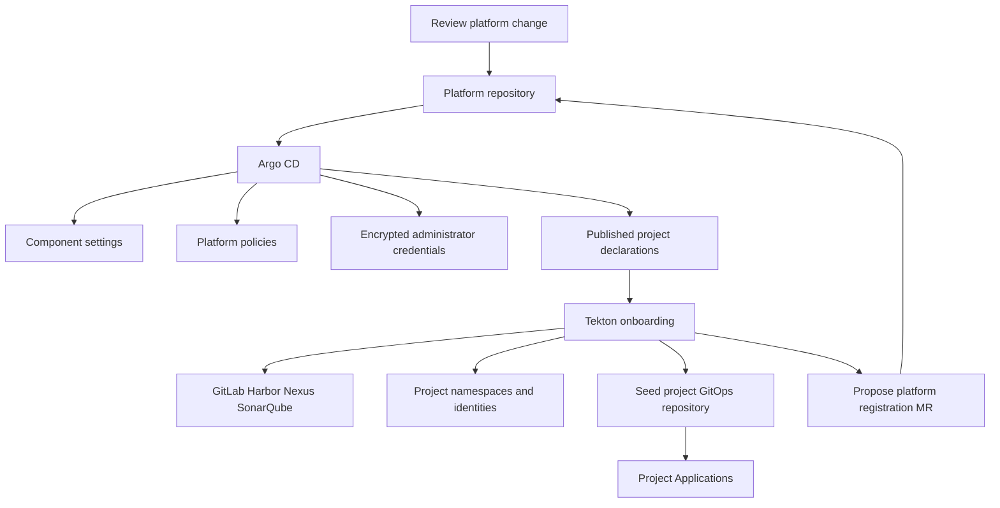

---
products:
  - Alauda Container Platform
  - Alauda DevOps
kind:
  - Article
ProductsVersion:
  - 4.x
id: KB261000025
---

# Managing Platform Configuration and Onboarding Isolated Projects with Argo CD and Tekton on ACP

Use a platform Git repository to review and preserve shared configuration. Use an onboarding pipeline to create a project's namespaces and tool-side resources, then propose its deployment configuration through a merge request. Argo CD reconciles the objects owned by Git; the onboarding tasks reconcile the resources they create in external tools.

This article is the platform part of [Alauda DevOps Best Practices](./Alauda_DevOps_Best_Practices_Overview.md). It assumes one ACP project and separate tool-side tenants per project. Its configuration baseline is Pipelines 4.15, Artifact Hub Shim 1.0, Connectors 1.14, and GitOps 4.4 on a compatible ACP installation. Teams sharing one namespace and one tool tenant need a different boundary model.

The [companion samples](https://github.com/AlaudaDevops/devops-best-practices-samples) contain the complete reference files. Names such as `shop`, `payments`, `platform-connectors`, and `registry.example.com` are fictional. Replace them, the image placeholders, group resource names, policy identities, and encrypted Secret placeholders for the target environment.

## Establish the ownership model

Keep three kinds of repository separate:

| Repository | Contents | Owner |
| --- | --- | --- |
| Platform repository | Component configuration, admission policies, encrypted administrator credentials, project declarations, and platform Application definitions | Platform team |
| Template repository and catalog | Versioned shared Pipelines and Tasks; initial project GitOps repository content | Platform team |
| Project repositories | Application source and `.tekton/`; environment manifests and digest references in the project GitOps repository | Project team |

Run Templates are execution settings in project namespaces. They are distinct from versioned catalog Pipeline definitions. Keep application manifests out of the platform repository, and keep platform policy ownership out of application repositories.



Assign one owner to each resource or field. Argo CD self-healing applies to objects it tracks; it does not reconcile every object in the cluster or reverse external tool operations. Removing a declaration is not an automated decommissioning procedure.

## Prepare the platform before bootstrap

Install components using their product installation instructions:

- [Pipelines](https://docs.alauda.io/alauda-devops-pipelines/4.15/install.html), including the required [PaC component](https://docs.alauda.io/alauda-devops-pipelines/4.15/pac/install/manage_pac.html) and [Manual Approval Gate](https://docs.alauda.io/alauda-devops-pipelines/4.15/how_to/manual_approval_gate_operator.html).
- [Connectors](https://docs.alauda.io/alauda-devops-connectors/1.14/install/install.html).
- [GitOps](https://docs.alauda.io/gitops/4.4/install_gitops/index.html).
- [Kyverno](https://docs.alauda.io/container_platform/4.4/security/security_and_compliance/compliance/install.html) and the sealed-secrets controller. Their CRDs must exist before syncing policies and SealedSecrets.

An administrator creates the management namespace, `platform-connectors` in the samples, and installs the four Connectors automatic creation Tasks there. These Tasks are installed from the Connectors documentation; they are not fetched from the general Task catalog. Prepare administrator access to the four tools and encrypt the credentials for the target sealed-secrets controller before committing them.

Create the Chains signing key and central registry credential outside Git. The central registry credential must exist before syncing the component layer that mounts it. Give it access only to registry projects that Chains must read and sign, and update that access when a project is onboarded.

Register the platform repository with Argo CD and provide read access to each project GitOps repository. A repository credential template can cover the approved GitLab URL prefix; narrower templates must be added per project. Use repository URLs ending in `.git` for Application and AppProject GitLab references. Use the cluster name registered by Alauda GitOps for both Application destinations and AppProject destination constraints.

Create the ACP project through the platform before onboarding it. The pipeline exports that project's manifest for subsequent registration. Importing an existing project into Git needs the same review as creating one: the project Application can later prune that resource.

Platform administrators are responsible for webhook setup and event-delivery verification for platform, project GitOps, and application repositories. Registration with a token authorized to manage repository webhooks supports controller-managed webhook creation and deletion. For centralized management, follow [Create a Git Secret for PAC](https://docs.alauda.io/alauda-devops-pipelines/4.15/pac/how_to/create_git_secret.html). The sample's Developer-level GitOps token cannot manage webhooks; complete the administrator webhook configuration and test a real event before accepting onboarding.

Keep Harbor projects private. Configure Nexus anonymous access and SonarQube permissions according to the project-isolation requirements in their Task guides. Do not infer isolation merely from the presence of separate credentials.

For a disconnected environment, prepare local catalog content, pinned tool and base images, dependency repositories, certificates, and vulnerability databases before running pipelines.

## Decide the 18 platform baselines

The table identifies the platform decision and its repository layer. Values and detailed steps belong in the linked product documentation. These are administrator-managed recommendations, with maturity and prerequisites determined by the selected release.

| # | Decision | Why it is shared | Layer and guidance |
| --- | --- | --- | --- |
| 1 | Separate Repository access tokens from webhook administration; use reviewed default-branch definitions and an explicit GitLab provider URL. | Credential scope and pre-merge execution trust should be consistent. | Credentials and project: [PaC Repository configuration](https://docs.alauda.io/alauda-devops-pipelines/4.15/pac/how_to/advanced_repository_config.html). |
| 2 | Standardize merge-request retries with `/test <pipelinerun-name>`. | Teams use one supported entry. | Project template: [Trigger PAC Pipelines](https://docs.alauda.io/alauda-devops-pipelines/4.15/pac/how_to/trigger_pipeline.html). |
| 3 | Separate platform-provided Repository parameters from application inputs. | Addresses and Connector names have a defined owner. | Project: [Advanced Repository Configuration](https://docs.alauda.io/alauda-devops-pipelines/4.15/pac/how_to/advanced_repository_config.html). |
| 4 | Decide Harbor event handoffs. | Event endpoints and validation need consistent ownership. | Component: [Harbor events](https://docs.alauda.io/alauda-devops-pipelines/4.15/triggers/how_to/harbor_events.html). |
| 5 | Schedule reconciliation and rotation with failure alerts. | The platform owns the interval and operational response. | Component: [ScheduledTrigger](https://docs.alauda.io/alauda-devops-pipelines/4.15/triggers/how_to/scheduledtriggers.html). |
| 6 | Standardize EventListener exposure. | TLS, routes, and webhook validation belong to the platform. | Component: [Automatic exposure rules](https://docs.alauda.io/alauda-devops-pipelines/4.15/triggers/how_to/trigger-wrapper-config.html). |
| 7 | Orchestrate tool-side tenant creation with the four product Tasks. | Administrators retain tool-wide credentials. | Credentials and project: tool Task guides below. |
| 8 | Define long-lived credential rotation for each tool. | Expiry and renewal behavior differ by tool. | Component and credentials: [Credential rotation](https://docs.alauda.io/alauda-devops-connectors/1.14/how_to/automatically_create_connectors_for_a_project.html#credential-rotation). |
| 9 | Configure Chains signing keys and image verification. | The platform owns the signer and distributes its public key. | Component, credentials, policy: [Signing keys](https://docs.alauda.io/alauda-devops-pipelines/4.15/chains/configure/signing_key_configuration.html). |
| 10 | Use Connector proxy access while tracking long-lived credential exceptions. | Access boundaries and rotation need a central owner. | Credentials: [Connectors Proxy](https://docs.alauda.io/alauda-devops-connectors/1.14/connectors/concepts/connectors_proxy.html) and [CSI Driver](https://docs.alauda.io/alauda-devops-connectors/1.14/connectors/concepts/connectors_csi.html). |
| 11 | Apply namespace Pod Security and separate build namespaces. | Build tooling and workloads have different privilege needs. | Policy and project: [Restricted standard](https://docs.alauda.io/alauda-devops-pipelines/4.15/pipelines/how_to/comply_with_pod_security_restricted.html). |
| 12 | Install approval and define protected-environment groups and promotion rules. | Approval ownership is a platform control. | Component, project, policy: [Manual Approval Gate](https://docs.alauda.io/alauda-devops-pipelines/4.15/pipelines/how_to/manual_approval_gate.html). |
| 13 | Establish platform and project policy layers. | Projects can add restrictions without weakening the platform baseline. | Policy: [Constrain pipeline execution](https://docs.alauda.io/alauda-devops-pipelines/4.15/pipelines/how_to/constrain_pipeline_execution_with_kyverno.html). |
| 14 | Own the shared, locally available catalog. | Reuse and offline content need governance. | Component: [Author Catalog Resources](https://docs.alauda.io/alauda-devops-artifacthub-shim/1.0/catalog/how_to/author_catalog_resources.html). |
| 15 | Publish versioned central Pipelines. | Projects adopt reviewed versions explicitly. | Component: [Centralized Pipeline management](https://docs.alauda.io/alauda-devops-pipelines/4.15/pipelines/how_to/hub_pipeline_run_template_centralized_management.html). |
| 16 | Select Pruner defaults and namespace override policy. | Cleanup affects shared cluster history and capacity. | Component: [Pruner configuration](https://docs.alauda.io/alauda-devops-pipelines/4.15/pruner/configure/pruner_configuration.html). |
| 17 | Define Results storage, watch scope, authentication, and retention. | Audit records need storage independent of live objects. | Component: [Results retention](https://docs.alauda.io/alauda-devops-pipelines/4.15/results/configure/retention_policy_configuration.html). |
| 18 | Enable metrics and operational monitoring. | Operators need evidence of controller and execution health. | Component: [Metrics Collection](https://docs.alauda.io/alauda-devops-pipelines/4.15/configure/metrics_collection.html). |

### Separate policy scope from definition trust

Use platform ClusterPolicies for shared controls and namespaced Policies for project-specific restrictions. Restrict direct TaskRun and CustomRun creation by the actual submitting identity; client-supplied owner references alone are not an authorization boundary. Enumerate controller identities and review their permissions.

Optionally restrict PipelineRun references to approved resolver types. This abbreviated policy illustrates only the source-type decision; adapt namespace exclusions for every platform system namespace:

```yaml
apiVersion: kyverno.io/v1
kind: ClusterPolicy
metadata:
  name: pipelinerun-source-baseline
spec:
  background: false
  rules:
    - name: approved-resolver-only
      match:
        any:
          - resources:
              kinds: [tekton.dev/v1/PipelineRun]
              operations: [CREATE]
      exclude:
        any:
          - resources:
              namespaces: [platform-connectors]
      validate:
        failureAction: Audit
        message: "pipelineRef must use an approved resolver"
        deny:
          conditions:
            all:
              - key: "{{ request.object.spec.pipelineRef.resolver || '' }}"
                operator: AnyNotIn
                value: [cluster, hub, git]
```

This does not constrain a resolver's URL, catalog, namespace, version, definition content, or runtime credential scope. It also rejects inline `pipelineSpec` when enforced. Convert the sample's inline validation flow to a catalog Pipeline before enabling that restriction for project repositories. Restrict PolicyException creation or disable exceptions according to platform policy.

The sample's `argocd-project-namespace-boundary` policy constrains writes of Role, RoleBinding, ResourceQuota, LimitRange, and NetworkPolicy by the configured Argo CD identities in labelled project namespaces. It allows the platform-owned registration path and requires `allowExistingViolations: false`. Adapt both Argo CD identities for the target cluster and verify the intended allow and deny cases before relying on the boundary. Install and verify the policy on every destination cluster to which the boundary should apply.

Kyverno availability and recovery are platform operating concerns. Prepare a local runbook; this series does not prescribe the cluster's write behavior during a policy-service outage. See [Pipeline Policy Constraints with Tekton and Kyverno](./Pipeline_Policy_Constraints_with_Tekton_and_Kyverno.md) for the policy design.

## Organize and synchronize the platform repository

The sample is split into four ownership layers and the onboarding installation:

```text
platform-config/
├── argocd/apps/       # Root and child Application definitions
├── components/        # TektonConfig and component options
├── policies/          # Platform admission policies
├── credentials/       # Administrator Connectors and sealed placeholders
├── projects/          # Declarations and reviewed registration output
├── templates/         # Registration rendering templates
├── onboarding/        # Pipelines, Run Templates, schedules, and RBAC
└── .tekton/           # Validation and changed-project dispatch
```

Copy `onboarding/` from the sample to the platform repository root as described by its README. Register the repository read-only with Argo CD and use one child Application per layer. The root Application manages those Application definitions.

For partial singleton component configuration, use server-side apply so the platform repository owns only the specified fields. The samples also set `argocd.argoproj.io/compare-options: ServerSideDiff=true`. Review the generated diff and the operator's field ownership before synchronization. The component layer uses `prune: false` so that removing a fragment does not delete the singleton TektonConfig. Establish the component layer's automated synchronization behavior in the target environment before enabling ongoing self-healing.

The credential layer does not enable self-healing: seal credentials for the target controller and plan how rotations update live Secrets and encrypted source. Other layers can use prune and self-heal according to their ownership. Namespaces are created by onboarding; do not add a second namespace creator with `CreateNamespace`.

ACP maintains the AppProject associated with an ACP project. The registration patch manages only the intended repository and destination fields. Reconcile the effective destinations with the platform-managed entries, and use the admission boundary for object-kind restrictions. Do not rely on an Application's sync status alone to prove the deployment boundary.

Review deletion carefully. Pruning a registered ACP project can delete its same-named namespace and its Secrets, Connectors, and Repository objects. It does not reverse tool-side creation or remove every build, delivery, or environment namespace. Decommissioning requires a separate approved procedure.

### Validate changes before merging

Both the platform and project GitOps templates include `.tekton/validate.yaml`, which composes catalog `git-clone` and `run-script` Tasks. Replace its tool image with a locally available image containing the required shell and Kustomize commands. Establish its webhook before the first merge-request run. With default-branch definition provenance, a change to the validation definition is first exercised after it has entered that branch.

Validate every directory owned by an Application, and add new directories to the validation paths. Re-run a merge-request check with `/test validate`. YAML parsing and Kustomize rendering do not validate CRD admission behavior; use the target schemas and an isolated project for that acceptance step.

## Declare a project and run onboarding

The declaration is a sample schema, not an ACP API. The pipeline validates its supported naming conventions. A complete `shop` declaration includes the following fields; use the sample's full file:

```yaml
name: shop
platformProject: shop
owners:
  - shop-platform-owners
environments: [test, prod]
tools: [gitlab, harbor, nexus, sonarqube]
approvers:
  prod: group:release-managers
imagePullFrom: []
namespaces:
  workloads: [shop, shop-test, shop-prod]
  build: shop-build
  delivery: shop-cd
gitlab:
  group: shop
  subgroups: [apps, gitops]
harbor:
  projects: [shop, shop-prod]
nexus:
  repositories:
    - name: shop-maven
      format: maven2
      type: hosted
    - name: shop-npm
      format: npm
      type: hosted
sonarqube:
  project: shop
```

`owners` contains ACP group resource names without a `group:` prefix; approval entries use `group:<resource-name>`. A console display name is not the resource name. Group membership changes belong to group administration, rather than edits naming individuals in every declaration.

Submit the declaration, project-specific onboarding permissions, and schedule through a platform merge request. Confirm that the declaration and onboarding Applications have synchronized; synchronize them manually when using a manual sync policy. Then examine the dispatcher result and every child onboarding run. A successful merge or dispatcher does not by itself establish complete project readiness.

The sample dispatches changed declarations after a merge. A path filter can also admit a run with no relevant declaration changes; the dispatcher is responsible for selecting actual declarations. A deleted declaration is skipped, rather than interpreted as an instruction to delete a project.

### Understand the seven onboarding stages

| Stage | Work | Owner or mechanism |
| --- | --- | --- |
| 1 | Export the existing ACP project without runtime metadata; create or reconcile labelled namespaces and delivery identities. Workloads use restricted Pod Security; the build namespace is separate. | Sample orchestration and Kubernetes APIs |
| 2 | Create the GitLab tenant group and a project access token; make a separate writer Connector for GitOps delivery. | GitLab automatic creation Task |
| 3 | Create private source and production Harbor projects, distribute image pull configuration, and create separate source-read and production-write Connectors for release. | Harbor automatic creation Task |
| 4 | Create Nexus repositories and a scoped user, then write the project Connector. | Nexus automatic creation Task |
| 5 | Create the SonarQube user, token, and project permission template, then write the Connector. | SonarQube automatic creation Task |
| 6 | Seed the empty project GitOps repository and create its PaC Repository and access Secret. Complete and verify webhook configuration separately. | Sample template seeding and PaC resources |
| 7 | Render project Applications, AppProject patch, owner and Connector bindings, and the exported ACP project. Open a platform registration merge request. | A separate `gitops-repo-update` PipelineRun |

The registration step proposes Git changes instead of directly applying Argo CD resources. Review the entire diff, including RBAC and destination changes. Keep sufficient execution capacity for both the parent and child run: the waiting parent still reserves its Pod resources. Cancellation and cleanup must account for the independently created child run.

The pipeline runs in the management namespace with administrator Connectors. Permission to create Pods or PipelineRuns there is effectively access to those credentials, even without API permission to read Secrets. Limit that namespace and the onboarding identity to platform automation and administrators.

### Reuse the product Tasks

The four Tasks have different parameters and rotation behavior. Read their installation, access, and prerequisite instructions:

- [GitLab tenant group and Connector](https://docs.alauda.io/alauda-devops-connectors/1.14/connectors-gitlab/how_to/using_gitlab_connector_automatic_creation_task.html).
- [Harbor resources and Connector](https://docs.alauda.io/alauda-devops-connectors/1.14/connectors-harbor/how_to/using_harbor_connector_automatic_creation_task.html).
- [Nexus resources and Connector](https://docs.alauda.io/alauda-devops-connectors/1.14/connectors-nexus/how_to/using_nexus_connector_automatic_creation_task.html).
- [SonarQube tenant and Connector](https://docs.alauda.io/alauda-devops-connectors/1.14/connectors-sonarqube/how_to/using_sonarqube_connector_automatic_creation_task.html).

Set the target `connector` as `namespace/name`. Set GitLab access levels explicitly: the project access token and the GitOps writer have different responsibilities. In the sample, project access uses `api` and `read_repository`; the writer additionally uses `write_repository`. Connectors CSI mounts use the `connectors` attribute, with the namespace included.

The sample writes only to the current cluster using an explicitly authorized ServiceAccount. For cross-cluster application, follow each Task's Kubernetes Connector and `kubeconfig` Workspace instructions. Do not assume that the management namespace's default ServiceAccount has the required write permissions.

An alternative product workflow creates project Connectors from namespace events: [Automatically Create Connectors for a Project](https://docs.alauda.io/alauda-devops-connectors/1.14/how_to/automatically_create_connectors_for_a_project.html). If choosing that path, assign one creator and rotation owner per tenant and resource. Avoid two independent reconcilers managing the same credentials.

## Register repositories and verify events

Set the self-managed provider URL and reviewed definition source on every PaC Repository. The following fragment omits credential data; create its referenced Secret through the approved credential path:

```yaml
apiVersion: pipelinesascode.tekton.dev/v1alpha1
kind: Repository
metadata:
  name: shop-gitops
  namespace: shop
spec:
  url: https://git.example.com/shop/gitops/config
  git_provider:
    type: gitlab
    url: https://git.example.com
    secret:
      name: shop-gitops-auth
    webhook_secret:
      name: shop-gitops-auth
  settings:
    pipelinerun_provenance: default_branch
```

Set the provider URL explicitly so completion requests and the Repository token use the intended GitLab instance. The PaC repository URL differs from the `.git` URL used by Argo CD. `gitops/config` is a repository beneath the `gitops` subgroup, rather than a repository path conflicting with that subgroup's name.

The sample's project GitOps token is Developer-level and requires administrator-managed webhook setup. Verify a fresh event and its resulting run. Keep webhook management credentials available through repository decommissioning, and check for remaining code-platform webhooks afterward. The application's Repository belongs in the build namespace, where CI executes.

## Reconcile and rotate deliberately

Use repeated runs of the same supported parameters for reconciliation. Do not equate Connector `Ready=True` with an unexpired, usable tool token; perform an authorized tool request or workload operation before and after rotation.

| Change | Required operating action |
| --- | --- |
| A supported declaration field changes | Review Task-specific recreation and rotation effects, then reconcile the project. |
| A new environment is added | Add its GitOps directory and validation path through a project merge request as well as changing the declaration. |
| A template changes | Propose updates to existing project repositories separately. Seeding copies only into an empty repository. |
| A credential is due for rotation | Run the relevant Task on a schedule shorter than expiry minus a safety margin; alert and retry on failure. |
| A credential has no expiry | Rotate at the interval required by policy; choose the Task's refresh behavior explicitly. |

The sample's supported GitLab subgroups are `apps` and `gitops`. Changing that convention requires a reviewed pipeline change, rather than only a declaration edit. Tool-side identity changes can recreate accounts or credentials; inspect the product Task's contract before changing names or project sets.

Do not overlap runs for the same tenant. Arrange rotation outside active pipeline windows and monitor failed runs before the current credential expires. CSI workload-token issuance is separate from rotating the tool's long-lived credential. Consult the Task guide for expiry recovery; define a local recovery procedure rather than depending on an unobserved natural-expiry path.

If enabling Connector approval, prepare grants for every affected workload, enable `enable-connectors-approval`, immediately create the required AccessPolicies, and then enable `enable-connector-proxy-permissions`. The sample's optional administrator AccessPolicy is excluded from the default Kustomization and is applied only after the feature is enabled. Use RBAC for the documented cross-namespace grants and keep approval-gated production Connectors free of direct proxy grants. See the [delivery article](./From_Commit_to_Production_on_ACP.md#gate-the-production-connector-after-approval) for the complete rollout boundary.

## Accept the project boundaries

| Boundary | What must be demonstrated |
| --- | --- |
| Namespaces and Pod Security | Workload namespaces have the intended labels; builds and delivery use their separate namespaces and identities. |
| Deployment scope | Effective AppProject destinations and platform admission permit only the intended project deployment path. Test forbidden RBAC and quota writes with the actual Argo CD identities. |
| Tool access | GitLab, Harbor, Nexus, and SonarQube authorization matches the tenant. Use positive controls before negative cross-project tests. |
| Credential access | Project users cannot create Pods or runs in administrator or signing namespaces. Inventory image pull Secrets, PaC clone credentials, and central Chains credentials separately. |
| Event routing | A fresh repository event or merge-request retry produces the expected run in the intended namespace. |
| Rotation | A successful non-overlapping run updates the intended credential and an authorized operation works afterward. |

Run `acceptance/02-platform-and-onboarding.sh` from the sample in an isolated acceptance project. Its companion delivery script verifies the image path after the first application build. Check every child onboarding run, the four Connectors, the seeded repository, registration merge request, and Applications. The initial placeholder digest is not deployable; workload health follows the first real deployment.

For cross-project image denial, first verify that the exact image exists and can be pulled in its own project. Then test an unauthorized project, distinguish `unauthorized` from `not found` and Pod Security rejection, and repeat in the opposite direction using an image that exists there. Delete temporary probe resources after the checks.

Test self-healing only on a disposable resource in the acceptance project. Record its UID and recovery manifest, perform the approved change, and confirm recreation with a different UID. Restore it if the check fails. This is separate from proving ongoing automatic reconciliation of the operator-managed component layer.

## Preserve audit records and plan recovery

Choose one cleanup mechanism and review its scope before enabling it. Use event-based Pruner according to the global and namespace configuration guides; disable the older periodic mechanism when migrating. Verify each selected retention mode in the target environment before it can remove shared run history.

Use external PostgreSQL and the documented log storage for Results. Define watch scope, authentication, and one retention policy for the reference configuration. Verify read authorization through the Results API, rather than inferring it from Kubernetes resource visibility. Preserve approval responses separately before cleanup removes the ApprovalTask objects.

Scope Results Watcher before enabling it: default watching can affect finished runs across namespaces and add `results.tekton.dev/*` finalizers. Disabling archiving does not remove finalizers already present. Follow the product recovery procedure before deletion and treat external Results storage as the audit source after cluster objects are pruned. See [S3 storage](https://docs.alauda.io/alauda-devops-pipelines/4.15/results/configure/s3_storage_configuration.html) and [Results retention](https://docs.alauda.io/alauda-devops-pipelines/4.15/results/configure/retention_policy_configuration.html).

Git does not replace backups of credentials and external data. Before a platform rebuild, the platform team must prepare and rehearse recovery of these dependencies:

1. Compatible platform components, Kyverno, and sealed-secrets CRDs and controllers.
2. The sealed-secrets decryption key, or re-sealed credentials for the new controller.
3. Chains signing keys and the central registry credential; coordinate any verification-key change with image admission.
4. The management namespace and installed automatic creation Tasks.
5. Argo CD repository access and project repository credential templates, plus PaC access and webhook configuration.

After preparing those dependencies, synchronize the platform layers, run onboarding for the declared projects, review registration changes, and complete the acceptance checks. This is a dependency outline; a complete empty-cluster or second-cluster recovery runbook must be exercised in the target environment.

Before production, complete the sample's hardening work: isolate pre-merge validation from administrator credentials, narrow the AppProject used for project registration, protect the GitOps writer's namespace, install promotion Core rules, and restrict production image sources. Restrict direct cluster writes alongside Git review. Template upgrades, decommissioning, capacity sizing, offline package distribution, and customer change-management integration require separate operating procedures.

Continue with [From Commit to Production](./From_Commit_to_Production_on_ACP.md) to use the onboarded project's build, test, promotion, and production GitOps paths.
