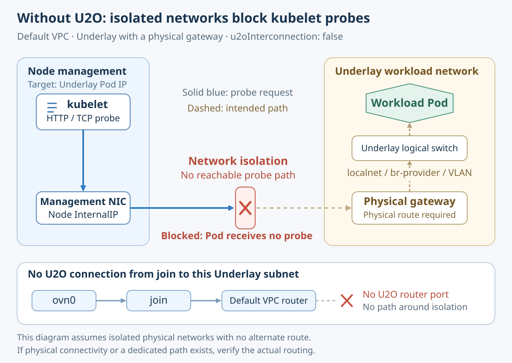
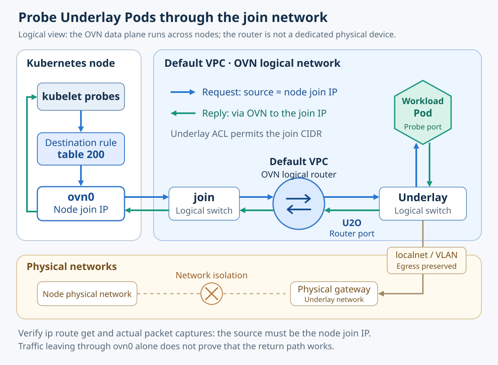
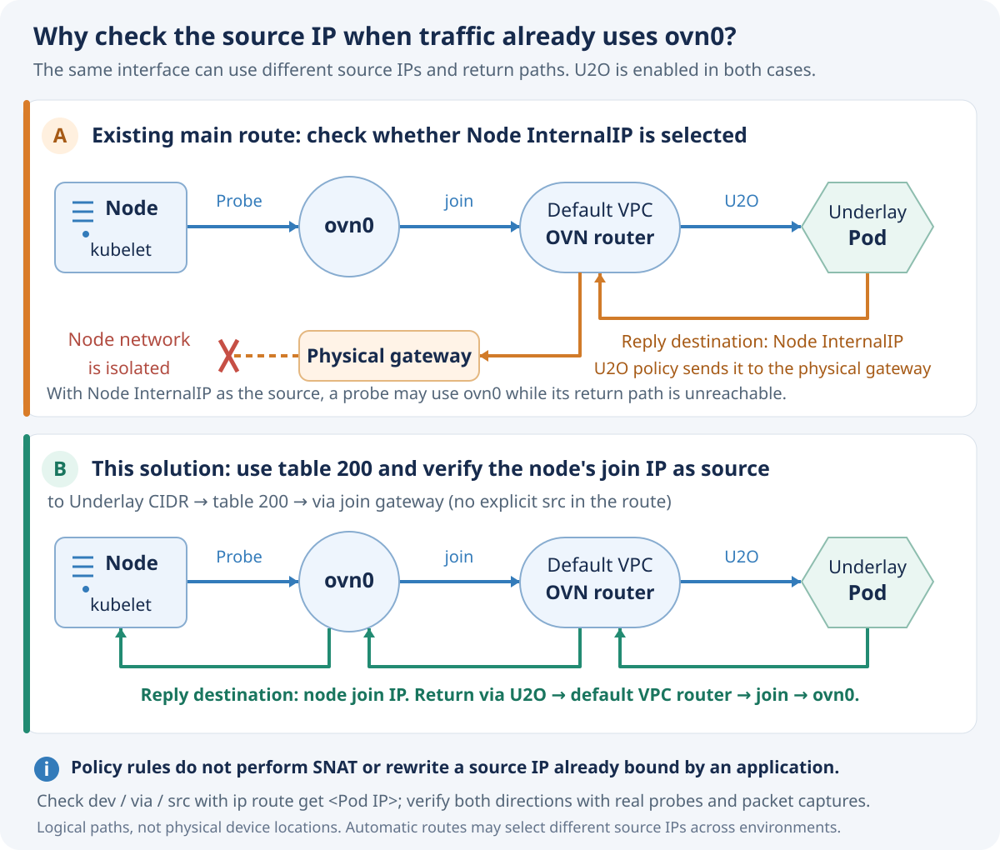

---
products:
  - Alauda Container Platform
kind:
  - Solution
ProductsVersion:
  - '4.2.x,4.3.x,4.4.x'
id: KB261000040
---

# Kubelet probe connectivity between isolated node and Underlay networks

## Issue

When U2O is not enabled on an Underlay subnet that uses a physical gateway, its logical switch is not connected to the default VPC's OVN router through a U2O router port. Nodes cannot reach that subnet through the join network. Kubelet probes to Underlay Pods therefore require a reachable physical network path or another dedicated path. If the node management network is isolated from the Underlay workload network and no alternative path is available, probe requests cannot reach the Pods, resulting in timeouts or connection failures.



This solution combines **Underlay-to-Overlay interconnection (U2O), an ACL allowing traffic from the join subnet, and destination-based policy routing through table 200 on each node**. For probe connections that meet the conditions described below, the node's join IP is selected as the source, and both requests and responses travel through the OVN network. Success means that actual probes work in both directions; the presence of routes and rules alone is insufficient.

## Environment and scope

**Applicable versions:** ACP 4.2.x, 4.3.x, and 4.4.x, subject to the network requirements below.

**Validation versions:** The compatibility review and shared forwarding path upgrade test used the following version combinations:

| ACP version | Kube-OVN version |
| --- | --- |
| 4.2.3 | v1.14.34 |
| 4.3.3 | v1.15.24 |

ACP 4.4.x and other patch releases in the listed version families have not been tested individually. Confirm the installed Kube-OVN capabilities and complete the verification steps in the target environment before deployment.

**Validation scope:** During the ACP 4.2.3 to 4.3.3 upgrade, testing with Overlay Pods covered the `table 200 → ovn0 → join → default VPC` forwarding path. The routing configuration was retained, and tested connectivity recovered after transient interruptions during component replacement. End-to-end kubelet probes to Underlay Pods with U2O and the join-CIDR ACL were not exercised in that test. Verify this full path in the target environment using the checks below.

- The ACP cluster uses Kube-OVN, and its Subnet CRD supports both `spec.u2oInterconnection` and `spec.acls`. Check these fields and the installed version's U2O behavior before deployment.
- This article covers IPv4 Underlay subnets in the default VPC that use a physical gateway: `spec.vlan` is configured and `spec.logicalGateway` is `false`.
- The Underlay address is the workload Pod's primary network IP and the actual target of kubelet probes. If only a secondary interface uses Underlay, first determine which address the probes target.
- The node's ovn0 interface, join network, default VPC router, and Underlay VLAN/ProviderNetwork configuration are healthy.
- The operator has Kubernetes permissions to modify Subnets and workloads, and root access to the affected nodes.

Do not apply this procedure directly to custom VPCs, Overlay subnets, or Underlay subnets with `logicalGateway: true`. U2O connects an Underlay subnet to the router of its own VPC. It does not automatically connect a custom VPC to the default VPC's join network or advertise routes to physical routers.

## How it works

### U2O connects the logical networks

In U2O, U stands for Underlay and O for Overlay. The join subnet in the default VPC is already connected to that VPC's OVN logical router. Enabling U2O on the target Underlay subnet connects it to the same router through a U2O router port, creating this path:

`Node ovn0 → join → default VPC router → U2O router port → Underlay Pod`

The join gateway is the next hop for the node's route. The U2O IP is the router interface address on the Underlay side. The Underlay physical gateway provides the corresponding physical network egress. These are distinct addresses.



For newly created Pods using this Underlay subnet as their primary network, the CNI configures the Pod gateway according to the U2O settings. Updating the Subnet does not automatically update the network namespaces of existing Pods. Recreate them gradually according to workload availability requirements. U2O also affects connectivity to Overlay networks and egress handling, so verify the existing application traffic paths as well.

### Table 200 controls route selection on the node

This solution adds two objects on each node:

| Object | Purpose |
| --- | --- |
| `ip rule … to <UNDERLAY_CIDR> … table 200` | Match the destination Underlay CIDR and look up table 200 before the main table. |
| `ip route … <UNDERLAY_CIDR> via <JOIN_GW> … table 200` | Provide a route through the join gateway and ovn0 in that table. |

An automatically managed route in the main table may specify the Node InternalIP as its preferred source address. The route in table 200 does not specify `src`, allowing requests that have not bound a source address to use ovn0's join IP according to the selected route. **The policy rule does not perform SNAT and does not override a source address already bound by an application.** Verify the selected source using `ip route get` and actual kubelet traffic.



Responses addressed to the node's join IP can return through U2O, the default VPC router, and join. Responses addressed to the Node InternalIP may still be directed through the physical gateway by U2O routing policies. An existing route through ovn0 therefore does not, by itself, prove that the solution is working.

## Configuration

### 1. Identify the parameters and save the current configuration

Start with one node and a representative set of workload Pods, then proceed one node at a time. Eventually cover every node that may run the affected workloads, including newly added nodes.

| Parameter | Source or requirement |
| --- | --- |
| `<UNDERLAY_SUBNET>`, `<UNDERLAY_CIDR>` | Use the target Subnet's name and `spec.cidrBlock`. List each subnet separately if there are multiple subnets. |
| `<JOIN_SUBNET>`, `<JOIN_CIDR>`, `<JOIN_GW>` | Read the name, CIDR, and gateway from the actual join Subnet. Do not assume fixed addresses. Use the canonical network address in each CIDR. |
| `<NODE_JOIN_IP>` | Read the IPv4 address of ovn0 on each node. The address differs between nodes. |
| `<RULE_PRIORITY>` | Choose an unused priority that runs before the main table lookup, and check for any earlier matching policies. Lower numbers run first. Do not reuse a priority merely because it appears in example output. |
| `<POD_IP>`, `<PROBE_PORT>`, `<PROBE_PATH>` | Use the Underlay primary IP of an actual workload or dedicated validation Pod, and its real health check port and path. |

From the cluster administration terminal, inspect the Subnets and save their YAML before making changes:

```bash
kubectl get subnet <UNDERLAY_SUBNET> -o yaml
kubectl get subnet <JOIN_SUBNET> -o yaml
kubectl get subnet -o yaml
```

On each affected node, save the following output and copies of any `.network` files, systemd units, or scripts that will be modified. Store backups in a persistent directory on the administration host or node, rather than only in a temporary container filesystem.

```bash
ip -4 addr show dev ovn0
ip -4 rule show
ip -4 route show table main
ip -4 route show table 200
ip -4 route get <POD_IP>
systemctl is-active systemd-networkd NetworkManager
```

Confirm that table 200 does not conflict with other policy routes, `Subnet.spec.policyRoutingTableID`, or network management tools. The `ovn_table` alias affects only how the table name is displayed. Using the numeric ID 200 is sufficient; repeatedly appending an alias to `/etc/iproute2/rt_tables` is unnecessary. If equivalent rules already exist, identify their priorities and persistence mechanism before proceeding, and avoid adding duplicates.

### 2. Enable U2O and merge the ACL

Enable U2O on the target Underlay Subnet:

```bash
kubectl patch subnet <UNDERLAY_SUBNET> --type=merge \
  -p '{"spec":{"u2oInterconnection":true}}'
kubectl edit subnet <UNDERLAY_SUBNET>
```

In the editor, **append or merge the following ACL into the existing `spec.acls` list**, retaining the existing rules. This is a configuration fragment, not a complete Subnet manifest. Do not use it to overwrite the entire ACL list.

```yaml
spec:
  u2oInterconnection: true
  acls:
    # Keep existing ACLs and merge the following rule.
    - action: allow-related
      direction: to-lport
      match: "ip4.src == <JOIN_CIDR>"
      priority: 3000
```

`to-lport` means traffic entering the Pod's logical port, and `allow-related` provides stateful permission. As in the original procedure, this rule allows all IPv4 protocols and ports from the join subnet, not just health probes. If a narrower rule is required, design it for the actual probe protocols and ports, then validate it again. Priority 3000 does not guarantee precedence over every other ACL or NetworkPolicy, and the ACL does not replace return-route checks.

Inspect the Subnet status, U2O address allocation, and related events to confirm that the controller has processed the configuration:

```bash
kubectl get subnet <UNDERLAY_SUBNET> -o yaml
kubectl describe subnet <UNDERLAY_SUBNET>
```

Once the node policy routes are ready, gradually recreate the existing workload Pods in this subnet so that their network configuration takes effect. Account for workload type, available replicas, and disruption budgets. Validate newly created Pods first, then proceed in batches; do not delete all workload Pods at once.

### 3. Make the node routes persistent

Choose one of the following methods. For multiple subnets, each Underlay CIDR must have its own matching route and rule. Do not use an unrelated CIDR as the rule's match condition.

The examples below make the interface or rule priority explicit and add readiness and repeat-execution checks to the scripts. These are implementation safeguards. The routing principle remains the same: look up table 200 for the target CIDR, use the join gateway as the next hop, and do not specify `src` on the route.

#### Method 1: systemd-networkd

Use this method on nodes where systemd-networkd is already enabled and has been confirmed to coexist with the CNI's management of ovn0. Run `networkctl status ovn0` to identify the current matching file. `.network` files take effect according to their matching order. Ensure that the new file does not unintentionally replace existing configuration, and do not let NetworkManager and networkd both manage the same interface.

The following is an example of `/etc/systemd/network/10-ovn0.network`. Replace every placeholder. `KeepConfiguration=yes` is intended to retain existing configuration. Before deployment, confirm that the installed systemd version supports this setting, and verify on the first node that reconfiguration does not remove existing addresses or routes.

```ini
[Match]
Name=ovn0

[Network]
DHCP=no
KeepConfiguration=yes

[Route]
Destination=<UNDERLAY_CIDR>
Gateway=<JOIN_GW>
Table=200

[RoutingPolicyRule]
To=<UNDERLAY_CIDR>
Table=200
Priority=<RULE_PRIORITY>
```

For multiple subnets, repeat the `[Route]` and `[RoutingPolicyRule]` pair for each CIDR. Use the same CIDR in both sections and the planned priority for each rule. Do not set `PreferredSource` to the Node InternalIP.

During a maintenance window, load and check the configuration one node at a time:

```bash
networkctl reload
networkctl reconfigure ovn0
networkctl status ovn0
journalctl -u systemd-networkd --since '-10 min' --no-pager
```

Reconfiguring the interface may affect addresses or routes that are in use. Perform the complete verification in the next section immediately afterward. For nodes using NetworkManager, implement equivalent routes and rules through the environment's existing persistence mechanism and verify how they are restored.

#### Method 2: a systemd oneshot service

Use this method when a network manager does not maintain this configuration. The templates below require Bash 4 or later and iproute2. Create the files as root on each node. The setup script waits up to approximately 120 seconds for ovn0's IPv4 address and a route to the join gateway, then reports failure if they are not ready.

Create `/etc/ovn0-routes.conf` with the values for the environment. Each entry uses the format `Underlay CIDR|rule priority`. Every listed entry must be managed exclusively by this solution.

```bash
JOIN_GW='<JOIN_GW>'
UNDERLAY_ROUTES=(
  '<UNDERLAY_CIDR>|<RULE_PRIORITY>'
  # Add entries for other subnets, using a distinct priority for each.
)
```

Create `/usr/local/bin/setup-ovn0-routes.sh`:

```bash
#!/bin/bash
set -euo pipefail
source /etc/ovn0-routes.conf

# With the default main-table priority of 32766, use priorities 1-32765.
# Reject duplicate entries before changing any routes or rules.
declare -A seen_priorities=() seen_cidrs=()
for entry in "${UNDERLAY_ROUTES[@]}"; do
  IFS='|' read -r cidr priority <<< "$entry"
  if [[ -z "$cidr" || ! "$priority" =~ ^[1-9][0-9]{0,4}$ ]] ||
     ((priority >= 32766)); then
    echo "Invalid Underlay route entry: $entry" >&2; exit 1
  fi
  if [[ -n "${seen_priorities[$priority]+x}" || -n "${seen_cidrs[$cidr]+x}" ]]; then
    echo "Duplicate Underlay route entry: $entry" >&2; exit 1
  fi
  seen_priorities[$priority]=1
  seen_cidrs[$cidr]=1
done

ready=false
for ((i=0; i<120; i++)); do
  if ip -4 addr show dev ovn0 scope global 2>/dev/null | grep -q 'inet ' &&
     ip -4 route get "$JOIN_GW" 2>/dev/null | grep -Eq 'dev ovn0( |$)'; then
    ready=true
    break
  fi
  sleep 1
done
if [[ "$ready" != true ]]; then
  echo 'ovn0 IPv4 address or route to join gateway is not ready' >&2
  exit 1
fi

# Check all planned priorities first; existing entries must match this configuration.
for entry in "${UNDERLAY_ROUTES[@]}"; do
  IFS='|' read -r cidr priority <<< "$entry"
  ip -4 rule show | awk -v p="$priority:" -v c="$cidr" '
    $1 == p {
      n++
      if ($2 == "from" && $3 == "all" && $4 == "to" && $5 == c &&
          $6 == "lookup" && ($7 == "200" || $7 == "ovn_table") &&
          (NF == 7 || (NF == 9 && $8 == "proto"))) good++
    }
    END { exit !(n == 0 || (n == 1 && good == 1)) }
  ' || { echo "Conflicting rule priority: $priority" >&2; exit 1; }
done

for entry in "${UNDERLAY_ROUTES[@]}"; do
  IFS='|' read -r cidr priority <<< "$entry"
  ip -4 route replace "$cidr" via "$JOIN_GW" dev ovn0 table 200
  if ! ip -4 rule show | awk -v p="$priority:" \
       '$1 == p { found=1 } END { exit !found }'; then
    ip -4 rule add priority "$priority" to "$cidr" table 200
  fi
done
echo 'Underlay probe routes and rules applied'
```

Create `/usr/local/bin/cleanup-ovn0-routes.sh`. It removes only the entries listed in the configuration file; it does not flush the entire routing table or unrelated policy rules.

```bash
#!/bin/bash
set -u
source /etc/ovn0-routes.conf
for entry in "${UNDERLAY_ROUTES[@]}"; do
  IFS='|' read -r cidr priority <<< "$entry"
  ip -4 rule del priority "$priority" to "$cidr" table 200 || true
  ip -4 route del "$cidr" via "$JOIN_GW" dev ovn0 table 200 || true
done
```

Create `/etc/systemd/system/ovn0-routes.service`:

```ini
[Unit]
Description=Underlay probe routes through ovn0
After=network-online.target
Wants=network-online.target

[Service]
Type=oneshot
RemainAfterExit=yes
TimeoutStartSec=150
ExecStart=/usr/local/bin/setup-ovn0-routes.sh
ExecStop=/usr/local/bin/cleanup-ovn0-routes.sh

[Install]
WantedBy=multi-user.target
```

Set the file permissions and start the service:

```bash
chown root:root /etc/ovn0-routes.conf \
  /usr/local/bin/setup-ovn0-routes.sh /usr/local/bin/cleanup-ovn0-routes.sh
chmod 600 /etc/ovn0-routes.conf
chmod 700 /usr/local/bin/setup-ovn0-routes.sh /usr/local/bin/cleanup-ovn0-routes.sh
systemctl daemon-reload
systemctl enable --now ovn0-routes.service
systemctl status ovn0-routes.service --no-pager
journalctl -u ovn0-routes.service --since '-10 min' --no-pager
```

`active (exited)` means only that the last execution succeeded. This service does not continuously monitor or repair routes. Routes associated with ovn0 may disappear if the interface is deleted and recreated. After ruling out configuration conflicts, run the setup script directly again and verify the result. Do not use `systemctl restart` as a read-only check: it runs ExecStop to remove the rules and routes before ExecStart reapplies them, leaving a temporary gap in the configuration.

## Verification

### 1. Check routes, rules, and source addresses on every node

```bash
ip -4 addr show dev ovn0
ip -4 rule show
ip -4 route show table 200
ip -4 route get <POD_IP>
```

Acceptance criteria:

- The policy rule for the target CIDR exists and is selected before the main table in an actual route lookup.
- Table 200 contains the corresponding route with `via <JOIN_GW> dev ovn0`, without an incorrect Node InternalIP preferred source address.
- `ip route get <POD_IP>` reports `dev ovn0`, `table 200` (or its alias `ovn_table`), and `src <NODE_JOIN_IP>` for that node.
- ovn0 has the correct join address and healthy interface flags. A virtual interface reporting `state UNKNOWN` is not automatically DOWN; evaluate its `UP`/`LOWER_UP` flags, addresses, and actual traffic together.

If the rule exists but table 200 has no matching route, lookup may continue to later tables. `ip rule show` alone is not enough to confirm success.

### 2. Verify actual probes and the return path

Test the Underlay Pod's primary network IP using the actual probe protocol. The following HTTP example does not specify a source address, so it tests route selection for a normal connection that has not bound its source:

```bash
curl --noproxy '*' --connect-timeout 3 --max-time 5 \
  'http://<POD_IP>:<PROBE_PORT>/<PROBE_PATH>'
tcpdump -ni ovn0 'host <POD_IP> and port <PROBE_PORT>'
```

Observe the actual probes sent by kubelet. Requests must use the node's join IP as the source and the Pod IP as the destination, and responses must return through ovn0. A test using `curl --interface` can help with diagnosis, but it does not replace validation of real kubelet probes.

```bash
kubectl -n <NAMESPACE> get pods -o wide
kubectl -n <NAMESPACE> describe pod <POD_NAME>
```

Confirm that readiness and liveness probes meet the workload's requirements. Observe several probe cycles and check that there are no persistent Unhealthy events or new restarts caused by probe failures. Cover representative Pods on different nodes and in each target Underlay subnet. Recheck existing workload egress and relevant Overlay connectivity. Testing only Overlay Pods does not replace this Underlay/U2O verification.

### 3. Verify persistence

During a maintenance window, verify restoration after a reboot on a representative node, then check the remaining nodes individually. For Method 1, inspect the effective networkd configuration and logs. For Method 2, inspect the service logs and actual routes and rules. Both methods require a fresh source-address lookup and a test of real probes. Configuration files and service status alone are insufficient.

## Troubleshooting and recovery

| Symptom | Checks and actions |
| --- | --- |
| Table 200 has a route, but lookup still uses the main table | Check the destination CIDR, rule priority, and any earlier matching rules. Confirm that the checks run in the node's network namespace. |
| Requests use ovn0 but still have the Node InternalIP as their source | Check whether the route specifies `src`/`PreferredSource` or the application binds its source address. Confirm with a packet capture. Adding a destination rule does not rewrite a bound source address. |
| Requests reach the Pod, but responses do not return | Check the Pod's actual gateway, U2O status, response destination address, and ACL/NetworkPolicy rules. Confirm that Pods created before U2O was enabled have been recreated as planned. |
| The oneshot service is active, but rules or routes are missing | Check the logs and whether ovn0 was recreated. Rule out other management tools removing the configuration, rerun the setup script, and repeat the complete verification. |
| The networkd file exists but does not take effect | Check whether the service is enabled, which `.network` file matches first, whether the installed version supports the settings, and whether multiple managers are competing for the interface. |

Before reverting the changes, establish which workload access path will be available afterward, then follow the change record. For Method 1, restore and load the previous `.network` configuration. For Method 2, stop and disable the service, then check the cleanup result. Remove only the routes and rules added by this change; do not flush the entire table. If U2O or ACL settings must be restored, undo only this change and preserve unrelated rules. Disabling U2O may also require planned Pod recreation to restore their gateways. Updating the Subnet alone does not establish that recovery is complete. Verify actual probes and workload traffic again afterward.
