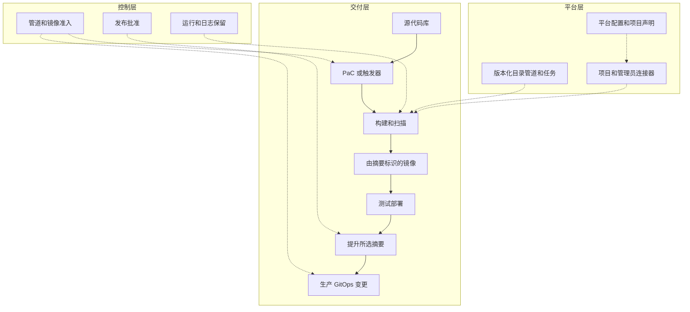

---
products:
  - Alauda Container Platform
  - Alauda DevOps
kind:
  - Best Practices
ProductsVersion:
  - 4.x
id: KB261000020
sourceSHA: 33733012cccdfec1c058e61b87b7c180ce897a5b15a18412a7e35341e7e4131e
---

# Alauda DevOps 最佳实践：概述与场景指南

一个从一个代码库开始的团队通常需要首先获得构建和测试结果。一旦这项工作完成，问题就会改变：经过测试的镜像如何到达生产环境，谁来批准它，以及在另一个团队可以使用相同流程之前，平台必须准备什么？本系列将按顺序解决这些问题。它解释了如何选择和组合功能，然后指向实现选择所需的产品说明和参考文件。

配置基线是 Alauda DevOps Pipelines 4.15、Artifact Hub Shim 1.0、Connectors 1.14 和 Alauda Container Platform GitOps 4.4，适用于兼容的 ACP 安装。在选择软件包时，请遵循每个组件的兼容性要求。示例使用 GitLab、Harbor、Nexus 和 SonarQube。参考设计要求在生产使用之前进行环境准备和验收检查。

## 如何使用本指南

根据您当前面临的问题选择一个条目：

| 您的起点                                                                                   | 您需要决定的事项                                                                 | 接下来阅读                                                                                                                                                                                                                               |
| ------------------------------------------------------------------------------------------ | -------------------------------------------------------------------------------- | --------------------------------------------------------------------------------------------------------------------------------------------------------------------------------------------------------------------------------------- |
| 您有一个代码库，或一个没有代码库的简单作业，并希望有一个可工作的管道。                     | 定义存放在哪里以及如何启动它。                                                     | [启动管道](#start-a-pipeline)。                                                                                                                                                                                                  |
| 管道已经在运行，但构建、测试和发布是分开的手动活动。                                       | 如何在环境之间传递相同的镜像，以及在哪里引入发布控制。                             | [连接交付阶段](#connect-the-delivery-stages)，然后 [从提交到生产](./From_Commit_to_Production_on_ACP.md)。                                                                                            |
| 多个团队将共享平台，每个项目都需要重复的管理。                                             | 在将平台交给项目之前，哪些设置和责任需要标准化。                                   | [准备共享平台](#prepare-a-shared-platform)，然后 [管理平台配置和引导隔离项目](./Managing_Platform_Configuration_and_Onboarding_Isolated_Projects_with_Argo_CD_and_Tekton_on_ACP.md)。 |

下面的每个场景解释了何时某个功能有帮助，它如何与其他功能相适应，以及在哪里继续。交付和平台文章详细说明了选择、配置点和预期结果。有关应用工作流的指导实现，请使用 [原生应用 CI/CD 教程](https://docs.alauda.io/alauda-devops-pipelines/4.15/pipelines/tutorials/index.html)。

[伴随示例](https://github.com/AlaudaDevops/devops-best-practices-samples)包含一个平台代码库、项目声明、引导管道、项目 GitOps 模板、原生应用 CI/CD 和验收脚本。它们是需要适应的参考文件。在使用之前，请替换示例地址、镜像、身份和加密凭证占位符。文章解释了决策和边界，因此阅读文件并不是理解设计的先决条件。

## 整体设计

该设计有三个层次。**交付层**跟踪从源到运行应用程序的一个变化。**平台层**提供定义、工具访问和项目环境，使该路径可重复。**控制层**在路径的特定点放置授权和证据检查。



| 层级    | 这里包含的内容                                                                                                                               | 决策者                                   |
| ------- | --------------------------------------------------------------------------------------------------------------------------------------------- | ---------------------------------------- |
| 交付    | 源、触发器、构建和扫描结果、镜像摘要、测试部署和生产变更。                                                                                 | 应用开发人员和项目维护者。               |
| 平台    | 组件设置、版本化目录内容、管理员连接器、加密凭证、项目声明和部署边界。                                                                     | 平台管理员。                             |
| 控制    | 所需的合并检查、发布批准、提升访问、镜像准入和保留的审计证据。                                                                             | 平台管理员和指定的发布批准者。           |

这些层级有不同的协调所有者。Argo CD 协调在平台或项目 GitOps 代码库中跟踪的对象。引导创建或协调命名空间、项目连接器和外部工具租户；Argo CD 不会自动管理这些外部操作。ACP 创建与其项目同名的命名空间，引导采用该命名空间。为每个资源或字段分配一个所有者，以避免两个控制器反复相互撤销。

分离构建和发布身份也很重要。开发人员可以生成候选镜像；发布决策在检查其构建和测试证据后授权特定摘要。签名、批准和生产 Git 更改各自建立该记录的不同部分。

<span id="start-a-pipeline"></span>

## 启动管道

对于单个应用程序，首先决定谁应该维护定义，以及定义更改是否需要与源更改相同的审查历史。一个简单的手动操作作业可以在集群中启动。希望进行合并请求检查的团队可以从 PaC 中受益。当多个项目共享相同的工作流时，集中实施并让项目提供输入。

| 模型                      | 定义和执行                                                                                       | 选择它的时机                                                                                 | 您承担的责任                                                                                                           |
| ------------------------- | ------------------------------------------------------------------------------------------------ | ---------------------------------------------------------------------------------------------- | --------------------------------------------------------------------------------------------------------------------- |
| 集群中的管道              | 在项目命名空间中维护管道；在运行模板中保存参数、工作区和集成。                                 | 少量作业需要简单的入口，包括没有代码库的作业。                                             | 通过平台流程维护定义历史和权限控制。                                                                                 |
| 代码作为管道 (PaC)       | 将 PipelineRun 定义保存在 `.tekton/` 中；代码库事件启动运行并报告结果。                       | 定义应随源演变，审查者需要在合并请求上进行检查。                                             | 必须管理对代码库的访问、Webhook 交付、定义来源和提议源可用凭证。                                                   |
| 集中管理的模板            | 发布版本化目录管道，或在受控命名空间中维护管道；项目引用它。                                 | 多个项目需要共享流程并进行有意识的升级。                                                   | 平台拥有兼容性和发布版本；项目仍然拥有其输入和采用。                                                                 |

这些选择可以共存。PaC 可以通过解析器引用中央管道，仅在 `.tekton/` 中保留触发器注释和项目输入。运行模板可以将同一集中维护的工作流暴露给手动、事件驱动和计划执行。因此，中央重用不需要放弃代码库的审查体验。

从 [运行模板](https://docs.alauda.io/alauda-devops-pipelines/4.15/pipelines/how_to/run_template.html)、[配置 GitLab 代码库](https://docs.alauda.io/alauda-devops-pipelines/4.15/pac/guides/configure_gitlab_repo.html)、[配置 GitHub 代码库](https://docs.alauda.io/alauda-devops-pipelines/4.15/pac/guides/configure_github_repo.html) 或 [通过 Hub 管道和运行模板进行集中管理](https://docs.alauda.io/alauda-devops-pipelines/4.15/pipelines/how_to/hub_pipeline_run_template_centralized_management.html) 开始。交付文章解释了这两条事件路径如何连接到这些定义。

### 选择工作开始的方式

| 工作应开始的时机         | 入口                                                | 典型原因                                                         |
| ------------------------ | -------------------------------------------------- | ---------------------------------------------------------------- |
| 有人请求它               | 从运行模板控制台或渲染的 PipelineRun。            | 首次验证、回归运行或发布决策。                                   |
| 代码更改                 | PaC，或带有运行模板的触发器。                     | 验证合并请求或在合并后构建。                                     |
| 发生工件事件             | Harbor 事件触发器。                               | 将镜像摘要传递给后续阶段。                                       |
| 间隔时间到达             | ScheduledTrigger。                                 | 协调工具资源、轮换凭证或进行定期检查。                           |
| 另一个系统请求它         | 传入 Webhook。                                    | 变更管理系统或内部门户启动工作。                                 |

对于同一代码事件，请使用一种路径，PaC 或触发器。两者都可以创建运行，因此将两者连接到该事件可能会重复工作。当代码库审查体验是核心时，优先选择 PaC；当平台拥有事件映射和运行模板时，使用触发器。计划对于协调非常有用，因为它重用与手动恢复运行相同的输入和执行定义。

对于来自合并请求的 PaC 重试，请在合并请求中评论 `/test <pipelinerun-name> branch:<branch>`。PaC 使用合并请求的源分支进行该评论；`branch:` 记录预期的源，但不会将合并请求切换到另一个分支。要运行不同的分支，请在该分支的最新提交上发布相同的命令。发布候选 `ci` 示例有一个额外的运行时限制，下面描述；它故意拒绝评论重试。有关完整语法，请参见 [触发 PaC 管道](https://docs.alauda.io/alauda-devops-pipelines/4.15/pac/how_to/trigger_pipeline.html)。

对于传入的 Webhook，向 PaC 控制器的 `/incoming` 端点发送带有 JSON 主体的 HTTP `POST` 请求。五个字段标识代码库、命名空间、分支、PipelineRun 定义和共享密钥：

```bash
# PAC_CONTROLLER_URL is the platform-provided controller endpoint.
curl -i -X POST "$PAC_CONTROLLER_URL/incoming" \
  -H 'Content-Type: application/json' \
  -d '{"repository":"<repository>","namespace":"<namespace>","branch":"main","pipelinerun":"<pipelinerun>","secret":"<webhook-secret>"}'
```

仅在返回 HTTP `202` 并且出现新的 PipelineRun 时，将请求视为已接受。空的 HTTP `200` 可能意味着没有匹配的运行，例如因为密钥不匹配。将密钥保存在调用者的凭证管理中。控制器配置、路由暴露和身份验证是平台先决条件；请参见 [传入 Webhooks](https://docs.alauda.io/alauda-devops-pipelines/4.15/pac/how_to/incoming_webhooks.html)。

<span id="connect-the-delivery-stages"></span>

## 连接交付阶段

一旦 CI 运行，接下来的问题是保持构建、测试和发布之间的关系。在阶段之间传递 `repository@sha256:<digest>`。标签有助于某人识别发布，但移动标签并不会改变在环境的部署配置中记录的摘要。

对于开发或测试，直接工作负载更新可能就足够了。生产通常需要经过审查的期望状态记录，这使得 GitOps 变更成为有用的部署入口。将生产工件项目分离增加了另一个决策：谁可以将批准的候选项复制到该项目中？为每个决策添加相应的控制。

| 情况                                                                  | 组合和原因                                                                                     | 继续进行                                                                                                                                           |
| --------------------------------------------------------------------- | ---------------------------------------------------------------------------------------------- | ------------------------------------------------------------------------------------------------------------------------------------------------- |
| 一次提交必须生成可追踪的、经过测试的镜像。                             | 重用目录任务进行构建和扫描，然后保留结果摘要和运行证据。                                      | [从提交到生产](./From_Commit_to_Production_on_ACP.md)。                                                                                     |
| 测试应快速更新且其状态的 Git 历史不必要。                             | 通过授权的工作负载或 Helm 任务直接部署摘要。                                                  | [原生应用 CI/CD 教程](https://docs.alauda.io/alauda-devops-pipelines/4.15/pipelines/tutorials/index.html)。                                      |
| 生产状态必须经过审查并可从 Git 恢复。                                 | 通过合并请求更新生产 GitOps 参考，然后让 Argo CD 进行协调。                                   | [GitOps](https://docs.alauda.io/gitops/4.4/)。                                                                                                   |
| 构建和生产注册表访问必须分开。                                       | 将所选摘要复制到具有发布身份的私有生产项目中。                                                | [使用 Skopeo 复制提升工件](https://docs.alauda.io/alauda-devops-artifacthub-shim/1.0/catalog/how_to/promote_artifacts_with_skopeo_copy.html)。 |
| 需要一个人授权发布并留下记录。                                       | 添加 ApprovalTask 并保留其响应；在需要时配置单独的 Git 审查。                                 | [手动批准门](https://docs.alauda.io/alauda-devops-pipelines/4.15/pipelines/how_to/manual_approval_gate.html)。                                   |
| 部署必须检查平台控制的签名者。                                       | 在发布和准入之前集中配置 Chains 并验证摘要。                                                  | [签名密钥配置](https://docs.alauda.io/alauda-devops-pipelines/4.15/chains/configure/signing_key_configuration.html)。                               |
| 注册表应将镜像传递给后续阶段。                                       | 将 Harbor 事件的摘要传递到下一个运行并检查其 CI 证据。                                         | [Harbor 事件触发器](https://docs.alauda.io/alauda-devops-pipelines/4.15/triggers/how_to/harbor_events.html)。                                     |

镜像推送事件确认镜像已到达。提升确认字节通过选定路径复制。两者都不能确认 CI 通过。批准者必须将摘要与成功的受信任构建、扫描和测试部署相关联。签名建立配置的签名者的声明；其含义取决于谁控制密钥以及哪些定义和源被允许使用签名路径。

### 交付示例的选择

该示例在测试和生产中都使用 GitOps，以便测试使用与生产相同的同步路径。测试更改直接提交；生产更改提出合并请求。它使用单独的源和生产注册表项目，具有单独的发布身份和在复制之前的批准节点。这些是与您自己的审查和工件访问要求进行比较的示例选择。

测试 CD、提升和生产 CD 在示例中手动启动，并采用前一阶段的摘要。这使每个交接都可见，同时建立工作流，但手动摘要输入是示例的后备，而不是目标操作模型。生产工作流应将摘要从受信任的 CI 结果传递到经过审查的触发输入。Harbor 驱动的自动化可以在事件身份验证、参数映射和 CI 结果关联配置后添加。第一次生产部署等待第一次提升的镜像及其经过审查的生产 GitOps 更改。

对于此示例，受信任的 CI 结果是 `ci`，用于 `main` 上的 `push`。预构建检查读取实际的 PaC 事件和分支注释，并在构建之前拒绝评论触发的 `ci` 运行，包括对 `main` 的评论。合并请求使用单独的定义和临时镜像代码库。共享项目凭证仍覆盖两个代码库；需要单独的临时注册表项目和受限凭证，以防止提议的源写入发布候选项。

<span id="prepare-a-shared-platform"></span>

## 准备共享平台

随着更多团队的加入，重复的管理成为一个所有权问题。平台必须决定每个项目接收哪些定义、工具资源、凭证、政策和保留设置。在引导之前标准化这些决策，然后让项目在既定边界内选择其特定于应用程序的工作流。

| 平台情况                                                            | 方法和原因                                                                                                                                         | 详细指南                                                                                                                                                                                                                                                            |
| ------------------------------------------------------------------- | ------------------------------------------------------------------------------------------------------------------------------------------------ | ------------------------------------------------------------------------------------------------------------------------------------------------------------------------------------------------------------------------------------------------------------------ |
| 管道需要工具而不分发管理员凭证。                                      | 使用项目连接器和代理工作负载令牌；单独跟踪剩余的长期凭证。                                                                                      | [连接器代理](https://docs.alauda.io/alauda-devops-connectors/1.14/connectors/concepts/connectors_proxy.html) 和 [CSI 驱动程序](https://docs.alauda.io/alauda-devops-connectors/1.14/connectors/concepts/connectors_csi.html)。                                           |
| 每个项目需要四个外部工具中的资源。                                    | 从经过审查的声明中协调四个连接器自动创建任务；为每个租户分配一个协调所有者。                                                                      | [引导和产品任务](./Managing_Platform_Configuration_and_Onboarding_Isolated_Projects_with_Argo_CD_and_Tekton_on_ACP.md#reuse-the-product-tasks)。                                                                                                                |
| 平台设置仅存在于运行的集群中。                                        | 将组件设置、政策、加密凭证和项目声明保存在平台代码库中。                                                                                        | [平台配置](./Managing_Platform_Configuration_and_Onboarding_Isolated_Projects_with_Argo_CD_and_Tekton_on_ACP.md)。                                                                                                                                              |
| 团队不得更改彼此的环境或凭证。                                        | 分离命名空间和工具租户，限制部署身份，并验证有效访问。                                                                                            | [项目边界](./Managing_Platform_Configuration_and_Onboarding_Isolated_Projects_with_Argo_CD_and_Tekton_on_ACP.md#accept-the-project-boundaries)。                                                                                                                    |
| 项目需要超出共享基线的限制。                                          | 将平台 ClusterPolicies 与项目政策结合；限制直接 TaskRun 和 CustomRun 创建，并可选地限制定义源。                                                  | [管道执行约束](https://docs.alauda.io/alauda-devops-pipelines/4.15/pipelines/how_to/constrain_pipeline_execution_with_kyverno.html)。                                                                                                                       |
| 集群历史必须清理，同时审计证据保持可用。                              | 选择 Pruner 设置和外部结果存储，并单独保留批准证据。                                                                                              | [审计和恢复](./Managing_Platform_Configuration_and_Onboarding_Isolated_Projects_with_Argo_CD_and_Tekton_on_ACP.md#preserve-audit-records-and-plan-recovery)。                                                                                                         |
| 凭证需要定期协调或更新。                                              | 调度相同的引导工作流，并设置故障警报和每个项目的并发锁。                                                                                          | [ScheduledTrigger](https://docs.alauda.io/alauda-devops-pipelines/4.15/triggers/how_to/scheduledtriggers.html) 和 [协调](./Managing_Platform_Configuration_and_Onboarding_Isolated_Projects_with_Argo_CD_and_Tekton_on_ACP.md#reconcile-and-rotate-deliberately)。 |
| 另一个系统启动工作。                                                  | 暴露经过身份验证的传入 Webhook，并定义对调用者的接受和完成的含义。                                                                                | [传入 Webhooks](https://docs.alauda.io/alauda-devops-pipelines/4.15/pac/how_to/incoming_webhooks.html)。                                                                                                                                                                  |

将 Kyverno `PolicyException` 的创建控制在平台管理员的控制之下。该例外可能削弱共享准入边界，因此不得留给本地项目政策或应用程序身份。

代理工作负载令牌并未消除所有长期凭证的责任。镜像拉取密钥、PaC 克隆凭证和 Chains 注册表凭证仍需范围访问、轮换和恢复。可以在带有凭证的命名空间中创建 Pods 的项目所有者可以使用这些凭证。因此，管理员、发布和签名命名空间需要明确的运行创建边界。

清理和归档也有共享后果。基于事件的 Pruner 默认设置可能会在第一次同步时影响每个命名空间，成功和失败的历史记录分别计算。在依赖于命名空间特定覆盖之前，将全局 Pruner 的 `enforcedConfigLevel` 设置为 `namespace`；否则，集群级别的值将保持有效。在启用删除之前，盘点租户及其保留需求。结果观察者可以在其观察范围内向完成的运行添加 `results.tekton.dev/*` 的最终处理程序；在启用之前定义该范围。禁用归档不会删除现有的最终处理程序。在清理之前遵循产品恢复程序，并验证在实时对象被修剪后仍然可以访问外部结果存储。

[平台文章](./Managing_Platform_Configuration_and_Onboarding_Isolated_Projects_with_Argo_CD_and_Tekton_on_ACP.md) 解释了 18 项决策、其代码库层、引导输出、权限、轮换和接受。这些是管理员管理的设置；检查 [功能成熟度](https://docs.alauda.io/alauda-devops-pipelines/4.15/overview/feature_maturity.html) 并分阶段引入。平台代码库提供持久配置和审查记录。密钥、外部工具数据和结果存储需要单独备份。恢复项目注册可能会修剪 ACP 项目及其同名命名空间，因此请将该操作视为退役审查。

## 选择采用路径

| 团队现在需要什么                | 从哪里开始                                                                         | 当需求出现时添加                                                                                 |
| ------------------------------ | ---------------------------------------------------------------------------------- | ------------------------------------------------------------------------------------------------ |
| 少量作业。                      | 集群管道和运行模板。                                                               | PaC 用于源审查；当重用变得有价值时使用中央模板。                                               |
| 可追踪的应用交付路径。          | 构建和扫描，传递摘要，并根据环境选择部署。                                         | 生产 Git 审查、批准、工件提升和根据发布边界的准入。                                          |
| 用于隔离项目的平台。            | 共享基线、管理员先决条件和经过审查的项目声明。                                   | 调度协调、故意轮换、政策执行和在接受后保留审计证据。                                          |

每一行都可以逐步采用。团队可以在集群中保留一个简单的作业，同时其主要应用程序使用 PaC 和共享目录管道。发布控制应满足环境的授权和证据要求。添加控制还会增加平台所有者、先决条件和操作恢复责任。

## 在没有互联网访问的情况下操作

通过批准的内部服务提供目录、固定工具和基础镜像、软件包依赖项、证书和漏洞数据库。运行时管道必须从本地目录或集群源解析任务和管道。示例将 Trivy 指向 `registry.example.com/mirror/trivy-db:2`；将其替换为可访问的数据库镜像并授予扫描器访问权限。

网络隔离的程度、团队数量和所需的批准证据是平台团队的部署输入。容量规划、迁移和退役自动化、平台灾难恢复、客户变更管理集成和离线软件包分发程序需要自己的操作计划。本系列提供了开发这些计划的选择和配置边界。

## 相关信息

- [Pipelines 4.15](https://docs.alauda.io/alauda-devops-pipelines/4.15/)
- [Artifact Hub Shim 1.0](https://docs.alauda.io/alauda-devops-artifacthub-shim/1.0/)
- [Connectors 1.14](https://docs.alauda.io/alauda-devops-connectors/1.14/)
- [GitOps 4.4](https://docs.alauda.io/gitops/4.4/)
- [使用 Tekton 和 Kyverno 进行软件供应链安全](./Software_Supply_Chain_Security_of_Alauda_Container_Platform_with_Tekton_and_Kyverno.md)
- [使用 Tekton 和 Kyverno 的管道政策约束](./Pipeline_Policy_Constraints_with_Tekton_and_Kyverno.md)
