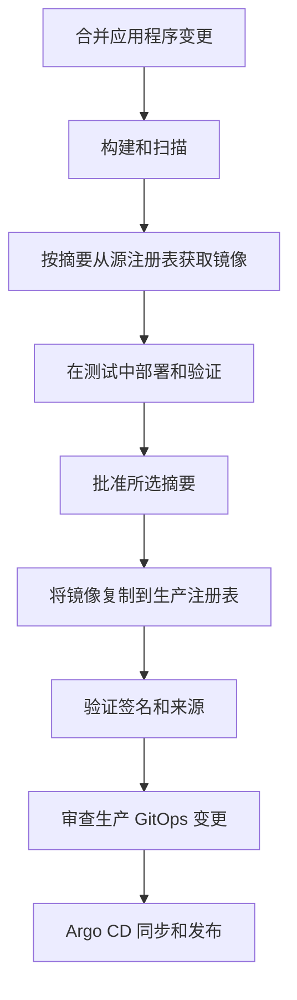
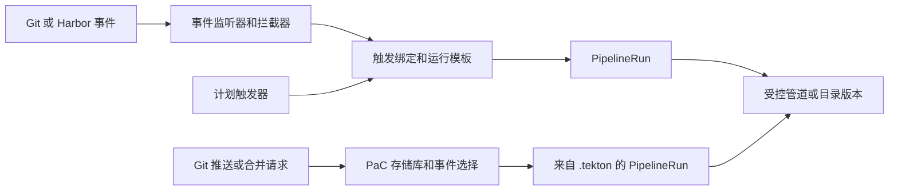

---
products:
  - Alauda Container Platform
  - Alauda DevOps
kind:
  - Best Practices
ProductsVersion:
  - 4.x
id: KB261000023
sourceSHA: d70d76330d3d8c63ee209b856ffaef9f532f1328f1c9e755325ac242accfa417
---

# 从提交到生产在 ACP 上：选择触发器、部署和发布控制

在变更合并后，团队通常希望构建、检查并部署到测试环境，而不需要有人在系统之间传递镜像名称。生产环境引入了更多问题：应该发布哪个经过测试的镜像，谁可以授权它，以及应该在哪里记录所需的生产状态？

当这些问题导致关于管道所有权、GitOps、批准或工件提升的选择时，请使用本文。它解释了替代方案及其后果，然后跟随伴随示例所做的选择。有关各个操作的指导实现，请参阅 [原生应用 CI/CD 教程](https://docs.alauda.io/alauda-devops-pipelines/4.15/pipelines/tutorials/index.html)。

到最后，您应该能够解释：

- 存储库的管道定义属于哪里，谁维护它，以及它是如何触发的。
- 为什么每个环境使用直接部署或 GitOps，以及它如何接收所选的镜像摘要。
- 生产环境是否需要工件复制、人为批准、批准门控凭证和部署接纳。
- 每个控制生效的地方以及平台团队必须提供哪些前提条件。

按照这个顺序处理这些决策。一个小项目可以通过手动运行启动，但目标工作流应该从受信任的 CI 结果中传递所选摘要，通过审核的输入。基于源的定义、中央模板和发布控制可以在其好处证明其所有权和运营成本时引入。

这是 [Alauda DevOps 最佳实践](./Alauda_DevOps_Best_Practices_Overview.md) 的交付部分。其配置基线为 Pipelines 4.15、Artifact Hub Shim 1.0、Connectors 1.14 和 GitOps 4.4。项目命名空间、工具侧资源和 Connectors 必须已经存在；[平台文章](./Managing_Platform_Configuration_and_Onboarding_Isolated_Projects_with_Argo_CD_and_Tekton_on_ACP.md) 解释了它们的准备。

[伴随示例](https://github.com/AlaudaDevops/devops-best-practices-samples) 使用一个虚构的 `shop` 项目。CI 在 `shop-build` 中运行；CD 和提升在 `shop-cd` 中运行；工作负载在 `shop-test` 和 `shop-prod` 中运行。示例仅绑定 `shop` 中的项目所有者组；应用 PaC 存储库、CD 和提升对象，以及启动它们的运行需要平台管理员或在 `shop-build` 和 `shop-cd` 中单独委派的授权。请参阅示例应用程序的 ["谁应用什么"](https://github.com/AlaudaDevops/devops-best-practices-samples/blob/main/sample-app/README.md#who-applies-what) 表。将每个示例地址、工具镜像、组、凭证占位符和策略身份替换为您的环境。确保漏洞数据库、工具镜像、基础镜像和依赖项在本地可用，以便进行离线执行。

## 准备项目及其职责

从一个工作项目管道和访问其代码及注册表开始。平台团队提供项目命名空间和 Connectors；它还将开发人员添加到 GitLab 租户组。入职创建该组，但不会同步其成员。没有所需组角色的开发人员无法创建应用程序存储库。

将构建保留在单独的命名空间中，因为容器构建任务可能需要与应用程序工作负载不同的 Pod 安全级别。示例使用 `baseline` 作为 `shop-build`，并使用 `restricted` 作为工作负载命名空间。请参阅 [内置任务和受限标准](https://docs.alauda.io/alauda-devops-pipelines/4.15/pipelines/how_to/comply_with_pod_security_restricted.html#built-in-tasks-and-the-restricted-standard)。交付命名空间提供了一个单独的地方来控制发布执行；仅创建该命名空间并不会确定谁可以使用其凭证。

本文保留每个交接的选择、前提条件、最小配置和证据在主要文本中。完整的任务参数和可执行的 PipelineRuns 存在于目录和伴随示例中。平台范围的设置、项目配置、保留和恢复在平台文章中描述。

## 在工作流中跟踪一个镜像身份



沿着这条路线的六个决策是定义所有权、触发、每个环境的部署、构建结果的转移、发布授权和执行。为一个步骤选择的工具并不决定其他步骤的决策。

使用 `repository@sha256:<digest>` 进行部署、提升源、签名验证和审计关联。标签帮助人们识别发布；单独的标签无法识别不可变内容。记录存储库和摘要：当提升更改存储库时，内容身份可以保持不变，但权限和接纳规则依赖于该存储库。

一个有用的起始设计是针对应用程序事件的 PaC、用于工作的目录任务、直接部署到测试和经过审核的 GitOps 变更用于生产。在发布边界需要它们的地方添加批准和工件复制。示例故意也在测试中使用 GitOps；原因在下面解释。Harbor 推送事件表明镜像已被推送。它并不表明成功的扫描、测试、签名或批准。

当在已部署的镜像中发现漏洞时，修复它并使用相同的构建、提升和部署工作流发布新的摘要。保留构建证据和用发布记录替换易受攻击镜像的决策。

## 选择定义的位置和运行的启动方式

| 模型             | 定义位置                                                         | 触发                                              | 适用场景                                               |
| ----------------- | ---------------------------------------------------------------- | -------------------------------------------------- | ------------------------------------------------------ |
| 集群管道         | 项目命名空间中的管道；运行模板中的执行设置                     | 手动、触发器或计划触发器                          | 少量集中操作的管道                                     |
| 代码即管道       | 应用程序的 `.tekton/` 目录中的 PipelineRun 文件                 | 推送和合并请求事件                                | 与源和合并请求检查一起版本控制的定义                 |
| 中央模板         | 版本化的目录管道，或受控集群命名空间中的管道                    | 运行模板或带有 `pipelineRef` 的 PaC PipelineRun | 跨项目共享标准                                         |

### 当工作简单时，从集群管道开始

项目命名空间中的管道适用于平台直接操作的少量工作，包括没有代码存储库的工作。将参数、工作区和集成保存在运行模板中，以便一个人、一个事件或一个计划可以调用相同的执行配置。如果工作需要源，`git-clone` 可以通过 Connector 获取它。

好处是简单的入口和更少的存储库资源准备。缺点是定义审核和变更历史属于平台的配置过程。仅在实时集群中保留管道不会提供 Git 审核轨迹。此路径仍然可以构建相同的源并运行相同的任务。

### 当工作流应随源演变时使用 PaC

PaC 将 PipelineRun 定义保存在 `.tekton/` 中，选择它们用于存储库事件，并将结果报告给代码平台。这适合特定分支的行为和审核者应看到的检查。应用程序团队可以通过其正常审核流程提出定义更改。

这种便利性将存储库访问、Webhook 交付、定义来源和合并前凭证暴露纳入范围。故意选择定义源；经过审核的定义仍然可以执行提议的应用程序代码。运行时凭证边界将在下面讨论。

### 当项目共享流程时发布中央模板

当许多存储库实现相同的构建和扫描序列时，将共享工作流维护与项目输入分开。平台发布一个版本化的目录管道，而每个项目提供其存储库、镜像位置和执行设置。当平台拥有其变更过程时，受控集群管道是另一个选择。

好处是一个维护的工作流，具有一致的行为。成本是一个明确的兼容性合同：平台维护版本和任务，项目审核新版本的采用。发布新版本并不会升级每个消费者。中央模板可以通过运行模板或 PaC 使用；这是一个所有权选择，可以伴随任何触发路径。

### 为每个工作选择一个事件路径

原生应用 CI/CD 教程从集群管道和触发器开始。当源审核是自然入口时，PaC 提供了另一条路径。两者最终都会创建 PipelineRuns：



当平台拥有事件过滤和参数映射时使用触发器。当定义和检查应遵循存储库审核时使用 PaC。为相同事件和工作选择一条路径，因为启用两者可能会重复工作。同一项目可以在集群中保留简单工作，使用 PaC 进行其主要应用程序，并从两者中引用中央模板。

对于从合并请求重试，请在合并请求上评论 `/test <pipelinerun-name> branch:<branch>`。PaC 使用该合并请求的源分支；`branch:` 参数记录源，但不选择其他分支。对于推送触发的运行，请在应运行的分支的最新提交上评论相同的形式。通过链接到 [触发 PAC 管道](https://docs.alauda.io/alauda-devops-pipelines/4.15/pac/how_to/trigger_pipeline.html) 保持完整语法在一个地方。

仅当 Git 平台要求该检查通过时，失败的检查才会阻止合并。在 GitLab 上，启用 **管道必须成功**。如果 Auto DevOps 创建了一个额外的管道而没有运行器接管它，GitLab 管道可能会保持运行，合并请求继续显示正在运行的管道；对于这些存储库禁用 Auto DevOps 或提供一个运行器。

### 将 PaC 与中央模板结合使用

将事件注释和项目输入保留在 `.tekton/` 中。通过解析器和固定版本引用平台的管道。以下片段显示了应用程序示例使用的引用；这不是一个完整的 PipelineRun。使用示例的完整参数和工作区绑定。

```yaml
spec:
  pipelineRef:
    resolver: hub
    params:
      - name: catalog
        value: catalog-pipelines
      - name: kind
        value: pipeline
      - name: name
        value: python-image-build-scan-deploy
      - name: version
        value: "0.3"
```

对于受控集群管道，使用 `resolver: cluster`。在 PaC 定义中避免使用裸 `pipelineRef.name`，当接纳必须检查定义的源时。请参阅 [解析器](https://docs.alauda.io/alauda-devops-pipelines/4.15/pipelines/concepts/resolver_concept.html) 和 [在 Git 中定义 PipelineRuns](https://docs.alauda.io/alauda-devops-pipelines/4.15/pac/how_to/maintain_pipeline_code.html)。

通过审核更改其固定版本来升级目录管道。项目不会自动采用新发布的版本。为了可重现地回滚定义，保留审核版本并定义发布坐标是否不可变。运行模板的版本更改是对现有模板的更改，而不是创建另一个模板的理由。

### 保护定义及其运行时凭证

对于自管理的 GitLab 实例，在每个 PaC `Repository` 上设置 `spec.git_provider.url`。没有该 URL，本文中描述的 PaC 行为 [高级存储库配置](https://docs.alauda.io/alauda-devops-pipelines/4.15/pac/how_to/advanced_repository_config.html) 可能会将完成状态请求和存储库令牌发送到 `gitlab.com`。为应用程序、平台和项目 GitOps 存储库显式设置提供程序 URL。

在预合并运行必须使用审核定义的地方设置 `spec.settings.pipelinerun_provenance: default_branch`。这选择定义，而不是受信任的应用程序代码：合并请求运行仍然使用该定义挂载的凭证构建提议的源。限制这些凭证，并将合并请求的镜像输出与发布候选分开。

### 为什么示例将 PaC 和目录管道结合使用

示例将触发器注释和项目输入保留在应用程序存储库中，并引用 `python-image-build-scan-deploy` 版本 `0.3`。审核者可以看到工作何时运行以及它写入的位置，而平台维护构建和扫描实现。版本引用使采用成为审核的项目变更，而不是立即在整个环境中推出。

合并请求验证还会推送一个镜像，因为扫描器从注册表读取。因此，它需要一个单独的输出位置和短期保留策略。只有受信任的合并后路径旨在生成测试 CD 和提升的候选。示例将两个输出分开：

| 定义                                     | 事件          | 镜像存储库                       | 交付用途                          |
| ---------------------------------------- | -------------- | -------------------------------- | --------------------------------- |
| `sample-app/.tekton/ci.yaml`            | 推送到 `main` | `registry.example.com/shop/hello` | 测试 CD 和提升的源              |
| `sample-app/.tekton/ci-merge-request.yaml` | 合并请求      | `registry.example.com/shop/hello-mr` | 临时合并请求工件                |

发布候选定义还使用目录管道的预构建步骤，要求源和目标分支为 `main` 的 `push` 事件。它读取 PaC 的实际 Pod 注释，因为评论参数可以覆盖事件和分支模板变量。命名的 `/test ci` 命令可以绕过 PaC 事件注释，因此在 `build-image` 之前，它在运行时检查失败，即使在 `main` 上评论。使用新的审核推送重试发布候选 CI；使用 `ci-merge-request` 进行评论触发的验证。

示例的 Harbor Connector 具有项目级访问权限。分离存储库名称并添加事件检查本身并不强制凭证边界：合并请求代码仍然使用可以写入该项目的凭证运行。为了更强的分离，使用一个不同的临时注册项目和一个不能写入发布候选镜像的凭证。在交付之前，将所选摘要与成功的受信任的 `main` CI 运行的 `IMAGE_DIGEST` 匹配，该运行的事件类型为 `push`，然后检查其扫描和测试证据。

如果交付从 Harbor 事件开始，仅在 Harbor 可以访问并验证每个请求的 EventListener 中暴露它，例如使用拦截器比较 Webhook 的授权头与一个 Secret。没有源验证的 EventListener 会为任何到达它的请求启动运行。请参阅 [使用 Harbor 事件触发器](https://docs.alauda.io/alauda-devops-pipelines/4.15/triggers/how_to/harbor_events.html)。

两个示例 CI 定义通过 `ca-bundle` 工作区绑定 Connector 代理 CA。即使上游注册表使用公共信任的证书，代理的 CA 也是必需的。对于离线扫描，将 `trivyExtraArgs` 设置为使用平台的镜像漏洞数据库，例如 `--db-repository registry.example.com/mirror/trivy-db:2`。扫描器必须能够拉取该镜像。

平台和 GitOps 存储库验证示例组合 `git-clone` 和 `run-script` 内联。如果平台启用禁止内联 `pipelineSpec` 的策略，请将该验证流程发布为目录管道，并通过解析器引用它。

## 为每个环境选择一个部署路径

选择每个环境，而不是仅仅因为 CI 已经使用它而采用一条路径。主要问题是所需的环境状态应该在哪里存在，谁被允许更改它。

| 路径               | 所选摘要如何到达环境                                            | 权衡                                                                         |
| ------------------- | -------------------------------------------------------------- | -------------------------------------------------------------------------- |
| 直接部署           | 任务如 `workload-apply`、`helm-upgrade` 或 `run-script` 更新工作负载。 | 移动部件更少；Git 不持有环境状态的第二份副本。                             |
| GitOps              | 变更更新环境的镜像引用到 Git；Argo CD 进行协调。                | 可审核的环境状态和历史；需要一个存储库和同步路径。                       |

### 当集群更新足够时，优先选择直接部署

直接部署适合应快速更新且不需要单独审核历史的开发和测试环境。管道可以使用 `workload-apply` 更新工作负载，使用 `helm-upgrade` 更新 Helm 发布，或使用 `run-script` 执行自定义逻辑。跨集群执行需要适当的 Kubernetes Connector 和授权。

此路径具有更少的组件进行操作。其权衡是 Git 不持有环境状态的第二份副本；保留运行输入和日志，并定义如何恢复或重复部署。如果有人稍后编辑工作负载，此路径本身不会持续恢复预期状态。

### 当所需状态需要审核和协调时，优先选择 GitOps

GitOps 为环境提供版本化的所需状态和在 Argo CD 更改集群之前的审核点。这对于生产和预生产很有用，操作员需要回答哪个版本是预期的，谁更改了它，以及如何提议返回到早期版本。

权衡是另一个存储库和同步路径需要操作。合并的变更仍然可能失败渲染、接纳、镜像拉取或发布。在同步后检查所选修订和工作负载。紧急实时编辑也可以通过自愈恢复；在依赖它之前建立基于 Git 的恢复路径。

一个有用的起始点是开发或测试的直接部署和生产的 GitOps。这些路径可以在一个交付设计中共存。

对于直接部署，在 `workloadContainers` 中使用摘要；使用小写的 `workloadKind`，例如 `deployment`。运行身份需要访问读取和更新目标工作负载。请咨询目录任务以获取其发布、超时、回滚和跨集群选项。

对于 GitOps，使用一个目录和每个环境一个应用程序。将每个镜像摘要保留在一个地方，例如 Kustomize 的 `images` 条目：

```text
gitops/
├── base/
└── envs/
    ├── test/kustomization.yaml
    └── prod/kustomization.yaml
```

在代码平台中强制执行生产 Git 审核。使用受保护的分支，并在支持的地方，使用代码所有者批准。其他选项包括单独受保护的生产分支或存储库，或经过审核的服务器端策略。仅分支保护并不会创建目录级保护。移除可以绕过所选审核路径的直接生产写入访问。

### 为什么示例在两个环境中都使用 GitOps

示例使用 `envs/test` 和 `envs/prod`，每个都有自己的应用程序和自动同步、修剪和自愈。测试使用与生产将使用相同的渲染和同步路径。这种一致性在建立工作流时很有用，即使直接测试部署需要更少的组件。

审核要求因环境而异。测试 CD 直接提交，使用 `submitMode: direct`；生产 CD 打开合并请求，使用 `submitMode: pr`。生产覆盖层已经包含生产注册表存储库，因此发布仅更改其摘要。这使得发布差异集中在所选内容上。测试使用 `kustomize edit set image`，可以重写其覆盖层；生产使用经过严格验证的 `sed` 更改并验证渲染结果。

示例手动启动所有三个交接：测试 CD、提升和生产 CD。这使得输入和身份在设置工作流时可见。自动 Harbor 事件链需要额外的身份验证、映射和 CI 证据检查；这是对该示例的扩展。添加另一个环境还需要项目 GitOps 目录和验证路径。重新运行入职不会升级具有该目录的非空存储库。

### 在构建、提升和 GitOps 之间传递结果

保持明确的交接合同。CI 记录镜像存储库和 `IMAGE_DIGEST`；提升选择该不可变源并报告其目标摘要。下一阶段必须使用实际的前一个结果和目标存储库，而不替换可变标签或无关的成功运行。

| 交接                   | 传递的值                                                                                     | 继续之前的检查                                                                                      |
| ----------------------- | ------------------------------------------------------------------------------------------- | -------------------------------------------------------------------------------------------------- |
| 受信任的 CI 到测试     | 源存储库加上 `IMAGE_DIGEST`，格式为 `repository@sha256:<digest>`。                         | `main` 上的 `push` 运行成功，其扫描结果与该摘要匹配。                                            |
| 测试到提升             | 测试过的源引用和人类可读的发布标签。                                                       | 测试运行了该确切镜像，发布记录包括其应用程序检查。                                                |
| 复制到生产 CD         | 目标存储库加上 `dst-IMAGE_DIGEST`；示例提升暴露 `promoted-digest`。                      | 复制结果和注册表摘要与所选候选匹配。                                                              |
| 生产 CD 到 GitOps      | 示例固定生产覆盖层中的裸目标摘要。                                                         | 合并请求更改了预期环境，Kustomize 渲染了完整的生产引用。                                          |

对于直接部署，将完整引用传递到部署任务的镜像参数中。对于 GitOps，启动 `gitops-repo-update` 并将值传递给更新脚本。它有自己的状态和身份；成功的构建并不意味着此后运行或其合并请求成功。将所选摘要作为参数传递给其更新脚本。每次运行使用新的源工作区卷和包含脚本使用的每个命令的镜像。`submitMode: pr` 还需要配置的 GitLab CLI 镜像和具有 API 访问权限的令牌。

更新脚本必须在提交之前验证输入和渲染的镜像。示例的生产脚本要求 SHA-256 摘要和覆盖层中恰好一个摘要字段，然后仅更改该字段。将 GitOps 写入者与应用程序 CI 令牌分开，并限制其 Git 权限和可以使用的命名空间。下面的执行权限部分解释了示例的维护者令牌需要额外保护的原因。

示例从渲染的 PipelineRun YAML 手动启动测试 CD、提升和生产 CD。替换模板参数，验证镜像映射、身份和工作区，并使用 `kubectl create` 提交。这条手动设置路径是示例的后备；目标工作流应该通过审核的触发输入从受信任的 CI 结果传递摘要，而不是要求操作员复制镜像引用。控制台运行模板表单暴露管道参数：在示例中，删除空的第三个 `updateArgs` 条目，使用完整的 `repository@sha256:digest` 进行测试 CD，并使用裸的 `sha256:digest` 进行生产 CD，因为生产存储库由种子覆盖层固定。限制谁可以在交付命名空间中创建 PipelineRuns；控制台表单可以暴露在渲染的 YAML 路径中固定的参数。使用 [运行模板](https://docs.alauda.io/alauda-devops-pipelines/4.15/pipelines/how_to/run_template.html) 进行其他执行条目。Harbor 事件自动化是额外的集成，不是示例的手动路径的一部分。

### 将执行权限与存储库所有权分开分配

应用程序团队维护 CD 和提升定义，但这并不自动授予应用或运行它们的权限。示例的所有者绑定在 `shop` 中；在构建和交付命名空间中的访问需要管理员或明确的委派授权。

| 对象或操作                                             | 命名空间             | 责任方和权限                                                                                              |
| ------------------------------------------------------ | --------------------- | --------------------------------------------------------------------------------------------------------- |
| 应用程序 PaC 存储库及其访问 Secret                    | `shop-build`          | 平台管理员，或具有存储库和 Secret 写入访问权限的委派维护者。                                            |
| 检查 CI 结果                                           | `shop-build`          | PipelineRuns、TaskRuns 和所需日志的授权读取者。                                                          |
| 应用 CD 运行模板和提升管道                            | `shop-cd`             | 具有相应资源写入访问权限的管理员或委派维护者。                                                          |
| 启动 CD 或提升并检查其结果                           | `shop-cd`             | 具有 PipelineRun 创建和读取访问权限的授权发起者；评估该权限可访问的凭证。                              |
| 批准提升                                             | `shop-cd`             | 配置的批准者组的成员，具有批准权限；控制台访问还需要可选的 ACP 角色绑定。                               |
| 授予生产 Connector 访问或管理其访问策略              | `platform-connectors` | 平台管理员，独立于应用程序管道编辑者。                                                                  |

示例使用 `shop-delivery` 进行 GitOps 更新，使用 `shop-release` 进行提升。CI 使用命名空间的默认执行身份，除非 `TektonConfig` 配置了另一个默认值。更改该默认值时，更新示例的 Connector 绑定以匹配。命名的 Connector `get` 授权记录预期关系，但并不缩小更广泛的 ACP 默认读取权限。当其功能标志启用时，代理授权是一个单独的控制。

在 `shop-cd` 中创建 Pod 或 PipelineRun 的权限也暴露了同一命名空间的 GitOps 写入者 Secret。在 Secret 保持在那里时保护该命名空间。为了在不交出写入者的情况下委派执行，将 Connector 及其 Secret 移动到受保护的命名空间，并授权受控的跨命名空间挂载。生产 Git 保护还必须限制写入者本身：示例的维护者组令牌可以更改保护设置。使用一个不能更改这些规则、直接写入生产或合并其自身生产变更的写入者，以及在需要时单独控制的生产分支或存储库。

### 返回到先前的生产版本

生产回滚遵循相同的审核边界。重建可能会产生不同的内容，因此选择一个保留的、先前提升的摘要并使用此 GitOps 路径：

1. 在生产 Git 历史中找到先前的摘要。
2. 确认它仍然在生产注册表中，验证其签名，并检查与当前配置和数据的兼容性。
3. 创建一个分支，仅更改生产覆盖层的 `digest:` 行。
4. 打开合并请求，等待验证，然后审核并合并它。
5. 在 Argo CD 和部署中确认所选镜像，并等待发布完成。
6. 如果需要返回到较新版本，请使用相同的审核单行更改。

对于证据审核，保留预期的单行差异并明确验证实时对象：

```bash
git log -p -- envs/prod/kustomization.yaml
kubectl -n argocd get application <project>-prod -o yaml
kubectl -n <project>-prod get deployment <workload> -o jsonpath='{.spec.template.spec.containers[*].image}{"\n"}'
kubectl -n <project>-prod rollout status deployment/<workload>
```

Git 差异应仅更改生产摘要；应用程序和部署应报告相同的摘要，发布命令应成功完成。

数据库和数据迁移需要特定于应用程序的回滚计划。在目标环境中排练完整的运行手册。配置 [Harbor 标签保留](https://goharbor.io/docs/2.14.0/working-with-projects/working-with-images/create-tag-retention-rules/) 和 [标签不可变性](https://goharbor.io/docs/2.14.0/working-with-projects/working-with-images/create-tag-immutability-rules/) 以确保所需的回滚镜像保持可用。

## 选择发布控制

发布可能需要几种类型的授权。在添加控制之前，决定每个控制必须回答哪个问题：复制工件、批准发布、发布凭证和接纳工作负载是单独的操作。

### 决定是复制工件还是仅更新其引用

当构建写入者不能是生产写入者，或者当生产内容需要自己的保留和访问策略时，单独的生产注册项目是有用的。复制经过测试的摘要而不重新构建它，然后更新生产 Git 引用。这增加了发布身份、注册表权限、复制证据和签名存储责任。

如果两个环境故意使用相同的存储库，更新生产 Git 引用可能就足够了。然后，存储库允许列表无法区分测试候选和批准的生产摘要。在需要区分的地方，基于批准摘要证据添加接纳，而不是假设对共享存储库的访问表示发布批准。

### 将发布批准与访问凭证分开

ApprovalTask 记录一个人的决定，并可以在复制之前停止正常工作流。生产 Git 审核授权所需的环境状态。组织可以选择任一审核点或要求两者；示例要求两者，以便发布决策和生产变更保持可见，作为单独的记录。

批准门控的 Connector 访问在生产凭证所有者和管道所有者是不同团队时很有用。它允许凭证所有者维护独立的批准者集。它还引入了全安装范围的代理权限前提和发布顺序。如果一个受信任的平台团队拥有两者，专用的发布身份、受保护的凭证命名空间和提升接纳可以提供一个更简单的起点。单独的批准节点并不会阻止另一个运行尝试使用相同的凭证。

因此，提升、批准、凭证门控和镜像接纳解决以下决策：

| 决策                                           | 推荐控制                                                                                                                                                                                                                                                                                     |
| ------------------------------------------------ | --------------------------------------------------------------------------------------------------------------------------------------------------------------------------------------------------------------------------------------------------------------------------------------------- |
| 生产是否使用单独的工件项目？                   | 将所选摘要复制到该项目中，然后更新生产 Git 引用。如果测试和生产使用相同的镜像存储库，仅提升 Git 引用并仅接纳已批准的摘要，因为基于存储库的规则无法区分环境。                                                                                                                           |
| 谁授权所选发布？                               | 根据政策，使用 ApprovalTask、生产 Git 合并请求审核或两者。                                                                                                                                                                                                                                   |
| 谁可以使用生产 Connector？                      | 专用的发布身份加上接纳和 RBAC 限制。当凭证所有者和管道所有者分开时，添加批准门控的代理访问。                                                                                                                                                                                                 |
| 可以部署什么？                                 | 针对允许的生产存储库、签名和任何所需的批准摘要证据的接纳政策。                                                                                                                                                                                                                               |

使用核心提升接纳规则 [使用 Kyverno 限制工件提升](https://docs.alauda.io/alauda-devops-artifacthub-shim/1.0/catalog/how_to/constrain_artifact_promotion_with_kyverno.html)。规则 1-3 限制提升执行路径。当提升管道在命名空间中维护时，添加规则 4，以控制对该定义的更改。伴随示例不安装这些提升规则或仅生产存储库的部署策略；平台管理员必须在使用参考设计作为生产控制之前添加它们。签名镜像证明拥有签名密钥，而不是该特定管道生成它。

提升验证源和目标映射并复制字节。它不会查询 CI 以确定镜像是否通过。批准者必须将摘要与受信任的构建、扫描和测试证据关联。示例验证镜像映射是否首先，源是否使用 SHA-256 摘要，存储库和发布标签格式是否与配置的工作流匹配。可选的签名映射必须引用相同的镜像摘要。当启用提升接纳时，使用管道的 `imageMappings` 输入进行每个源到发布的映射：接纳规则识别该映射形式，因此单独提供的存储库或标签参数不是替代品。

### 为什么示例将提升和生产 CD 分开

示例有两个 Harbor 项目，`shop` 和 `shop-prod`。提升在批准后将所选候选复制到生产项目；稍后的生产 CD 运行使用生成的摘要来提议 Git 更改。复制使镜像可用于生产。合并和同步 Git 更改将其选择用于环境。在声明发布完成之前检查这两个结果。

生产 Connector 生活在 `platform-connectors` 中，项目成员必须无法创建 Pods 或运行任意管道。始终需要现有的读取授权；生产 AccessPolicy 及其功能标志是可选的，直到平台选择批准门控的代理访问。在接受过程中保持该选择明确。

### 添加批准节点

在 `approvers` 中使用 ACP 组资源名称，而不是组的显示名称或个人名称。以下是任务片段；用实际资源名称替换示例组：

```yaml
- name: wait-for-approval
  taskRef:
    apiVersion: openshift-pipelines.org/v1alpha1
    kind: ApprovalTask
  timeout: "24h"
  params:
    - name: approvers
      value:
        - group:release-managers
    - name: numberOfApprovalsRequired
      value: "1"
    - name: description
      value: "Approve promotion into production"
```

PipelineRun 和任务超时预算必须包括批准前的工作、整个批准窗口和批准后的工作。将批准者组与允许启动或修改发布运行的身份分开。使用 [手动批准门](https://docs.alauda.io/alauda-devops-pipelines/4.15/pipelines/how_to/manual_approval_gate.html) 进行批准权限、组响应和超时配置。在对象被删除之前，单独保留 ApprovalTask 响应。

不要假设批准响应仅仅因为其 `name` 字段包含批准者名称而可归因。示例期望手动批准门 Webhook 将响应绑定到经过身份验证的用户，并拒绝命名其他用户的补丁，但该行为必须通过在目标集群上安装的手动批准门版本进行验证。测试批准成员自己的响应和身份外的响应，然后再将 ApprovalTask 视为可审计的用户决策。在两个检查通过之前，单独保留经过身份验证的审计事件，并将 ApprovalTask 描述为提交输入的记录，而不是提交者的证明。

批准者可以在控制台中或通过 `kubectl` 检查待处理工作。可选的示例 `promotion/optional/console-approver.yaml` 提供了一个自定义控制台角色和组绑定；它可以查看项目组和成员名称，但不能读取 Secrets，因此在应用之前审核该范围。可以使用目录的 `send-mail` 任务发送批准通知。电子邮件地址、SMTP 配置和凭证必须单独配置；示例不集成该通知步骤。

要通过 Pipelines-as-Code Incoming Webhook 启动运行，向控制器的 `/incoming` 端点发送包含 `repository`、`namespace`、`branch`、`pipelinerun` 和 `secret` 的 JSON 主体的 `POST` 请求。仅当返回 HTTP `202` 并且出现新的 PipelineRun 时，才将调用视为成功；HTTP `200` 和空主体意味着没有启动运行，例如因为秘密不匹配。请参阅 [Incoming Webhooks](https://docs.alauda.io/alauda-devops-pipelines/4.15/pac/how_to/incoming_webhooks.html)。

客户变更管理系统集成超出了本系列的范围。可用的构建块是批准节点和 [Incoming Webhooks](https://docs.alauda.io/alauda-devops-pipelines/4.15/pac/how_to/incoming_webhooks.html)。单独定义该集成的映射和审计合同。

<span id="gate-the-production-connector-after-approval"></span>

### 在批准后门控生产 Connector

将生产 Connector 及其 Secret 保留在项目成员无法创建 Pods 或运行任意管道的命名空间中。Pod 可以从其自己的命名空间挂载 Secret，而无需单独的 Secret 读取授权检查。因此，在承载凭证的命名空间中创建 Pod 或 PipelineRun 的权限是凭证边界。在禁用 `enable-connectors-approval` 时，可以在 `shop-cd` 中创建 Pod 或 PipelineRun 的主体可以使用授予给发布身份的生产 Connector；ApprovalTask 并不保护该路径。将命名空间及其 ServiceAccounts 视为边界，直到代理批准启用并验证。

示例发布 ServiceAccount `shop-release` 从 `platform-connectors` 挂载源和生产 Connectors。其现有授权在 `sample-app/promotion/standing-access.yaml` 中。两个注册表配置共享复制任务的代理环境；目标配置覆盖冲突的源设置。在此示例中，两端因此都使用生产 Connector 的代理凭证。生产机器人必须能够拉取暂存注册表以及写入生产注册表；入职授予两者。源挂载提供源 CA 包，并不建立单独的只读身份验证路径。即使注册表使用公共信任的证书，也要绑定 `src-ca-bundle` 和 `dst-ca-bundle`，因为代理重新签署 TLS。使用 RBAC 进行产品指南中描述的跨命名空间代理授权。

批准门控使用两个全安装范围的功能标志。按以下顺序推出它们：

1. 清点每个未经过批准的挂载 Connector 的身份。准备其读取授权和 `connectors/proxy` 权限，动词为 `*`。对 `connectors/proxy` 的 `get` 授权不足。不要直接授予生产 Connector 的代理访问权限，必须经过批准。
2. 启用 `enable-connectors-approval`。立即创建所需的 AccessPolicies，包括管理员-Connector 授权和生产批准策略。在启用标志和创建策略之间的间隔内，不要启动受影响的运行。
3. 保持提升管道的 ApprovalTask 和生产 AccessPolicy `approvers` 对齐。项目声明中的 `approvers` 字段仅为审核记录；入职不应用或比较它。将 AccessPolicy 保持在平台管理员控制下，以便管道编辑者无法更改门的两侧。删除任何其他匹配的默认或直接代理授权。
4. 启用 `enable-connector-proxy-permissions`，这也将代理权限检查应用于请求。

通过 `ConnectorsConfig` 设置功能标志。有关完整配置和验证路径，请参阅 [启用代理权限检查和批准门控](https://docs.alauda.io/alauda-devops-connectors/1.14/connectors/how_to/enable_proxy_permissions_and_approval.html)、[AccessPolicy](https://docs.alauda.io/alauda-devops-connectors/1.14/connectors/concepts/access_policy.html) 和 [Skopeo 复制连接器批准](https://docs.alauda.io/alauda-devops-artifacthub-shim/1.0/catalog/how_to/promote_artifacts_with_skopeo_copy.html#connector-approval)。

`defaultPermission` 策略具有授权前提，并不是每个跨命名空间 RBAC 授权的替代品。用于挂载 Connector 的每个身份必须能够在其源命名空间中 `get` 指定的 Connector；名称范围的 `get` 角色记录该关系，但本身并不满足需要命名空间范围读取的策略。`defaultPermission` 策略仅适用于具有命名空间范围 `get` 的身份；其他身份可能会被静默跳过，该跳过仅在控制器日志中可见，而策略仍然可以报告 `Ready`。示例授予入职身份在管理命名空间中命名空间范围的 `get`，同时将代理权限限制在命名的管理员 Connectors；将更广泛的读取范围保持在管理命名空间中。单独的 Ready 策略并不建立有效的挂载。验证实际身份、Pod 事件、挂载配置和 AccessRequest 结果。

### 按照实际顺序连接发布步骤

预期顺序是识别候选及其 CI 和测试证据，验证其源和目标，获得批准，复制它，验证生产签名和来源，并提议生产 GitOps 变更。在需要源签名验证的地方，在复制之前执行它。等待批准不得默默更改候选；在运行输入和发布记录中保持摘要。

Harbor 自动化可以在推送或扫描事件后启动后续运行，但需要四个额外的协议：可访问的监听器、经过身份验证的回调、与运行模板匹配的 TriggerBinding 参数，以及检查所选摘要是否属于成功的受信任 CI 运行。通知仅提醒批准者；它既不授予权限，也不提供该证据。

Incoming Webhooks 为另一个系统提供了一个入口。调用者仍然需要运行识别、完成、失败和保留的证据的合同。接收请求和完成发布是两个独立的事件。

## 签名和验证镜像

### 选择签名应建立的内容

在部署必须验证来自平台控制的签名者的声明时使用签名。决定哪个声明重要：候选在构建后被签名、复制的生产工件具有发布来源，还是其摘要已获得批准。仅签名检查建立配置的签名者声明。对该声明的信任取决于密钥的保护、执行身份和允许的定义。

在提升之前的验证可以在源进入生产项目之前拒绝不合适的源。在工作负载接纳时检查请求集群要运行的镜像，包括正常发布路径以外的请求。这两者都可以使用。示例提供部署验证和单独的 cosign 接受检查；它不在复制步骤之前添加源验证任务。Chains 不会为包含 `CustomRun` 任务的 `PipelineRun` 创建运行级签名，因此将这些运行与其镜像摘要、TaskRun 证据和任何单独的批准记录关联。

### 中央准备签名和注册表访问

在中央配置 Chains 签名密钥，并仅将公共验证密钥分发给项目。保护签名 Secret 和在其命名空间中创建 Pods 的能力。应用程序团队不需要访问签名 Secret。

在启用签名之前，检查每个项目身份的有效权限，包括自动创建的 EventListener ServiceAccounts 及其组。它们必须被拒绝 Secret 的 `get`、`list` 和 `watch`，以及在 Chains 命名空间中创建 Pod。检查集群范围的授权以及项目 RoleBindings。如果检查允许访问，请在入职之前缩小其平台管理源中的授权，或安装具有最低权限角色的组件版本；然后重复检查并确认拒绝使用独立项目令牌。内置的 Webhook Secret 验证在单独的 core-interceptors 身份下运行，因此不需要 EventListener 的集群范围 Secret 访问。在缩小权限后，验证经过身份验证的真实事件和不正确身份验证的负控制。示例 [Chains 前提条件](https://github.com/AlaudaDevops/devops-best-practices-samples/blob/main/sample-app/chains/README.md#check-project-access-before-enabling-signing) 提供了管理员命令。

示例将签名和证明存储在镜像旁边。Chains 首先使用运行的 ServiceAccount 中匹配的注册凭证。在示例中，镜像拉取 Secret 也具有推送权限，并由 Chains 使用，因此它不是只读凭证；在强化部署中将只读工作负载 Secret 与签名凭证分开。这些凭证必须能够推送到镜像的注册项目。在缺少它们的地方，通过 `TektonConfig` 在 Chains 控制器上配置中央管理的注册凭证。Chains 不使用 Connector 的 CSI 代理工作区作为其注册凭证。保持 `shop-release` ServiceAccount 不带匹配的生产注册凭证；否则，Chains 将首先选择它，提升身份将获得直接的生产写入路径。当提升运行没有匹配的 ServiceAccount 凭证时，使用平台拥有的中央凭证。

将 `signing-secrets` 视为平台拥有，并在轮换之前检查其 `immutable` 字段和拥有者引用。如果安装的 Chains 或安装程序将其标记为不可变或通过 SealedSecret 管理，请通过该组件的文档程序创建替换，并将验证密钥和接纳策略作为一个审核变更进行更新；不要在原地编辑生成的 Secret 数据。在每个使用旧密钥签名的镜像（包括保留的回滚镜像和正在运行的 Pods）被退役之前，将旧公共密钥保留在验证策略中与新密钥并列。在过渡期间使用两个密钥验证签名，然后在单独的审核变更中删除旧密钥。

中央凭证由管理员创建，位于 Git 之外。将其限制为 Chains 必须读取和签名的注册项目。在入职项目时，平台团队必须将其源和生产注册项目添加到该凭证的访问中。轮换并限制其 Secret 和命名空间。在维护窗口中应用控制器配置更改，保留已配置的其他容器选项。

### 独立验证存储的证据

成功的 PipelineRun 不是存储签名的证明。检查 TaskRun 签名注释和事件，并独立验证镜像及其证明。此处的接受对象是镜像摘要和复制 TaskRun 的来源；批准历史是单独的证据。

```bash
# IMAGE is the selected repository@sha256:digest; the platform supplies cosign.pub.
cosign verify --key cosign.pub "$IMAGE"
cosign verify-attestation --key cosign.pub --type slsaprovenance "$IMAGE"
```

`--type` 值必须与 Chains 发出的来源谓词匹配。此示例期望 Chains `artifacts.taskrun.format: slsa/v1`，它发出 SLSA 证明 v0.2，因此使用 cosign `--type slsaprovenance`。`slsa/v1` 配置名称并不意味着 SLSA v1 谓词。不同的 Chains 格式需要相应的 cosign 类型和证明策略路径。

对于配置为没有透明日志的离线安装，使用产品的离线验证设置，包括在需要时使用 `--insecure-ignore-tlog=true`。这跳过外部透明日志检查；保留签名和证明检查。对私有注册表进行身份验证，而不提交登录凭证。

如果平台选择单独的签名存储库，请在中央配置 `storage.oci.repository`，并在验证和 Kyverno 中使用相应的 `COSIGN_REPOSITORY`。更改存储设置不会迁移现有附件。在切换之前单独保留现有 CI 证据，并在依赖它进行提升之前验证新签名的镜像在配置的位置。审核存储和覆盖行为，然后再将构建和提升证明合并到相同摘要中：根据注册表和 Chains 配置，提升签名可能与 CI 写入的附件共存或替换。捕获并验证 CI 签名和来源，然后在提升之前单独保留。提升期间复制构建签名附件是可选的；示例使用显式的 `.sig` 和 `.att` 映射以默认相同存储库布局。对于多架构镜像，遵循 Skopeo 复制任务合同，并在复制索引及其附件时设置 `multiArch: all`；不要假设单一镜像映射会自动覆盖索引。

### 通过正面和负面控制引入部署验证

在部署接纳时，启动图像验证策略，使用示例的 `mutateDigest: false` 设置，并在执行之前审核匹配的镜像和报告。对于私有发布注册表，在 Kyverno 接纳控制器运行的命名空间中创建仅拉取的 `kubernetes.io/dockerconfigjson` Secret，通过 `imageRegistryCredentials.secrets` 引用它，并为每个发布镜像及 OCI `.sig` 和 `.att` 附件提供拉取访问。如果 Chains 将附件存储在单独的签名存储库中，则相同的 Kyverno 凭证（或显式配置的等效物）也必须能够读取该存储库。工作站的 `skopeo login` 或 `cosign login` 仅对该客户端进行身份验证；它不提供 Kyverno 注册表访问。将 `UNAUTHORIZED`、`401` 或类似的注册表身份验证消息视为凭证或注册表配置失败，而不是证据表明镜像未签名。首先获取已知签名摘要的成功报告，然后运行未签名的负控制，并仅在两个结果都归因于签名验证后切换到执行。示例的生产镜像列表是明确的：将每个新入职的生产存储库添加到策略中。请参阅 [镜像签名验证](https://docs.alauda.io/alauda-devops-pipelines/4.15/chains/how_to/image_signature_verification.html)。

签名策略明确选择生产镜像存储库。来自另一个存储库的镜像即使在生产命名空间中也可能不在该选择范围内。当平台的发布边界是源和摘要限制时，将验证与生产镜像源和摘要限制配对；示例未安装该附加限制。

在签名密钥轮换期间，使用一个证明者，`count: 1`，并为旧公共密钥和新公共密钥分别设置 `entries`，包括每个密钥所需的离线验证选项。这接受来自任一密钥的签名。在替换签名者之前验证旧镜像接纳，然后验证新签名和接纳。在任何旧签名的部署或回滚镜像仍然需要时，保留旧条目。

证明的管道标签可以帮助检测选择错误的工作流，但仅凭名称并不是唯一的执行身份：另一个命名空间可以包含同名的管道。示例的 SLSA v0.2 来源并不通过该标签建立命名空间。保护签名路径和接纳输入，而不是将标签视为特定平台拥有的管道的证明。

## 在实际执行点检查控制

| 工作流中的点                      | 检查内容                                            | 剩余责任                                     |
| ---------------------------------- | -------------------------------------------------- | -------------------------------------------- |
| 存储库事件和定义解析            | 事件匹配和审核的定义源                            | 限制可用于提议源代码的凭证。                 |
| PipelineRun 接纳                 | 允许的定义源和配置的提升路径                    | 限制谁可以编辑引用的定义和参数。             |
| TaskRun 或 CustomRun 创建         | 直接运行限制的批准控制器身份                      | 保护自动化身份及其 RBAC。                     |
| 批准                              | 指定的批准者响应                                  | 将批准的摘要与 CI 和测试证据匹配。           |
| 生产注册表写入                   | 提升映射和凭证访问                                | 控制其他写入者，包括签名身份。               |
| 工作负载接纳                      | 允许的注册表和所需的签名检查                      | 移除绕过政策的直接部署路径。                 |
| 保留和清理                       | 选定的运行/日志保留                               | 导出批准证据并验证归档访问。                 |

使用平台 ClusterPolicies 作为基线，项目 Policies 作为附加限制。仅允许平台管理员创建 `PolicyException` 对象，或根据平台政策禁用例外；不要将此逃生口委派给项目身份。仅解析器类型的允许列表并不固定目录、存储库、命名空间、版本或定义内容。启用无内联策略时，必须明确处理内联验证例外。

示例的解析器和裸运行策略排除了 `platform-connectors`，其中入职使用管理员 Connectors。保持该命名空间中的 Pod 和 PipelineRun 创建仅限于平台管理员和平台 ServiceAccount；策略排除并未创建该边界。

使用一次性项目的证据推出策略。审核确定哪些请求将匹配；执行是证明拒绝的必要条件。首先验证允许的请求，然后验证不允许的请求，以便缺少注册凭证或 Pod 安全拒绝不会被误认为成功的签名测试。在执行基于 Webhook 的控制之前，准备高可用性和本地恢复程序。不可达的 Webhook 和 `failurePolicy: Fail` 可能会阻止匹配写入；有序的控制器关闭可以移除 Webhook 注册，因此不要假设每种形式的控制器不可用都有相同的接纳结果。

### 将交付步骤与组件和工具匹配

工作流结合了产品能力，而不是将每个功能放在一个组件中。工具访问通常使用项目 Connectors；PaC 的克隆 Secret、镜像拉取配置和 Chains 注册凭证具有独立的生命周期。

| 交付步骤                     | 能力和工具                                                            | 配置或证据所有者                                                                      |
| ----------------------------- | ---------------------------------------------------------------------- | ------------------------------------------------------------------------------------ |
| 接收推送或合并请求           | PaC 或 Triggers 与 GitLab/GitHub。                                     | 平台准备路径；项目选择事件和所需的合并检查。                                         |
| 获取源                       | 使用 Git Connector 的 `git-clone`，或 PaC 提供的克隆凭证。             | 项目提供存储库和修订；平台管理凭证范围。                                             |
| 获取依赖项                   | 通过相关 Connector 和 Nexus 的 Maven、npm 或 PyPI 配置。               | 平台提供镜像和 CA；如果缺少所需的镜像配置，构建必须失败。                           |
| 检查代码质量                 | 具有其项目 Connector 的 SonarQube 扫描任务。                          | 项目选择适用的质量门并保留扫描结果。                                                 |
| 构建、推送和扫描镜像         | 目录构建/扫描任务与 Harbor 或其他 OCI 注册表。                        | 平台提供任务、工具镜像、注册表访问和离线漏洞数据库。                                 |
| 交接注册表事件               | Harbor EventListener、拦截器和 TriggerBinding。                       | 平台进行身份验证并映射事件；工作流检查摘要的 CI 证据。                               |
| 更新环境                     | `workload-apply`、`helm-upgrade` 或 `run-script`，或 Argo CD 同步。   | 执行身份需要目标授权；项目验证发布。                                                 |
| 提议 GitOps 变更             | `gitops-repo-update`，使用 Git 和 GitLab MR 创建 `submitMode: pr`。    | 项目提供更新脚本；平台保护写入者和生产审核路径。                                     |
| 批准并复制                   | ApprovalTask、`skopeo-copy` 和可选的 Connector AccessPolicy。          | 发布批准者授权摘要；凭证所有者控制访问。                                             |
| 通知审批人                     | 可选目录 `send-mail` 任务和 SMTP。                                     | 本地集成提供收件人、SMTP 配置和凭据。                          |
| 签署和验证                     | 链、cosign 和 Kyverno 录取。                                         | 平台控制密钥、注册访问、受信任的镜像范围和策略发布。                    |
| 保留证据                       | 结果存储和单独的审批记录导出。                                   | 平台定义保留；发布所有者在清理之前关联记录。                 |

有关依赖项设置，请参见
[将 Maven 连接器用作 Maven 注册表镜像](https://docs.alauda.io/alauda-devops-connectors/1.14/connectors-maven/how_to/using-as-maven-registry-mirror.html)。
在任务需要的地方绑定相关连接器的 CA。直接工作负载
操作和自定义应用逻辑由
[使用 run-script 任务管理 ACP 应用](https://docs.alauda.io/alauda-devops-artifacthub-shim/1.0/catalog/how_to/manage_acp_application_with_run_script.html)覆盖。
在每个决策部分使用产品链接以获取完整字段和支持的
变体。

## 接受交付工作流

### 确定预期的交付记录

完成的发布应连接经过审核的源修订、成功的受信任
CI、扫描和测试结果、不可变的镜像引用、审批响应、
复制结果、经过审核的生产 GitOps 修订和实际生产
发布。保留连接这些记录的标识符；一组不相关的
成功运行是不够的。

| 结果                                         | 证明其存在的记录                                                  |
| -------------------------------------------- | ------------------------------------------------------------ |
| 候选者来自预期的更改。                        | 源修订和受信任的 `push` 运行，包括其确切的镜像结果。    |
| 测试对该候选者进行了验证。                    | 测试镜像引用、发布和应用检查。                       |
| 选择并授权了生产内容。                        | 审批响应、源/目标映射和推广结果。       |
| 生产期望状态已审核。                          | 合并请求、验证结果和合并的 Git 修订。               |
| 生产运行所选内容。                            | Argo CD 修订、渲染的镜像、部署镜像和完成的发布。   |
| 所需的控制保持有效。                          | 独立的签名/来源检查和允许/拒绝的录取探针。 |

样本的手动条目在设置过程中很有用，但每个操作员必须准确复制
前面的结果。在自动化这些条目时，保留相同的
交接检查和发布记录，而不是将事件与准备状态等同起来。

### 运行接受并检查剩余证据

在第一次推广、生产 GitOps 合并和完成发布后运行 `acceptance/01-commit-to-production.sh`。使用一个一次性的接受项目，具有自己的命名空间和 Harbor 生产存储库。`PROJECT` 是必需的；检查剩余的默认值并替换所有特定于环境的输入。该脚本在该项目的生产命名空间中创建临时录取探针。该表将其检查与您必须单独检查的发布证据区分开来。

| 检查                                    | 脚本覆盖                                                                                          | 需要单独检查的证据                                                                                                                                                    |
| --------------------------------------- | ------------------------------------------------------------------------------------------------ | ----------------------------------------------------------------------------------------------------------------------------------------------------------------- |
| CI 完成                                 | 使用提供的 `BUILD_DIGEST`；它不选择或验证 CI 运行。                               | 受信任的 `push` 运行在 `main` 上成功；其存储库、摘要、扫描和测试结果与发布输入匹配。                                                               |
| 测试运行了所选镜像                       | 比较完整的镜像引用并等待发布完成。                                  | 该部署的应用级测试结果。                                                                                                                               |
| 推广复制了该镜像                         | 比较发布标签的注册表摘要与 `BUILD_DIGEST`。                                          | 推广运行的 `promoted-digest` 和目标映射与该摘要和存储库匹配。                                                                                   |
| 生产使用推广结果                         | 检查应用同步/健康、确切的发布摘要和发布完成。                        | 审查和合并预期的 GitOps 差异及其渲染的镜像。仅 `Synced` 可以描述较旧的修订。                                                               |
| 签名和来源存在                           | 针对生产镜像运行两个 cosign 命令。                                                  | 证明识别预期的复制 TaskRun；审批历史单独保留。                                                                                    |
| 录取报告或执行政策                     | 首先检查签名的生产镜像，然后检查未签名的镜像；按探针 UID 和政策选择报告。 | 审计报告证明报告。仅在相同控制通过 Enforce 后才执行声明。区分签名拒绝与 Pod 安全和注册表访问失败。 |
| 审批可归属                               | 检查审批对象的所有权链和响应，包括组成员。                     | 在清理之前，将这些响应、批准的摘要和相关运行标识符保存在发布记录中。                                                                      |

### 调整对目标环境的引用

替换示例项目和组资源名称、代码和注册表地址、
集群目标、工具镜像、CA 源、签名密钥、镜像依赖项、
和凭据。在验证政策和
中央签名访问中注册新的生产存储库。一起审查环境目录、AppProject 目标、
执行身份和实际 Git 平台的审查能力。

在生产之前，解决示例的显式加固工作：限制 GitOps 写入者的命名空间，保护生产 Git 更改，安装推广核心规则，约束生产镜像源，并限制直接集群写入。不要授予项目成员在包含管理员或发布凭据的命名空间中创建 Pod 的权限。建立本地回滚和政策服务恢复运行手册。

继续阅读 [管理平台配置和入驻隔离项目](./Managing_Platform_Configuration_and_Onboarding_Isolated_Projects_with_Argo_CD_and_Tekton_on_ACP.md)，以获取此工作流背后的平台配置、项目声明和操作边界。
