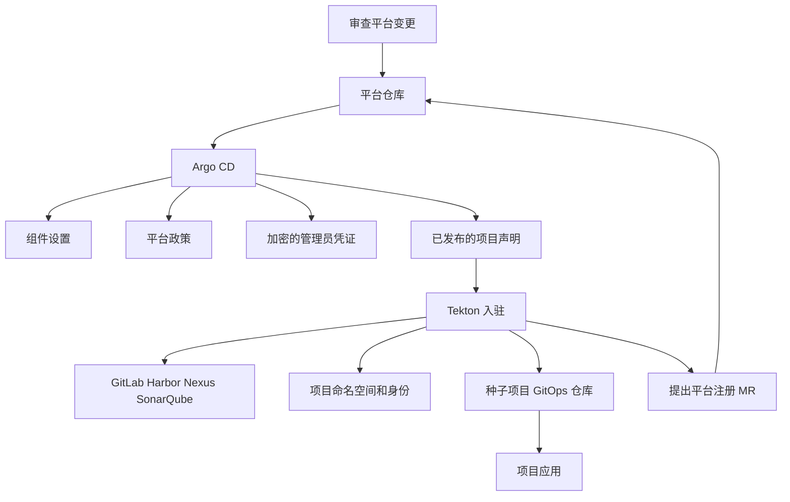

---
products:
  - Alauda Container Platform
  - Alauda DevOps
kind:
  - Article
ProductsVersion:
  - 4.x
id: KB261000025
sourceSHA: b2c9ad0d6d69c1a51365ba54b787769b62c7ad46619e5cb41db309d3beb2eec6
---

# 使用 Argo CD 和 Tekton 在 ACP 上管理平台配置和入驻隔离项目

使用平台 Git 仓库来审查和保留共享配置。使用入驻管道创建项目的命名空间和工具侧资源，然后通过合并请求提出其部署配置。Argo CD 会对 Git 所拥有的对象进行协调；入驻任务会协调它们在外部工具中创建的资源。

本文是 [Alauda DevOps 最佳实践](./Alauda_DevOps_Best_Practices_Overview.md) 的平台部分。它假设一个 ACP 项目和每个项目的独立工具侧租户。其配置基线为 Pipelines 4.15、Artifact Hub Shim 1.0、Connectors 1.14 和 GitOps 4.4，适用于兼容的 ACP 安装。共享一个命名空间和一个工具租户的团队需要不同的边界模型。

[伴随示例](https://github.com/AlaudaDevops/devops-best-practices-samples) 包含完整的参考文件。诸如 `shop`、`payments`、`platform-connectors` 和 `registry.example.com` 的名称是虚构的。请根据目标环境替换它们、图像占位符、组资源名称、策略身份和加密的 Secret 占位符。

## 建立所有权模型

将三种类型的仓库分开：

| 仓库                           | 内容                                                                                                                                     | 所有者         |
| ------------------------------ | ---------------------------------------------------------------------------------------------------------------------------------------- | -------------- |
| 平台仓库                       | 组件配置、准入政策、加密的管理员凭证、项目声明和平台原生应用定义                                                                        | 平台团队       |
| 模板仓库和目录                 | 版本化的共享 Pipelines 和 Tasks；初始项目 GitOps 仓库内容                                                                                | 平台团队       |
| 项目仓库                       | 应用源代码和 `.tekton/`；项目 GitOps 仓库中的环境清单和摘要引用                                                                          | 项目团队       |

运行模板是在项目命名空间中的执行设置。它们与版本化的目录 Pipeline 定义是不同的。将应用清单排除在平台仓库之外，并将平台策略所有权排除在应用仓库之外。



为每个资源或字段分配一个所有者。Argo CD 自我修复适用于其跟踪的对象；它不会协调集群中的每个对象或逆转外部工具操作。删除声明并不是自动退役程序。

## 在引导之前准备平台

根据其产品安装说明安装组件：

- [Pipelines](https://docs.alauda.io/alauda-devops-pipelines/4.15/install.html)，包括所需的 [PaC 组件](https://docs.alauda.io/alauda-devops-pipelines/4.15/pac/install/manage_pac.html) 和 [手动审批门](https://docs.alauda.io/alauda-devops-pipelines/4.15/how_to/manual_approval_gate_operator.html)。
- [Connectors](https://docs.alauda.io/alauda-devops-connectors/1.14/install/install.html)。
- [GitOps](https://docs.alauda.io/gitops/4.4/install_gitops/index.html)。
- [Kyverno](https://docs.alauda.io/container_platform/4.4/security/security_and_compliance/compliance/install.html) 和密封的秘密控制器。在同步策略和 SealedSecrets 之前，必须存在它们的 CRD。

管理员创建管理命名空间，示例中的 `platform-connectors`，并在其中安装四个 Connectors 自动创建任务。这些任务是从 Connectors 文档中安装的；它们不是从通用任务目录中获取的。在提交之前，准备好对四个工具的管理员访问权限，并加密目标密封秘密控制器的凭证。

在 Git 之外创建 Chains 签名密钥和中央注册凭证。中央注册凭证必须在同步挂载它的组件层之前存在。仅授予其访问 Chains 必须读取和签名的注册项目，并在项目入驻时更新该访问权限。

将平台仓库注册到 Argo CD，并为每个项目 GitOps 仓库提供读取访问权限。一个仓库凭证模板可以覆盖批准的 GitLab URL 前缀；必须为每个项目添加更窄的模板。对于应用和 AppProject GitLab 引用，请使用以 `.git` 结尾的仓库 URL。对于应用目标和 AppProject 目标约束，请使用由 Alauda GitOps 注册的集群名称。

通过平台创建 ACP 项目，然后再进行入驻。管道导出该项目的清单以供后续注册。将现有项目导入 Git 需要与创建项目相同的审查：项目应用可以稍后修剪该资源。

平台管理员负责平台、项目 GitOps 和应用仓库的 webhook 设置和事件交付验证。使用授权管理仓库 webhook 的令牌进行注册，支持控制器管理的 webhook 创建和删除。有关集中管理，请参见 [为 PAC 创建 Git Secret](https://docs.alauda.io/alauda-devops-pipelines/4.15/pac/how_to/create_git_secret.html)。示例中的开发人员级 GitOps 令牌无法管理 webhook；在接受入驻之前，请完成管理员 webhook 配置并测试真实事件。

保持 Harbor 项目私有。根据其任务指南中的项目隔离要求配置 Nexus 匿名访问和 SonarQube 权限。不要仅仅根据单独凭证的存在推断隔离。

对于离线环境，在运行管道之前准备本地目录内容、固定工具和基础镜像、依赖库、证书和漏洞数据库。

## 决定 18 个平台基线

下表标识平台决策及其仓库层。值和详细步骤属于链接的产品文档。这些是管理员管理的建议，成熟度和前提条件由所选版本决定。

| #  | 决策                                                                                                                                 | 共享原因                                                       | 层和指导                                                                                                                                                                                                                              |
| -- | ------------------------------------------------------------------------------------------------------------------------------------ | -------------------------------------------------------------- | ------------------------------------------------------------------------------------------------------------------------------------------------------------------------------------------------------------------------------------- |
| 1  | 将仓库访问令牌与 webhook 管理分开；使用经过审查的默认分支定义和显式的 GitLab 提供程序 URL。                                          | 凭证范围和合并前执行信任应保持一致。                           | 凭证和项目：[PaC 仓库配置](https://docs.alauda.io/alauda-devops-pipelines/4.15/pac/how_to/advanced_repository_config.html)。                                                                                                      |
| 2  | 使用 `/test <pipelinerun-name>` 标准化合并请求重试。                                                                                 | 团队使用一个支持的入口。                                       | 项目模板：[触发 PAC Pipelines](https://docs.alauda.io/alauda-devops-pipelines/4.15/pac/how_to/trigger_pipeline.html)。                                                                                                           |
| 3  | 将平台提供的仓库参数与应用输入分开。                                                                                                   | 地址和连接器名称有明确的所有者。                               | 项目：[高级仓库配置](https://docs.alauda.io/alauda-devops-pipelines/4.15/pac/how_to/advanced_repository_config.html)。                                                                                                           |
| 4  | 决定 Harbor 事件交接。                                                                                                                 | 事件端点和验证需要一致的所有权。                               | 组件：[Harbor 事件](https://docs.alauda.io/alauda-devops-pipelines/4.15/triggers/how_to/harbor_events.html)。                                                                                                                     |
| 5  | 使用失败告警调度协调和轮换。                                                                                                           | 平台拥有间隔和操作响应。                                       | 组件：[ScheduledTrigger](https://docs.alauda.io/alauda-devops-pipelines/4.15/triggers/how_to/scheduledtriggers.html)。                                                                                                           |
| 6  | 标准化 EventListener 暴露。                                                                                                           | TLS、路由和 webhook 验证属于平台。                             | 组件：[自动暴露规则](https://docs.alauda.io/alauda-devops-pipelines/4.15/triggers/how_to/trigger-wrapper-config.html)。                                                                                                           |
| 7  | 与四个产品任务协调工具侧租户创建。                                                                                                     | 管理员保留工具范围的凭证。                                     | 凭证和项目：以下工具任务指南。                                                                                                                                                                                                    |
| 8  | 为每个工具定义长期凭证轮换。                                                                                                           | 过期和续订行为因工具而异。                                     | 组件和凭证：[凭证轮换](https://docs.alauda.io/alauda-devops-connectors/1.14/how_to/automatically_create_connectors_for_a_project.html#credential-rotation)。                                                                         |
| 9  | 配置 Chains 签名密钥和镜像验证。                                                                                                       | 平台拥有签名者并分发其公钥。                                   | 组件、凭证、政策：[签名密钥](https://docs.alauda.io/alauda-devops-pipelines/4.15/chains/configure/signing_key_configuration.html)。                                                                                                   |
| 10 | 在跟踪长期凭证异常时使用连接器代理访问。                                                                                               | 访问边界和轮换需要中央所有者。                                 | 凭证：[连接器代理](https://docs.alauda.io/alauda-devops-connectors/1.14/connectors/concepts/connectors_proxy.html) 和 [CSI 驱动程序](https://docs.alauda.io/alauda-devops-connectors/1.14/connectors/concepts/connectors_csi.html)。 |
| 11 | 应用命名空间 Pod 安全性并分开构建命名空间。                                                                                           | 构建工具和工作负载有不同的特权需求。                           | 政策和项目：[受限标准](https://docs.alauda.io/alauda-devops-pipelines/4.15/pipelines/how_to/comply_with_pod_security_restricted.html)。                                                                                             |
| 12 | 安装审批并定义受保护环境组和提升规则。                                                                                                 | 审批所有权是平台控制。                                         | 组件、项目、政策：[手动审批门](https://docs.alauda.io/alauda-devops-pipelines/4.15/pipelines/how_to/manual_approval_gate.html)。                                                                                                     |
| 13 | 建立平台和项目政策层。                                                                                                                 | 项目可以添加限制而不削弱平台基线。                             | 政策：[约束管道执行](https://docs.alauda.io/alauda-devops-pipelines/4.15/pipelines/how_to/constrain_pipeline_execution_with_kyverno.html)。                                                                                          |
| 14 | 拥有共享的、本地可用的目录。                                                                                                            | 重用和离线内容需要治理。                                       | 组件：[作者目录资源](https://docs.alauda.io/alauda-devops-artifacthub-shim/1.0/catalog/how_to/author_catalog_resources.html)。                                                                                                     |
| 15 | 发布版本化的中央 Pipelines。                                                                                                            | 项目明确采用经过审查的版本。                                   | 组件：[集中式管道管理](https://docs.alauda.io/alauda-devops-pipelines/4.15/pipelines/how_to/hub_pipeline_run_template_centralized_management.html)。                                                                                     |
| 16 | 选择 Pruner 默认值和命名空间覆盖策略。                                                                                                 | 清理影响共享集群历史和容量。                                   | 组件：[Pruner 配置](https://docs.alauda.io/alauda-devops-pipelines/4.15/pruner/configure/pruner_configuration.html)。                                                                                                              |
| 17 | 定义结果存储、监视范围、身份验证和保留。                                                                                                 | 审计记录需要独立于实时对象的存储。                             | 组件：[结果保留](https://docs.alauda.io/alauda-devops-pipelines/4.15/results/configure/retention_policy_configuration.html)。                                                                                                       |
| 18 | 启用指标和操作监控。                                                                                                                   | 操作人员需要控制器和执行健康的证据。                           | 组件：[指标收集](https://docs.alauda.io/alauda-devops-pipelines/4.15/configure/metrics_collection.html)。                                                                                                                         |

### 将政策范围与定义信任分开

使用平台 ClusterPolicies 进行共享控制，使用命名空间 Policies 进行项目特定限制。通过实际提交身份限制直接创建 TaskRun 和 CustomRun；仅凭客户端提供的所有者引用并不是授权边界。列举控制器身份并审查其权限。

可选择将 PipelineRun 引用限制为批准的解析器类型。此简化政策仅说明源类型决策；为每个平台系统命名空间调整命名空间排除：

```yaml
apiVersion: kyverno.io/v1
kind: ClusterPolicy
metadata:
  name: pipelinerun-source-baseline
spec:
  background: false
  rules:
    - name: approved-resolver-only
      match:
        any:
          - resources:
              kinds: [tekton.dev/v1/PipelineRun]
              operations: [CREATE]
      exclude:
        any:
          - resources:
              namespaces: [platform-connectors]
      validate:
        failureAction: Audit
        message: "pipelineRef 必须使用批准的解析器"
        deny:
          conditions:
            all:
              - key: "{{ request.object.spec.pipelineRef.resolver || '' }}"
                operator: AnyNotIn
                value: [cluster, hub, git]
```

这并不限制解析器的 URL、目录、命名空间、版本、定义内容或运行时凭证范围。它还会拒绝强制执行的内联 `pipelineSpec`。在为项目仓库启用该限制之前，将示例的内联验证流程转换为目录 Pipeline。根据平台政策限制 PolicyException 的创建或禁用异常。

示例中的 `argocd-project-namespace-boundary` 策略通过配置的 Argo CD 身份限制 Role、RoleBinding、ResourceQuota、LimitRange 和 NetworkPolicy 的写入。它允许平台拥有的注册路径，并要求 `allowExistingViolations: false`。为目标集群调整两个 Argo CD 身份，并在依赖于边界之前验证预期的允许和拒绝情况。在每个目标集群上安装并验证该策略，以确保边界适用。

Kyverno 的可用性和恢复是平台操作的关注点。准备本地运行手册；本系列不规定在政策服务中断期间集群的写入行为。有关政策设计，请参见 [使用 Tekton 和 Kyverno 的管道政策约束](./Pipeline_Policy_Constraints_with_Tekton_and_Kyverno.md)。

## 组织和同步平台仓库

示例分为四个所有权层和入驻安装：

```text
platform-config/
├── argocd/apps/       # 根和子应用定义
├── components/        # TektonConfig 和组件选项
├── policies/          # 平台准入政策
├── credentials/       # 管理员连接器和密封占位符
├── projects/          # 声明和审核注册输出
├── templates/         # 注册渲染模板
├── onboarding/        # Pipelines、运行模板、调度和 RBAC
└── .tekton/           # 验证和变更项目调度
```

根据其 README 将 `onboarding/` 从示例复制到平台仓库根目录。将仓库以只读方式注册到 Argo CD，并为每个层使用一个子应用。根应用管理这些应用定义。

对于部分单例组件配置，使用服务器端应用，以便平台仓库仅拥有指定字段。示例还设置了 `argocd.argoproj.io/compare-options: ServerSideDiff=true`。在同步之前审查生成的差异和操作员的字段所有权。组件层使用 `prune: false`，以便删除片段不会删除单例 TektonConfig。在启用持续自我修复之前，建立组件层在目标环境中的自动同步行为。

凭证层不启用自我修复：为目标控制器密封凭证，并计划如何在轮换时更新实时 Secrets 和加密源。其他层可以根据其所有权使用修剪和自我修复。命名空间由入驻创建；不要使用 `CreateNamespace` 添加第二个命名空间创建者。

ACP 维护与 ACP 项目关联的 AppProject。注册补丁仅管理预期的仓库和目标字段。与平台管理的条目协调有效目标，并使用准入边界进行对象类型限制。不要仅依赖应用的同步状态来证明部署边界。

仔细审查删除。修剪注册的 ACP 项目可能会删除其同名命名空间及其 Secrets、Connectors 和 Repository 对象。它不会逆转工具侧创建或删除每个构建、交付或环境命名空间。退役需要单独批准的程序。

### 在合并之前验证更改

平台和项目 GitOps 模板都包含 `.tekton/validate.yaml`，该文件组合了目录 `git-clone` 和 `run-script` 任务。将其工具镜像替换为包含所需 shell 和 Kustomize 命令的本地可用镜像。在第一次合并请求运行之前建立其 webhook。通过默认分支定义来源，验证定义的更改在进入该分支后首次执行。

验证每个由应用拥有的目录，并将新目录添加到验证路径中。使用 `/test validate` 重新运行合并请求检查。YAML 解析和 Kustomize 渲染不会验证 CRD 准入行为；使用目标模式和隔离项目进行该接受步骤。

## 声明项目并运行入驻

声明是示例架构，而不是 ACP API。管道验证其支持的命名约定。完整的 `shop` 声明包括以下字段；使用示例的完整文件：

```yaml
name: shop
platformProject: shop
owners:
  - shop-platform-owners
environments: [test, prod]
tools: [gitlab, harbor, nexus, sonarqube]
approvers:
  prod: group:release-managers
imagePullFrom: []
namespaces:
  workloads: [shop, shop-test, shop-prod]
  build: shop-build
  delivery: shop-cd
gitlab:
  group: shop
  subgroups: [apps, gitops]
harbor:
  projects: [shop, shop-prod]
nexus:
  repositories:
    - name: shop-maven
      format: maven2
      type: hosted
    - name: shop-npm
      format: npm
      type: hosted
sonarqube:
  project: shop
```

`owners` 包含没有 `group:` 前缀的 ACP 组资源名称；审批条目使用 `group:<resource-name>`。控制台显示名称不是资源名称。组成员资格的更改属于组管理，而不是在每个声明中编辑个人名称。

提交声明、项目特定的入驻权限和调度通过平台合并请求。确认声明和入驻应用已同步；在使用手动同步策略时手动同步它们。然后检查调度结果和每个子入驻运行。成功的合并或调度并不单独建立完整的项目准备状态。

示例在合并后调度更改的声明。路径过滤器也可以允许没有相关声明更改的运行；调度程序负责选择实际声明。删除的声明被跳过，而不是被解释为删除项目的指令。

### 理解七个入驻阶段

| 阶段 | 工作                                                                                                                                                                                               | 所有者或机制                          |
| ---- | -------------------------------------------------------------------------------------------------------------------------------------------------------------------------------------------------- | ------------------------------------- |
| 1    | 导出现有的 ACP 项目而不带运行时元数据；创建或协调标记命名空间和交付身份。工作负载使用受限的 Pod 安全性；构建命名空间是分开的。                                                               | 示例编排和 Kubernetes API              |
| 2    | 创建 GitLab 租户组和项目访问令牌；为 GitOps 交付创建一个单独的写入连接器。                                                                                                                     | GitLab 自动创建任务                  |
| 3    | 创建私有源和生产 Harbor 项目，分发镜像拉取配置，并为发布创建单独的源读取和生产写入连接器。                                                                                                     | Harbor 自动创建任务                  |
| 4    | 创建 Nexus 仓库和范围用户，然后写入项目连接器。                                                                                                                                                 | Nexus 自动创建任务                   |
| 5    | 创建 SonarQube 用户、令牌和项目权限模板，然后写入连接器。                                                                                                                                       | SonarQube 自动创建任务               |
| 6    | 种子空项目 GitOps 仓库并创建其 PaC 仓库和访问 Secret。单独完成和验证 webhook 配置。                                                                                                            | 示例模板播种和 PaC 资源               |
| 7    | 渲染项目应用、AppProject 补丁、所有者和连接器绑定以及导出的 ACP 项目。打开平台注册合并请求。                                                                                                     | 单独的 `gitops-repo-update` PipelineRun |

注册步骤提出 Git 更改，而不是直接应用 Argo CD 资源。审查整个差异，包括 RBAC 和目标更改。为父运行和子运行保留足够的执行容量：等待的父运行仍然保留其 Pod 资源。取消和清理必须考虑独立创建的子运行。

管道在管理命名空间中运行，使用管理员连接器。在那里创建 Pods 或 PipelineRuns 的权限实际上是对这些凭证的访问，即使没有 API 权限读取 Secrets。将该命名空间和入驻身份限制为平台自动化和管理员。

### 重用产品任务

这四个任务具有不同的参数和轮换行为。阅读它们的安装、访问和前提条件说明：

- [GitLab 租户组和连接器](https://docs.alauda.io/alauda-devops-connectors/1.14/connectors-gitlab/how_to/using_gitlab_connector_automatic_creation_task.html)。
- [Harbor 资源和连接器](https://docs.alauda.io/alauda-devops-connectors/1.14/connectors-harbor/how_to/using_harbor_connector_automatic_creation_task.html)。
- [Nexus 资源和连接器](https://docs.alauda.io/alauda-devops-connectors/1.14/connectors-nexus/how_to/using_nexus_connector_automatic_creation_task.html)。
- [SonarQube 租户和连接器](https://docs.alauda.io/alauda-devops-connectors/1.14/connectors-sonarqube/how_to/using_sonarqube_connector_automatic_creation_task.html)。

将目标 `connector` 设置为 `namespace/name`。明确设置 GitLab 访问级别：项目访问令牌和 GitOps 写入者有不同的职责。在示例中，项目访问使用 `api` 和 `read_repository`；写入者还使用 `write_repository`。连接器 CSI挂载使用 `connectors` 属性，并包含命名空间。

示例仅使用显式授权的 ServiceAccount 向当前集群写入。对于跨集群应用，请遵循每个任务的 Kubernetes 连接器和 `kubeconfig` 工作区说明。不要假设管理命名空间的默认 ServiceAccount 具有所需的写入权限。

替代产品工作流从命名空间事件创建项目连接器：[为项目自动创建连接器](https://docs.alauda.io/alauda-devops-connectors/1.14/how_to/automatically_create_connectors_for_a_project.html)。如果选择该路径，请为每个租户和资源分配一个创建者和轮换所有者。避免两个独立的协调者管理相同的凭证。

## 注册仓库并验证事件

在每个 PaC 仓库上设置自我管理的提供程序 URL 和经过审查的定义源。以下片段省略凭证数据；通过批准的凭证路径创建其引用的 Secret：

```yaml
apiVersion: pipelinesascode.tekton.dev/v1alpha1
kind: Repository
metadata:
  name: shop-gitops
  namespace: shop
spec:
  url: https://git.example.com/shop/gitops/config
  git_provider:
    type: gitlab
    url: https://git.example.com
    secret:
      name: shop-gitops-auth
    webhook_secret:
      name: shop-gitops-auth
  settings:
    pipelinerun_provenance: default_branch
```

明确设置提供程序 URL，以便完成请求和仓库令牌使用预期的 GitLab 实例。PaC 仓库 URL 与 Argo CD 使用的 `.git` URL 不同。`gitops/config` 是 `gitops` 子组下的一个仓库，而不是与该子组名称冲突的仓库路径。

示例的项目 GitOps 令牌为开发人员级别，需要管理员管理的 webhook 设置。验证新事件及其结果运行。在仓库退役后保持 webhook 管理凭证可用，并检查剩余的代码平台 webhook。应用的仓库属于构建命名空间，CI 在其中执行。

## 深思熟虑地协调和轮换

使用相同支持参数的重复运行进行协调。不要将连接器 `Ready=True` 等同于未过期、可用的工具令牌；在轮换之前和之后执行授权的工具请求或工作负载操作。

| 更改                                | 所需操作                                                                                                           |
| ----------------------------------- | ----------------------------------------------------------------------------------------------------------------- |
| 支持的声明字段更改                 | 审查任务特定的重建和轮换影响，然后协调项目。                                                                     |
| 添加新环境                          | 通过项目合并请求添加其 GitOps 目录和验证路径，以及更改声明。                                                   |
| 模板更改                            | 分别提出对现有项目仓库的更新。仅将副本播种到空仓库中。                                                           |
| 凭证到期                            | 在到期减去安全边际的时间间隔内运行相关任务；在失败时发出警报并重试。                                           |
| 凭证没有到期                        | 根据政策要求的时间间隔进行轮换；明确选择任务的刷新行为。                                                       |

示例支持的 GitLab 子组为 `apps` 和 `gitops`。更改该约定需要经过审查的管道更改，而不仅仅是声明编辑。工具侧身份更改可以重新创建帐户或凭证；在更改名称或项目集之前检查产品任务的合同。

不要重叠同一租户的运行。安排轮换在活动管道窗口之外，并在当前凭证过期之前监控失败的运行。CSI 工作负载令牌的发放与轮换工具的长期凭证是分开的。请参阅任务指南以获取到期恢复；定义本地恢复程序，而不是依赖未观察到的自然到期路径。

如果启用连接器审批，请为每个受影响的工作负载准备授权，启用 `enable-connectors-approval`，立即创建所需的 AccessPolicies，然后启用 `enable-connector-proxy-permissions`。示例中的可选管理员 AccessPolicy 被排除在默认 Kustomization 之外，仅在启用该功能后应用。使用 RBAC 进行文档化的跨命名空间授权，并保持审批门控的生产连接器不直接授予代理权限。有关完整的发布边界，请参见 [交付文章](./From_Commit_to_Production_on_ACP.md#gate-the-production-connector-after-approval)。

## 接受项目边界

| 边界                      | 必须证明的内容                                                                                                                                                           |
| ------------------------- | ----------------------------------------------------------------------------------------------------------------------------------------------------------------------- |
| 命名空间和 Pod 安全性    | 工作负载命名空间具有预期的标签；构建和交付使用其单独的命名空间和身份。                                                                                                 |
| 部署范围                  | 有效的 AppProject 目标和平台准入仅允许预期的项目部署路径。使用实际的 Argo CD 身份测试禁止的 RBAC 和配额写入。                                                         |
| 工具访问                  | GitLab、Harbor、Nexus 和 SonarQube 授权与租户匹配。在进行负面跨项目测试之前，使用正面控制。                                                                         |
| 凭证访问                  | 项目用户无法在管理员或签名命名空间中创建 Pods 或运行。在单独的清单中盘点镜像拉取 Secrets、PaC 克隆凭证和中央 Chains 凭证。                                             |
| 事件路由                  | 新的仓库事件或合并请求重试会在预期的命名空间中产生预期的运行。                                                                                                        |
| 轮换                      | 成功的非重叠运行更新预期的凭证，并且授权操作在之后正常工作。                                                                                                         |

在隔离的验收项目中运行示例中的 `acceptance/02-platform-and-onboarding.sh`。其伴随交付脚本在第一次应用构建后验证镜像路径。检查每个子入驻运行、四个连接器、播种的仓库、注册合并请求和应用。初始占位符摘要不可部署；工作负载健康状况在第一次真实部署后跟随。

对于跨项目镜像拒绝，首先验证确切的镜像存在并可以在其自己的项目中拉取。然后测试未授权项目，区分 `unauthorized` 与 `not found` 和 Pod 安全性拒绝，并在使用存在于该项目中的镜像的相反方向重复。检查后删除临时探测资源。

仅在可接受项目中的一次性资源上测试自我修复。记录其 UID 和恢复清单，执行批准的更改，并确认使用不同的 UID 重新创建。如果检查失败，则恢复。这与证明操作员管理的组件层的持续自动协调是分开的。

## 保留审计记录并计划恢复

选择一种清理机制并在启用之前审查其范围。根据全局和命名空间配置指南使用基于事件的 Pruner；在迁移时禁用较旧的定期机制。在目标环境中验证每种选择的保留模式，以确保其可以删除共享运行历史。

使用外部 PostgreSQL 和文档化的日志存储来保存结果。定义监视范围、身份验证和一个保留策略作为参考配置。通过结果 API 验证读取授权，而不是从 Kubernetes 资源可见性推断。清理之前单独保留审批响应，以免清理删除 ApprovalTask 对象。

在启用结果观察者之前确定其范围：默认观察可能会影响跨命名空间的已完成运行，并添加 `results.tekton.dev/*` 最终处理程序。禁用归档不会删除已经存在的最终处理程序。在删除之前遵循产品恢复程序，并在集群对象被修剪后将外部结果存储视为审计源。有关 S3 存储和结果保留的更多信息，请参见 [S3 存储](https://docs.alauda.io/alauda-devops-pipelines/4.15/results/configure/s3_storage_configuration.html) 和 [结果保留](https://docs.alauda.io/alauda-devops-pipelines/4.15/results/configure/retention_policy_configuration.html)。

Git 并不能替代凭证和外部数据的备份。在平台重建之前，平台团队必须准备并演练这些依赖项的恢复：

1. 兼容的平台组件、Kyverno 和密封秘密 CRD 和控制器。
2. 密封秘密解密密钥，或新控制器的重新密封凭证。
3. Chains 签名密钥和中央注册凭证；在镜像准入时协调任何验证密钥更改。
4. 管理命名空间和安装的自动创建任务。
5. Argo CD 仓库访问和项目仓库凭证模板，以及 PaC 访问和 webhook 配置。

在准备好这些依赖项后，同步平台层，运行入驻声明的项目，审查注册更改，并完成验收检查。这是一个依赖项大纲；完整的空集群或第二集群恢复运行手册必须在目标环境中进行演练。

在生产之前，完成示例的加固工作：将合并前验证与管理员凭证隔离，缩小用于项目注册的 AppProject，保护 GitOps 写入者的命名空间，安装提升核心规则，并限制生产镜像源。在 Git 审查的同时限制直接集群写入。模板升级、退役、容量规划、离线包分发和客户变更管理集成需要单独的操作程序。

继续阅读 [从提交到生产](./From_Commit_to_Production_on_ACP.md)，以使用入驻项目的构建、测试、提升和生产 GitOps 路径。
